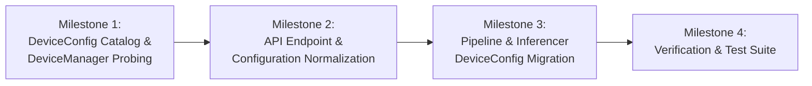

# DeviceConfig & Catalog Index Architecture

> **Implementation Status Notice**:
> The `DeviceConfig` catalog, `gpu_device_id_int` sequential index (`0..N`), and provider-based initialization are implemented across `vcclient.device`, API contracts, configuration managers, and inference pipelines (`RVCPipeline`, `ContentVec`, `FCPE`, `RMVPE`, `RVC`). Section 6 (separate `analysis_device_id` / `synthesis_device_id` fields and automated dispatch heuristics) remains a planned design for Roadmap Item 9.

> **Summary**: Legacy VCClient used overloaded integers for physical device IDs and execution-provider selection. For example, `1000` denoted an OpenVINO GPU, while `-1` represented no selected or available device and generally fell back to CPU. The **Catalog Index Architecture** replaces these conventions: `DeviceManager` discovers available (physical adapter $\times$ Execution Provider) pairings at startup and assigns sequential, zero-based catalog indices. Index `0` is always CPUExecutionProvider, so invalid indices can safely fall back to CPU. Device resolution is an $O(1)$ array lookup. The `gpu_device_id_int` API field remains, but its values now represent catalog indices rather than legacy device IDs.

---

## 1. Context & Structural Problems with Integer Sentinels

### 1.1 Overloaded Integer Semantics

Before the catalog migration, integer fields such as `device_id`, `device_id_int`, `gpu_device_id_int`, and `gpu_device_index` served multiple conflicting purposes:

| Legacy `device_id` | Intended Target            | Meaning & Role                                       | Architectural Limitation                                                              |
| :----------------- | :------------------------- | :--------------------------------------------------- | :------------------------------------------------------------------------------------ |
| `-1`               | Host CPU SIMD              | Sentinel flag ("No GPU")                             | Negative number requires special-cased branches                                       |
| `0, 1, 2, ...`     | Physical NVIDIA GPU        | Hardware adapter index                               | Collides with DirectML and CoreML index spaces                                        |
| `0, 1, 2, ...`     | Physical DXGI GPU          | Direct3D adapter index                               | Collides with CUDA index space                                                        |
| `1000`             | OpenVINO Intel GPU         | Fixed magic constant                                 | Single constant (`OPENVINO_GPU_DEVICE_ID`) cannot address multiple Intel GPUs or NPUs |
| `0, 2, 4, ...`     | CoreML Apple Neural Engine | Encoded execution mode (`MLComputeUnits: ALL`)       | Overloads integer parity with execution policy                                        |
| `1, 3, 5, ...`     | CoreML Apple GPU           | Encoded execution mode (`MLComputeUnits: CPUAndGPU`) | Overloads integer parity with execution policy                                        |

Because the legacy integer alone did not identify the provider, `_resolve_onnx_execution_provider` inspected available runtime libraries and the host platform via a waterfall heuristic.

### 1.2 Concrete Failure Modes

1. **Provider Omission and Index Collision Across Coexisting Backends**:
   In the legacy implementation, `RestAPIGPUDeviceManager.get_devices` returned `get_cuda_info()` when CUDA was available, omitting OpenVINO devices. Conversely, when multiple providers were exposed together, raw adapter index `0` could not distinguish between providers. The current endpoint returns the device catalog instead.

2. **NPU and Multi-Device Scaling Barrier**:
   Adding client NPUs (such as Intel AI Boost via OpenVINO) or addressing systems with both an Intel integrated GPU (`GPU.0`) and an Intel Arc discrete GPU (`GPU.1`) would require inventing additional sentinel constants (e.g., `1001`, `2000`) and maintaining brittle range checks across provider modules.

3. **Ambiguity in Heterogeneous Hybrid Pipelining**:
   When configuring a two-stage hybrid pipeline—such as running the acoustic front-end on an Intel NPU/iGPU via OpenVINO and the vocoder back-end on an NVIDIA dGPU via CUDA (in the `cuda` edition) or an AMD/Intel GPU via DirectML (in the `standard` edition)—a raw adapter integer cannot disambiguate which execution provider owns device `0`.

---

## 2. The Solution: Sequential Catalog Index Architecture

Instead of overloading physical hardware numbers with provider sentinels, `DeviceManager` acts as a **Hardware Catalog Registrar**. At application startup (or upon hardware reload), `DeviceManager` probes active platform providers and builds a deterministic array of available execution targets.

Each target is assigned a **sequential, zero-based Catalog Index (`id: int = 0, 1, 2, ...`)**:

```python
# Conceptual hardware catalog constructed by DeviceManager (Windows Standard Edition example)
_device_catalog: list[DeviceConfig] = [
    # Index 0 is strictly CPU
    DeviceConfig(id=0, canonical_id="cpu", provider="cpu", name="CPU", device_type="CPU"),

    # DirectML physical adapters (Windows Standard edition)
    DeviceConfig(
        id=1,
        canonical_id="dml:0",
        provider="directml",
        device_index=0,
        device_type="GPU",
        name="[DirectML] Intel(R) Arc(TM) 140V GPU (16GB)",
    ),

    # OpenVINO accelerators (Level Zero / oneDNN plugin, bundled in both Standard and CUDA editions)
    DeviceConfig(
        id=2,
        canonical_id="openvino:gpu:0",
        provider="openvino",
        device_index=0,
        device_type="GPU",
        name="[OpenVINO] Intel(R) Arc(TM) 140V GPU (16GB)",
        metadata={"ov_device": "GPU.0"},
    ),
    DeviceConfig(
        id=3,
        canonical_id="openvino:npu:0",
        provider="openvino",
        device_index=0,
        device_type="NPU",
        name="[OpenVINO] Intel(R) AI Boost",
        metadata={"ov_device": "NPU"},
    ),
]
```

_(Note: As documented in [Modern Client Hardware Acceleration](./npu-cpu-hardware-acceleration-and-universal-distribution.md#52-the-determinant-constraint-python-wheel-namespace-and-plugin-coexistence), `onnxruntime-directml` and `onnxruntime-gpu` are mutually exclusive in a single Python environment, whereas `onnxruntime-ep-openvino` is a composable plugin. Thus, a Windows `standard` catalog enumerates CPU + DirectML + OpenVINO targets, while a Windows `cuda` catalog enumerates CPU + CUDA + OpenVINO targets.)_

### 2.1 Why Index `0` is Assigned to CPU

In legacy implementations, `0` was ambiguous (representing the first GPU in CUDA/DirectML or CoreML ANE mode, while `-1` represented CPU). By assigning **Index `0` to `CPUExecutionProvider`**:

1. Index `0` is present on all target platforms.
2. Any uninitialized configuration, out-of-bounds index, or legacy `-1` sentinel deterministically falls back to host CPU execution (`_device_catalog[0]`).
3. Positive indices `1, 2, ...` represent hardware-accelerated execution targets.

---

## 3. Domain Model: `DeviceConfig` Specification

Under `vcclient.device.data_types`, `DeviceConfig` defines the typed descriptor for a catalog entry while preserving the serialized fields expected by `GPUInfo` consumers:

```python
from __future__ import annotations

from typing import Any, Literal
from pydantic import BaseModel, Field, computed_field

ExecutionProviderType = Literal[
    "cpu",
    "cuda",
    "directml",
    "openvino",
    "coreml",
]

DeviceType = Literal["CPU", "GPU", "NPU"]


class DeviceConfig(BaseModel):
    """Unified, provider-agnostic compute device descriptor."""

    id: int = Field(
        ...,
        description="Sequential zero-based catalog index (0 for CPU, 1..N for accelerators).",
    )
    canonical_id: str = Field(
        ...,
        description="Deterministic string identifier (e.g. 'cpu', 'cuda:0', 'dml:0', 'openvino:gpu:0', 'openvino:npu:0').",
    )
    provider: ExecutionProviderType = Field(
        ...,
        description="Target execution provider backend.",
    )
    device_index: int = Field(
        default=0,
        description="Physical hardware/adapter index within the provider space.",
    )
    device_type: DeviceType = Field(
        default="GPU",
        description="Hardware execution classification (CPU, GPU, or NPU).",
    )
    name: str = Field(
        default="",
        description="Human-readable display name with provider prefix (e.g. '[DirectML] Intel(R) Arc(TM) Graphics').",
    )
    adapter_ram: int = Field(
        default=0,
        description="Dedicated video/adapter memory in bytes (0 for host-shared/unified memory).",
    )
    metadata: dict[str, Any] = Field(
        default_factory=dict,
        description="Provider-specific metadata (DXGI LUID, OpenVINO 'ov_device', CoreML 'compute_units', etc.).",
    )

    @computed_field
    @property
    def device_id_int(self) -> int:
        """Exposes catalog index as device_id_int in JSON responses for legacy web_front contracts."""
        return self.id

    @computed_field
    @property
    def device_id(self) -> str:
        """Exposes canonical_id as device_id in JSON responses for legacy GPUInfo compatibility."""
        return self.canonical_id

    def is_cpu(self) -> bool:
        return self.id == 0 or self.provider == "cpu" or self.device_type == "CPU"
```

Using Pydantic v2's `@computed_field` ensures that both `device_id_int` and `device_id` are included when FastAPI serializes `list[DeviceConfig]` to JSON.

---

## 4. UI & API Integration: REST Contract & Frontend Compatibility

The Catalog Index design originally maintained drop-in compatibility with the bundled legacy frontends (`web_front/`) without frontend bundle edits and continues to serve the Svelte 5 UI (`frontend/`) and REST API clients through the same `gpu_device_id_int` contract:

```mermaid
sequenceDiagram
    autonumber
    participant UI as Frontend UI / API Client
    participant API as FastAPI Layer
    participant CM as ConfigurationManager
    participant DM as DeviceManager Catalog
    participant VC as VoiceChanger / Pipeline

    Note over UI,DM: 1. Device Discovery & Dropdown Population
    UI->>API: GET /api/gpu-device-manager/devices
    API->>DM: get_device_catalog()
    DM-->>API: list[DeviceConfig]
    API-->>UI: 200 OK (JSON with name and device_id_int = 0, 1, 2, ...)
    Note over UI: Populates <select> options with device_id_int values

    Note over UI,VC: 2. Device Selection & Model Reload
    UI->>API: PUT /api/configuration-manager/configuration (gpu_device_id_int = 2)
    API->>CM: set_voice_changer_configuration(conf)
    CM->>DM: get_device(2)
    Note over CM,DM: Normalizes gpu_device_id_int to valid catalog id
    API->>VC: check_and_update_pipeline()
    VC->>DM: get_device(conf.gpu_device_id_int)
    DM-->>VC: DeviceConfig (catalog[2])
    Note over VC: Pipeline initializes sessions using typed DeviceConfig
```



### 4.1 Serialization for `GET /api/gpu-device-manager/devices`

When the UI queries `/api/gpu-device-manager/devices`, `RestAPIGPUDeviceManager.get_devices` returns the full catalog (`get_device_catalog()`) regardless of whether CUDA is active, so that OpenVINO and CUDA devices are both visible in the `cuda` edition:

```json
[
  {
    "id": 0,
    "canonical_id": "cpu",
    "provider": "cpu",
    "device_index": 0,
    "device_type": "CPU",
    "name": "CPU",
    "adapter_ram": 0,
    "metadata": {},
    "device_id_int": 0,
    "device_id": "cpu"
  },
  {
    "id": 1,
    "canonical_id": "dml:0",
    "provider": "directml",
    "device_index": 0,
    "device_type": "GPU",
    "name": "[DirectML] Intel(R) Arc(TM) 140V GPU (16GB)",
    "adapter_ram": 17179869184,
    "metadata": {},
    "device_id_int": 1,
    "device_id": "dml:0"
  },
  {
    "id": 2,
    "canonical_id": "openvino:gpu:0",
    "provider": "openvino",
    "device_index": 0,
    "device_type": "GPU",
    "name": "[OpenVINO] Intel(R) Arc(TM) 140V GPU (16GB)",
    "adapter_ram": 0,
    "metadata": { "ov_device": "GPU.0" },
    "device_id_int": 2,
    "device_id": "openvino:gpu:0"
  }
]
```

The UI binds each `<option>` label to `item.name` and its value to `item.device_id_int`.

### 4.2 Constant-Time $O(1)$ Resolution and Configuration Normalization

When the user selects a device in the UI, the client transmits `{ "gpu_device_id_int": <id> }`. Resolving the selected hardware is a bounds-checked array lookup:

```python
# backend/vcclient/device/device_manager.py

def get_device(device_id: int) -> DeviceConfig:
    """Retrieve DeviceConfig by catalog index in O(1) time."""
    catalog = get_device_catalog()
    if 0 <= device_id < len(catalog):
        return catalog[device_id]
    # Negative values (e.g. legacy default -1) or out-of-bounds indices (e.g. legacy 1000) fall back to CPU (Index 0)
    return catalog[0]
```

To ensure UI device selectors match an existing option in `GET /api/gpu-device-manager/devices`:

- `VoiceChangerConfiguration.gpu_device_id_int` defaults to `0` (instead of legacy `-1`).
- When loading `settings/vc_conf.json` or applying configuration updates, `get_device()` normalizes out-of-range indices, including legacy `-1` and ordinarily `1000`, to CPU at index `0`. It does not automatically preserve a legacy `1000` OpenVINO selection.
- A separate `resolve_legacy_device_id()` helper maps legacy `1000` to the first OpenVINO catalog entry when present, but the configuration loading and update paths do not call it.

On the first backend startup without `settings/vc_conf.json`, Forge tries the initial model on detected devices in this order: CUDA GPUs, CoreML `ALL`, OpenVINO GPUs, DirectML GPUs, then CPU. Within each GPU provider, larger device numbers are tried first (for OpenVINO, `GPU.n` is used when available, otherwise the discovery index). The initializer constructs each candidate pipeline, checks its ONNX session providers and calls its public `warmup()` method; ONNX Runtime's runtime provider retry is disabled for this test. Provider presence alone does not prove that every operation ran on the accelerator. A successful catalog index is saved; if every candidate fails, startup reports an error without saving a default configuration. If the initial model is unavailable, selection is deferred. On subsequent starts the saved index is used, with out-of-range indices normalized and saved as CPU. Because only the catalog index is stored, a changed catalog can assign the same index to a different device.

---

## 5. Pipeline & Inference Layer Execution

Inside the inference engine, model components and session factories accept `DeviceConfig` (or resolve an integer catalog ID via `get_device()`):

### 5.1 Object-Oriented Session Creation via `DeviceConfig.create_session()`

Hardware execution is natively encapsulated in `DeviceConfig`. Rather than routing through procedural waterfall functions, components directly invoke `self.device.create_session(model_file, patch_type=...)`, while provider resolution (`_resolve_provider`) and session options configuration (`_configure_session_options`) are kept as private internal helpers:

```python
class DeviceConfig(BaseModel):
    ...
    def _resolve_provider(self) -> tuple[list[str], list[dict[str, Any]]]:
        """Resolve ONNX Runtime execution provider and options for this device descriptor."""
        ...

    def _configure_session_options(
        self,
        so: onnxruntime.SessionOptions | None = None,
    ) -> onnxruntime.SessionOptions:
        """Configure SessionOptions with hardware/EP-specific performance and stability flags."""
        ...

    def create_session(
        self,
        model_payload: str | bytes | Path,
        patch_type: str | None = None,
        so: onnxruntime.SessionOptions | None = None,
    ) -> tuple[onnxruntime.InferenceSession, list[str], list[dict[str, Any]]]:
        """Create an ONNX InferenceSession optimized for this compute device descriptor."""
        ...
```

### 5.2 Provider Dispatch Isolation & Delegation

Each provider module configures session options, resolves execution provider descriptors, and applies hardware-specific graph patches via delegation hooks without polluting `DeviceConfig`:

- `cuda.py`: Exports `resolve_cuda_device_provider(device)` reading `device.device_index` for `{"device_id": device.device_index}`.
- `directml.py`: Exports `resolve_dml_device_provider(device)` assigning `device.device_index` to DXGI adapter routing `{"device_id": device.device_index}`.
- `openvino.py`: Exports `prepare_openvino_model(device, payload, patch_type)` to handle NPU-to-CPU vocoder safety fallbacks and OpenVINO 4D SineGen / RMVPE graph patches, alongside `configure_openvino_session_options(so, device)`.
- `coreml.py`: Exports `prepare_coreml_model(device, payload, patch_type, ...)` to evaluate two-tier static shape limits (`COREML_CONV_MEMORY_LIMIT`) and `resolve_coreml_device_provider(device, ...)`.
- `cpu.py`: Invoked when `device.is_cpu()` is `True`.

In `RVCPipeline` (`rvc_pipeline.py`), `make_onnx_upscaler` and the component managers (`EmbedderManager`, `PitchEstimatorManager`, `InferencerManager`) also resolve providers through `DeviceConfig`, while `EmbedderInfo`, `PitchEstimatorInfo`, and `RVCInferencerInfo` record `device.id` in their `device_id: int` telemetry fields.

---

## 6. Bridge to Two-Stage Concurrent Hybrid Pipelining (Planned Design — Roadmap Item 9)

> **Design Status**: Not yet implemented. Currently, `VoiceChangerConfiguration` defines only `gpu_device_id_int: int = 0`, and `DeviceManager` does not yet implement `get_optimal_synthesis_device()` or `get_optimal_analysis_device()`.

Because execution targets are represented by catalog indices (`0..N`), two-stage hybrid pipelining (Roadmap Item 9) can assign separate catalog indices to the analysis front-end and synthesis back-end while remaining backward-compatible with `gpu_device_id_int`:

```python
# Planned extension for Roadmap Item 9 (not yet implemented in VoiceChangerConfiguration)
class VoiceChangerConfiguration(BaseModel):
    # Front-end: Acoustic Analysis (ContentVec + RMVPE / FCPE + FAISS)
    analysis_device_id: int = 0  # Defaults to Index 0 (CPU) or NPU

    # Back-end: Vocoder Synthesis (RVC HiFi-GAN)
    synthesis_device_id: int = 0  # Defaults to Index 0 (CPU) or primary GPU

    # Compatibility field synchronized with synthesis_device_id for GET/PUT and vc_conf.json
    gpu_device_id_int: int = 0
```

When `PUT /api/configuration-manager/configuration` is called with `gpu_device_id_int`, a planned model validator can synchronize `synthesis_device_id` and `gpu_device_id_int` and normalize both through `get_device().id`.

### Planned Automated Dispatch Heuristic (Roadmap Item 9)

- **Back-end (Synthesis)**: Planned `DeviceManager.get_optimal_synthesis_device()` selects the highest-throughput GPU target, prioritizing `cuda` > `openvino:gpu` > `directml` > `cpu`. On Intel Arc 140V hardware, OpenVINO GPU with the 4D SineGen patch executes RVC synthesis in **36.45 ms** vs **47.77 ms** on DirectML (see [Benchmark Telemetry](./npu-cpu-hardware-acceleration-and-universal-distribution.md#231-benchmark-telemetry-across-execution-providers)).
- **Front-end (Analysis)**: Planned `DeviceManager.get_optimal_analysis_device()` selects a low-latency accelerator for pitch and feature extraction (`openvino:npu` / `openvino:gpu` > `cpu`). On Intel Lunar Lake, OpenVINO avoids DirectML's DirectX 12 command list recording and `WaitForSingleObject` fence stalls on RMVPE (`3.89 ms` on OpenVINO GPU and `5.09 ms` on OpenVINO NPU vs `42.84 ms` on DirectML).

---

## 7. Implementation Roadmap & Acceptance Criteria



1. **Milestone 1: Domain Model & Catalog Construction** `[Completed]`
   - Create `backend/vcclient/device/data_types.py` defining `DeviceConfig` with `@computed_field` properties (`device_id_int` and `device_id`).
   - Implement `reload_device_catalog() -> list[DeviceConfig]` in `device_manager.py` with Index `0` assigned to CPU and all active providers enumerated sequentially.
   - Implement `get_device(id: int) -> DeviceConfig` with $O(1)$ array access and CPU fallback (`_device_catalog[0]`).

2. **Milestone 2: API & Configuration Layer Integration** `[Completed]`
   - Update `RestAPIGPUDeviceManager.get_devices` to return `get_device_catalog()` across both Standard and CUDA editions.
   - Update `VoiceChangerConfiguration.gpu_device_id_int` default to `0` and normalize out-of-bounds or negative IDs (such as legacy `-1` or `1000`) via `get_device().id` in `ConfigurationManager`.
   - Verify that `web_front` (`2.0.78` and `2.1.4`) displays, selects, and switches devices without unmatched dropdown states.

3. **Milestone 3: Pipeline & Inference Layer Migration** `[Completed]`
   - Encapsulate execution session creation into `DeviceConfig.create_session()` with private internal helpers `_resolve_provider()`, `_configure_session_options()`, and `_fallback_to_cpu()`.
   - Refactor `RVCPipeline` (including `make_onnx_upscaler`), `RVCInferencerOnnxF0`, `RVCInferencerOnnxNoF0`, `ContentvecOnnx`, `FCPEOnnxPitchEstimator`, and `RMVPEOnnxPitchEstimator` to directly create sessions via `self.device.create_session()`.
   - Retire procedural session factory functions (`create_pipeline_session`, `create_inference_session`, `configure_session_options`, `get_onnx_execution_provider`, `resolve_provider_for_device`).

4. **Milestone 4: Verification & Test Suite** `[Completed]`
   - Added unit tests in `backend/tests/test_device_catalog.py` verifying catalog enumeration, $O(1)$ index resolution, legacy sentinel normalization (`-1` -> `0`, `1000` -> `0`), and per-provider session configuration.
   - Verified that full backend pytest suite (141 tests) and desktop test suite passed cleanly.
