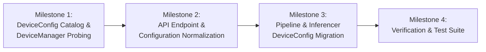

# DeviceConfig & Catalog Index Architecture

> **Implementation Status Notice**:
> This architecture has been fully implemented across `vcclient.device`, API contracts, configuration managers, and inference pipelines (`RVCPipeline`, `ContentVec`, `FCPE`, `RMVPE`, `RVC`).

> **Summary**: In legacy VCClient and v2.0.78-beta, hardware selection relied on an overloaded integer (`device_id_int: int`) mixing physical hardware indices with execution provider flags (`-1` for CPU, `1000` for OpenVINO, even/odd parity for CoreML). This document specifies the **Catalog Index Architecture**: `DeviceManager` discovers valid (physical adapter $\times$ Execution Provider) pairings at startup, constructing a deterministic catalog (`list[DeviceConfig]`) with sequential, zero-based integer identifiers (`0, 1, 2, ...`). The host CPU is assigned to index `0`, and available accelerators follow sequentially. This turns device resolution into an $O(1)$ array lookup, removes magic constants, supports client NPUs and multi-GPU topologies, and preserves compatibility with the bundled legacy frontend (`web_front/`) without frontend code changes.

---

## 1. Context & Structural Problems with Integer Sentinels

### 1.1 Overloaded Integer Semantics

In the existing codebase (`device_manager.py`, `rvc_pipeline.py`, `data_types.py`, `voice_changer_data_types.py`, and `voice_changer.py`), integer fields (`device_id`, `device_id_int`, `gpu_device_id_int`, `gpu_device_index`) serve multiple conflicting purposes:

| Legacy `device_id` | Intended Target            | Meaning & Role                                       | Architectural Limitation                                                              |
| :----------------- | :------------------------- | :--------------------------------------------------- | :------------------------------------------------------------------------------------ |
| `-1`               | Host CPU SIMD              | Sentinel flag ("No GPU")                             | Negative number requires special-cased branches                                       |
| `0, 1, 2, ...`     | Physical NVIDIA GPU        | Hardware adapter index                               | Collides with DirectML and CoreML index spaces                                        |
| `0, 1, 2, ...`     | Physical DXGI GPU          | Direct3D adapter index                               | Collides with CUDA index space                                                        |
| `1000`             | OpenVINO Intel GPU         | Fixed magic constant                                 | Single constant (`OPENVINO_GPU_DEVICE_ID`) cannot address multiple Intel GPUs or NPUs |
| `0, 2, 4, ...`     | CoreML Apple Neural Engine | Encoded execution mode (`MLComputeUnits: ALL`)       | Overloads integer parity with execution policy                                        |
| `1, 3, 5, ...`     | CoreML Apple GPU           | Encoded execution mode (`MLComputeUnits: CPUAndGPU`) | Overloads integer parity with execution policy                                        |

Because the integer alone does not identify the provider, `_resolve_onnx_execution_provider` inspects available runtime libraries and platform operating systems via a waterfall heuristic.

### 1.2 Concrete Failure Modes

1. **Provider Omission and Index Collision Across Coexisting Backends**:
   In `RestAPIGPUDeviceManager.get_devices` (`vcserver_rest_api_gpu_device_manager.py`), when `is_cuda_available()` is `True`, the endpoint returns `get_cuda_info()`, which lists only CPU and NVIDIA GPUs and omits bundled `OpenVINOExecutionProvider` devices (such as Intel iGPU, Arc GPU, or NPU on hybrid laptops). Conversely, when multiple providers are exposed together, raw adapter index `0` cannot distinguish between providers in `_resolve_onnx_execution_provider`.

2. **NPU and Multi-Device Scaling Barrier**:
   Adding client NPUs (such as Intel AI Boost via OpenVINO) or addressing systems with both an Intel integrated GPU (`GPU.0`) and an Intel Arc discrete GPU (`GPU.1`) would require inventing additional sentinel constants (e.g., `1001`, `2000`) and maintaining brittle range checks across provider modules.

3. **Ambiguity in Heterogeneous Hybrid Pipelining**:
   When configuring a two-stage hybrid pipeline—such as running the acoustic front-end on an Intel NPU/iGPU via OpenVINO and the vocoder back-end on an NVIDIA dGPU via CUDA (in the `cuda` edition) or an AMD/Intel GPU via DirectML (in the `standard` edition)—a raw adapter integer cannot disambiguate which execution provider owns device `0`.

---

## 2. The Solution: Sequential Catalog Index Architecture

Instead of overloading physical hardware numbers with provider sentinels, `DeviceManager` acts as a **Hardware Catalog Registrar**. At application startup (or upon hardware reload), `DeviceManager` probes active platform providers and builds a deterministic array of available execution targets.

Each target is assigned a **sequential, zero-based Catalog Index (`id: int = 0, 1, 2, ...`)**:

```python
# Conceptual hardware catalog constructed by DeviceManager (Windows Standard Edition example)
_device_catalog: list[DeviceConfig] = [
    # Index 0 is strictly CPU
    DeviceConfig(id=0, canonical_id="cpu", provider="cpu", name="CPU", device_type="CPU"),

    # DirectML physical adapters (Windows Standard edition)
    DeviceConfig(
        id=1,
        canonical_id="dml:0",
        provider="directml",
        device_index=0,
        device_type="GPU",
        name="[DirectML] Intel(R) Arc(TM) 140V GPU (16GB)",
    ),

    # OpenVINO accelerators (Level Zero / oneDNN plugin, bundled in both Standard and CUDA editions)
    DeviceConfig(
        id=2,
        canonical_id="openvino:gpu:0",
        provider="openvino",
        device_index=0,
        device_type="GPU",
        name="[OpenVINO] Intel(R) Arc(TM) 140V GPU (16GB)",
        metadata={"ov_device": "GPU.0"},
    ),
    DeviceConfig(
        id=3,
        canonical_id="openvino:npu:0",
        provider="openvino",
        device_index=0,
        device_type="NPU",
        name="[OpenVINO] Intel(R) AI Boost",
        metadata={"ov_device": "NPU"},
    ),
]
```

_(Note: As documented in [Modern Client Hardware Acceleration](./npu-cpu-hardware-acceleration-and-universal-distribution.md#52-the-determinant-constraint-python-wheel-namespace-and-plugin-coexistence), `onnxruntime-directml` and `onnxruntime-gpu` are mutually exclusive in a single Python environment, whereas `onnxruntime-ep-openvino` is a composable plugin. Thus, a Windows `standard` catalog enumerates CPU + DirectML + OpenVINO targets, while a Windows `cuda` catalog enumerates CPU + CUDA + OpenVINO targets.)_

### 2.1 Why Index `0` is Assigned to CPU

In legacy implementations, `0` was ambiguous (representing the first GPU in CUDA/DirectML or CoreML ANE mode, while `-1` represented CPU). By assigning **Index `0` to `CPUExecutionProvider`**:

1. Index `0` is present on all target platforms.
2. Any uninitialized configuration, out-of-bounds index, or legacy `-1` sentinel deterministically falls back to host CPU execution (`_device_catalog[0]`).
3. Positive indices `1, 2, ...` represent hardware-accelerated execution targets.

---

## 3. Domain Model: `DeviceConfig` Specification

Under `vcclient.device.data_types`, `DeviceConfig` defines the typed descriptor for a catalog entry while preserving the serialized fields expected by `GPUInfo` consumers:

```python
from __future__ import annotations

from typing import Any, Literal
from pydantic import BaseModel, Field, computed_field

ExecutionProviderType = Literal[
    "cpu",
    "cuda",
    "directml",
    "openvino",
    "coreml",
]

DeviceType = Literal["CPU", "GPU", "NPU"]


class DeviceConfig(BaseModel):
    """Unified, provider-agnostic compute device descriptor."""

    id: int = Field(
        ...,
        description="Sequential zero-based catalog index (0 for CPU, 1..N for accelerators).",
    )
    canonical_id: str = Field(
        ...,
        description="Deterministic string identifier (e.g. 'cpu', 'cuda:0', 'dml:0', 'openvino:gpu:0', 'openvino:npu:0').",
    )
    provider: ExecutionProviderType = Field(
        ...,
        description="Target execution provider backend.",
    )
    device_index: int = Field(
        default=0,
        description="Physical hardware/adapter index within the provider space.",
    )
    device_type: DeviceType = Field(
        default="GPU",
        description="Hardware execution classification (CPU, GPU, or NPU).",
    )
    name: str = Field(
        default="",
        description="Human-readable display name with provider prefix (e.g. '[DirectML] Intel(R) Arc(TM) Graphics').",
    )
    adapter_ram: int = Field(
        default=0,
        description="Dedicated video/adapter memory in bytes (0 for host-shared/unified memory).",
    )
    metadata: dict[str, Any] = Field(
        default_factory=dict,
        description="Provider-specific metadata (DXGI LUID, OpenVINO 'ov_device', CoreML 'compute_units', etc.).",
    )

    @computed_field
    @property
    def device_id_int(self) -> int:
        """Exposes catalog index as device_id_int in JSON responses for legacy web_front contracts."""
        return self.id

    @computed_field
    @property
    def device_id(self) -> str:
        """Exposes canonical_id as device_id in JSON responses for legacy GPUInfo compatibility."""
        return self.canonical_id

    def is_cpu(self) -> bool:
        return self.id == 0 or self.provider == "cpu" or self.device_type == "CPU"
```

Using Pydantic v2's `@computed_field` ensures that both `device_id_int` and `device_id` are included when FastAPI serializes `list[DeviceConfig]` to JSON.

---

## 4. UI & API Integration: Legacy Frontend Compatibility

The Catalog Index design maintains compatibility with the bundled legacy frontends (`web_front/ui/2.0.78/index.js` and `web_front/ui/2.1.4/assets/index-D8G8J-aW.js`) without modifying frontend bundles:


### 4.1 Serialization for `GET /api/gpu-device-manager/devices`

When `web_front` queries `/api/gpu-device-manager/devices`, `RestAPIGPUDeviceManager.get_devices` returns the full catalog (`get_device_catalog()`) regardless of whether CUDA is active, so that OpenVINO and CUDA devices are both visible in the `cuda` edition:

```json
[
  {
    "id": 0,
    "canonical_id": "cpu",
    "provider": "cpu",
    "device_index": 0,
    "device_type": "CPU",
    "name": "CPU",
    "adapter_ram": 0,
    "metadata": {},
    "device_id_int": 0,
    "device_id": "cpu"
  },
  {
    "id": 1,
    "canonical_id": "dml:0",
    "provider": "directml",
    "device_index": 0,
    "device_type": "GPU",
    "name": "[DirectML] Intel(R) Arc(TM) 140V GPU (16GB)",
    "adapter_ram": 17179869184,
    "metadata": {},
    "device_id_int": 1,
    "device_id": "dml:0"
  },
  {
    "id": 2,
    "canonical_id": "openvino:gpu:0",
    "provider": "openvino",
    "device_index": 0,
    "device_type": "GPU",
    "name": "[OpenVINO] Intel(R) Arc(TM) 140V GPU (16GB)",
    "adapter_ram": 0,
    "metadata": { "ov_device": "GPU.0" },
    "device_id_int": 2,
    "device_id": "openvino:gpu:0"
  }
]
```

`web_front` binds each `<option>` label to `item.name` and its value to `item.device_id_int`.

### 4.2 Constant-Time $O(1)$ Resolution and Configuration Normalization

When the user selects a device in the UI, `web_front` transmits `{ "gpu_device_id_int": <id> }`. Resolving the selected hardware is a bounds-checked array lookup:

```python
# backend/vcclient/device/device_manager.py

def get_device(device_id: int) -> DeviceConfig:
    """Retrieve DeviceConfig by catalog index in O(1) time."""
    catalog = get_device_catalog()
    if 0 <= device_id < len(catalog):
        return catalog[device_id]
    # Negative values (e.g. legacy default -1) or out-of-bounds indices (e.g. legacy 1000) fall back to CPU (Index 0)
    return catalog[0]
```

To ensure `web_front`'s `<select value={gpu_device_id_int}>` and status chip match an existing option in `GET /api/gpu-device-manager/devices`:

- `VoiceChangerConfiguration.gpu_device_id_int` defaults to `0` (instead of legacy `-1`).
- When `ConfigurationManager.reload()` loads an existing `settings/vc_conf.json` (which may contain `-1` or `1000`) or when `set_voice_changer_configuration()` receives an update, `conf.gpu_device_id_int` is normalized to `get_device(conf.gpu_device_id_int).id`.

---

## 5. Pipeline & Inference Layer Execution

Inside the inference engine, model components and session factories accept `DeviceConfig` (or resolve an integer catalog ID via `get_device()`):

### 5.1 Refactored `create_pipeline_session` and `SessionOptions` Binding

As documented in [Dynamic Plugin Session Factory Contract](./npu-cpu-hardware-acceleration-and-universal-distribution.md#235-dynamic-plugin-session-factory-contract-create_inference_session), dynamically registered plugins such as `onnxruntime-ep-openvino` bind target hardware via `so.add_provider_for_devices([ep_device], opts)`. Therefore, `configure_session_options` must receive the target `DeviceConfig` so it binds the specific OpenVINO device (`GPU` vs `NPU`) rather than hardcoding `"GPU"`:

```python
def create_pipeline_session(
    model_payload: str | bytes | Path,
    device: DeviceConfig | int,
    patch_type: str | None = None,
    so: onnxruntime.SessionOptions | None = None,
) -> tuple[onnxruntime.InferenceSession, list[str], list[dict[str, Any]]]:
    """Create an ONNX InferenceSession for pipeline components, resolving EPs and hardware patches."""
    resolved_device = get_device(device) if isinstance(device, int) else device

    # RVC HiFi-GAN vocoder exceeds client NPU SRAM capacity; fall back to CPU if NPU is selected pipeline-wide
    if resolved_device.provider == "openvino" and resolved_device.device_type == "NPU" and patch_type == "rvc":
        logger.warning("RVC vocoder is not supported on NPU; falling back to CPU for synthesis session.")
        resolved_device = get_device(0)

    providers, provider_options = resolve_provider_for_device(resolved_device)

    if resolved_device.provider == "openvino":
        if patch_type == "rvc":
            try:
                from .openvino_patch import patch_rvc_model_for_openvino

                model_payload = patch_rvc_model_for_openvino(model_payload)
            except Exception as e:
                logger.warning("Failed to apply OpenVINO 4D SineGen patch to %s: %s", model_payload, e)
        elif patch_type == "rmvpe":
            try:
                from .openvino_patch import patch_rmvpe_model_for_openvino

                model_payload = patch_rmvpe_model_for_openvino(model_payload)
            except Exception as e:
                logger.warning("Failed to apply OpenVINO patch to RMVPE model %s: %s", model_payload, e)

    session = create_inference_session(
        model_payload,
        providers,
        provider_options,
        so=so,
        device=resolved_device,
    )
    return session, providers, provider_options
```

### 5.2 Provider Dispatch Isolation

Each provider module configures session options based on `DeviceConfig` properties without magic-number branches:

- `cuda.py`: Reads `device.device_index` directly for `{"device_id": device.device_index}`.
- `directml.py`: Assigns `device.device_index` to DXGI adapter routing `{"device_id": device.device_index}`.
- `openvino.py`: Matches `device.device_type` and `device.metadata.get("ov_device")` against `ort.get_ep_devices()` in `configure_openvino_session_options(so, device)`, without checking `1000`. When `device.device_type == "NPU"` is used for front-end models (`RMVPE`, `FCPE`, `ContentVec`), static input shape constraints (`reshape_input`) are applied as specified in [NPU Dynamic Shape Resolution](./npu-cpu-hardware-acceleration-and-universal-distribution.md#232-npu-dynamic-shape-resolution--runtime-dimension-derivation-reshape_input).
- `coreml.py`: Reads `device.metadata.get("compute_units", "ALL")` instead of encoding `ALL` vs `CPUAndGPU` in even/odd `device_id` parity.
- `cpu.py`: Invoked when `device.is_cpu()` is `True`.

In `RVCPipeline` (`rvc_pipeline.py`), `make_onnx_upscaler` and the component managers (`EmbedderManager`, `PitchEstimatorManager`, `InferencerManager`) also resolve providers through `DeviceConfig`, while `EmbedderInfo`, `PitchEstimatorInfo`, and `RVCInferencerInfo` record `device.id` in their `device_id: int` telemetry fields.

---

## 6. Bridge to Two-Stage Concurrent Hybrid Pipelining

Because execution targets are represented by catalog indices (`0..N`), two-stage hybrid pipelining (Roadmap Item 9) can assign separate catalog indices to the analysis front-end and synthesis back-end while remaining backward-compatible with `gpu_device_id_int`:

```python
class VoiceChangerConfiguration(BaseModel):
    # Front-end: Acoustic Analysis (ContentVec + RMVPE / FCPE + FAISS)
    analysis_device_id: int = 0  # Defaults to Index 0 (CPU) or NPU

    # Back-end: Vocoder Synthesis (RVC HiFi-GAN)
    synthesis_device_id: int = 0  # Defaults to Index 0 (CPU) or primary GPU

    # Legacy field synchronized with synthesis_device_id for web_front GET/PUT and vc_conf.json compatibility
    gpu_device_id_int: int = 0
```

When `PUT /api/configuration-manager/configuration` is called by `web_front` with `gpu_device_id_int`, a model validator synchronizes `synthesis_device_id` and `gpu_device_id_int` and normalizes both through `get_device().id`.

### Automated Dispatch Heuristic (Roadmap Item 9)

- **Back-end (Synthesis)**: `DeviceManager.get_optimal_synthesis_device()` selects the highest-throughput GPU target, prioritizing `cuda` > `openvino:gpu` > `directml` > `cpu`. On Intel Arc 140V hardware, OpenVINO GPU with the 4D SineGen patch executes RVC synthesis in **36.45 ms** vs **47.77 ms** on DirectML (see [Benchmark Telemetry](./npu-cpu-hardware-acceleration-and-universal-distribution.md#231-benchmark-telemetry-across-execution-providers)).
- **Front-end (Analysis)**: `DeviceManager.get_optimal_analysis_device()` selects a low-latency accelerator for pitch and feature extraction (`openvino:npu` / `openvino:gpu` > `cpu`). On Intel Lunar Lake, OpenVINO avoids DirectML's DirectX 12 command list recording and `WaitForSingleObject` fence stalls on RMVPE (`3.89 ms` on OpenVINO GPU and `5.09 ms` on OpenVINO NPU vs `42.84 ms` on DirectML).

---

## 7. Implementation Roadmap & Acceptance Criteria



1. **Milestone 1: Domain Model & Catalog Construction** `[Completed]`
   - Create `backend/vcclient/device/data_types.py` defining `DeviceConfig` with `@computed_field` properties (`device_id_int` and `device_id`).
   - Implement `reload_device_catalog() -> list[DeviceConfig]` in `device_manager.py` with Index `0` assigned to CPU and all active providers enumerated sequentially.
   - Implement `get_device(id: int) -> DeviceConfig` with $O(1)$ array access and CPU fallback (`_device_catalog[0]`).

2. **Milestone 2: API & Configuration Layer Integration** `[Completed]`
   - Update `RestAPIGPUDeviceManager.get_devices` to return `get_device_catalog()` across both Standard and CUDA editions.
   - Update `VoiceChangerConfiguration.gpu_device_id_int` default to `0` and normalize out-of-bounds or negative IDs (such as legacy `-1` or `1000`) via `get_device().id` in `ConfigurationManager`.
   - Verify that `web_front` (`2.0.78` and `2.1.4`) displays, selects, and switches devices without unmatched dropdown states.

3. **Milestone 3: Pipeline & Inference Layer Migration** `[Completed]`
   - Update `create_pipeline_session`, `create_inference_session`, and `configure_session_options` to accept `DeviceConfig` and bind the matching OpenVINO `ep_device`.
   - Refactor `RVCPipeline` (including `make_onnx_upscaler`), `RVCInferencerOnnxF0`, `RVCInferencerOnnxNoF0`, `ContentvecOnnx`, `FCPEOnnxPitchEstimator`, and `RMVPEOnnxPitchEstimator` to resolve providers via `DeviceConfig`.
   - Maintain backward compatibility for legacy keyword arguments across all inferencers and session factories.

4. **Milestone 4: Verification & Test Suite** `[Completed]`
   - Added unit tests in `backend/tests/test_device_catalog.py` verifying catalog enumeration, $O(1)$ index resolution, legacy sentinel normalization (`-1` -> `0`, `1000` -> `0`), and per-provider session configuration.
   - Verified that full backend pytest suite (141 tests) and desktop test suite passed cleanly.
