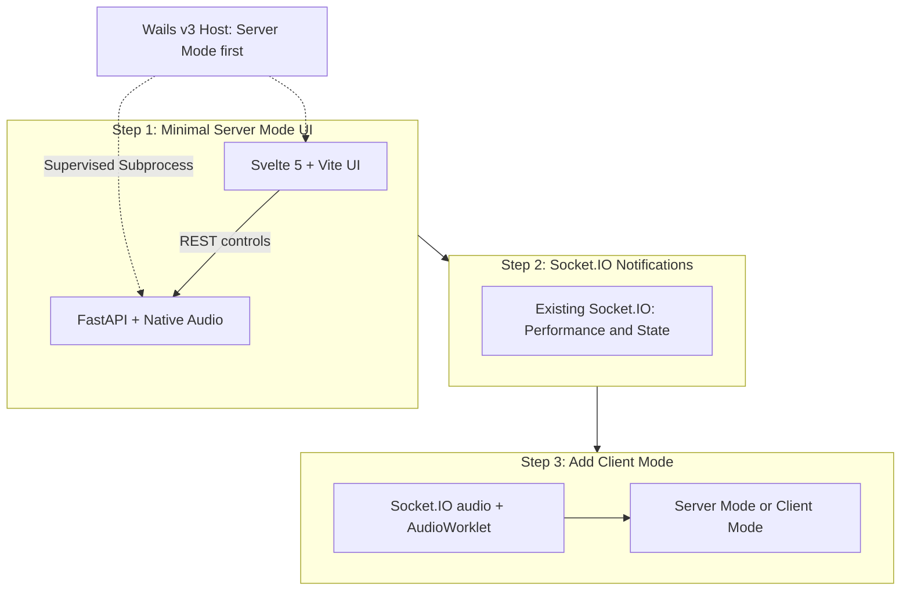

# Next-Gen Frontend Architecture: Svelte 5, Socket.IO, and Native Desktop Packaging

**Transport decision (2026-11-09):** Retain Socket.IO as the API for notifications
and browser audio; cancel the planned migration to raw WebSocket and removal of
Socket.IO. The echo measurements below show a small difference in the tested
environments, which does not justify a compatibility break. They do not establish
actual browser audio latency or inference-load behavior. Retaining the existing
API does not rule out compatible implementation improvements.

## Deployment Assumptions

### Appearance Preview Baseline (2026-11-06)

The initial `frontend/` scaffold was a standalone Svelte 5 + TypeScript + Vite appearance
preview inspired by the tracked v2.1.4 layout. Exact pixel matching is not a
goal; maintainable components take priority. Bits UI provides sliders and
accessible, nested dialogs; simple controls use standard HTML. Model/audio
controls and settings fields were disabled, while dialog navigation, collapsible
sections, language selection, and light/dark themes work locally.

The initial scaffold used immutable sample data; current settings now come from
the existing GET responses described below. Per-app Svelte
context owns language/theme state and an i18next instance; all 13 original
community dictionaries are imported from their tracked upstream location with
English fallback and Arabic RTL. Added preview messages are translated into
Japanese and English. The initial scaffold used sample model data; the read-only
model integration below replaced it. Later milestones connected Server Mode
controls and settings writes. The new UI's Socket.IO notifications and browser
microphone access remain unimplemented.

### Read-Only Model Integration (2026-11-06)

The development UI now reads `/api/slot-manager/slots` and
`/api/configuration-manager/configuration` using `frontend/src/lib/api.ts`.
The adapter validates the fields it consumes and maps them to display types in
`catalog.ts`; components do not depend on backend DTOs or fetch directly.
Per-app `catalog.svelte.ts` state owns loading/ready/error, an 8-second timeout,
cancellation on replacement/unmount, manual retry, and current-model lookup by
slot ID. Failed refreshes clear prior data; no sample-model fallback is used.

Both requests must succeed before publishing a catalog. There is no server
revision/snapshot guarantee across the two GETs; automatic polling and event
subscriptions are not yet implemented. The model cards, manager, selected-model
heading/description, and portrait consume this state. Empty slots are filtered,
pending/broken slots are labeled, missing selected IDs are not replaced by the
first model, and broken portrait URLs fall back to the upstream placeholder.
Counts represent returned occupied slots, not an assumed backend capacity.

Vite dev/preview proxies `/api` and `/model_dir` to the backend on loopback port
18888, overridable via `VCCLIENT_BACKEND_URL`. Production packaging still uses
the legacy UI. Browser tests intercept API responses and exercise sparse IDs,
selection, partial failures, retry, malformed data, timeout, and image fallback
alongside the existing appearance checks. Model selection/editing and all audio
and settings writes remain disabled.

### Read-Only Settings Display (2026-11-06)

The existing catalog/configuration GET pair also supplies the configuration
snapshot in `frontend/src/lib/settings.ts`. Input/output/monitor gains, mode,
native device/GPU IDs, device sample rates, WASAPI exclusive mode, filters,
cutoffs, noise gate, extra context, and analysis switches/intervals now populate
the controls. Selected-model pitch/index/estimator/embedder/chunk settings are
mapped from the slot response. Missing fields remain null and display `—` or an
indeterminate checkbox, rather than sample defaults. Browser-only preferences
are not fetched yet. Reload updates these values;
failed loads clear them. All setting controls remain disabled.

Native audio device names/hosts are resolved by ID from the existing
`/api/audio-device-manager/input_devices` and `output_devices` GETs. The monitor
uses the output list. Device loading/error state is independent of the catalog,
so slow or failed lists do not hide current settings. Missing IDs and failed
lists display the configured ID and status, never an arbitrary fallback device.
Mount and Reload read cached lists without requesting a PortAudio rescan.

No backend API changes or setting writes were part of the read-only milestone.
The native-controls implementation below builds on it using the existing full
configuration GET/PUT contract.

### Native Controls and Live Gain Updates (2026-11-06)

`frontend/src/lib/session.svelte.ts` now coordinates per-app drafts and confirmed
settings. Model cards and native input/output/monitor selectors are enabled while
stopped. A changed device uses Auto sample rate. Server Mode can be selected from
Audio Devices; existing native start/stop POSTs and information GET are connected.
Runtime polling runs every two seconds without Socket.IO. The returned enable
flag does not guarantee a healthy stream or audible output; live meters are still
unavailable. The current native monitor callback uses output gain, so the UI shows
that linkage rather than enabling an ineffective independent monitor slider.

Input/output gain sends the latest edit at 100 ms intervals while dragging, with
immediate flush on pointer/key release or focus loss. Requests are serialized and
coalesced; an acknowledgement cannot overwrite newer draft values. Every write
GETs fresh full configuration, merges only edits, PUTs the full DTO, and GETs the
result to detect failures including silent model rollback. Failed saves retain
drafts for explicit retry/discard. Start waits for confirmed settings; Stop queues
behind the in-flight write. Writes/operations have a 30-second timeout, and a lost
response is reported as uncertain rather than automatically retried. The existing
API cannot provide atomic conflict resolution against another controlling client.

Backend code and APIs are unchanged. Browser tests mock the API to exercise the
control sequence, preservation, coalescing, stale acknowledgements, and failures.
All 41 browser checks passed. The user confirmed native audio playback from the
new UI on 2026-11-06; perceived gain latency and longer sessions remain to be
validated. Each configuration PUT still persists the settings file; separating
live application from disk persistence remains backend roadmap work. Playback
confirmation alone does not establish all of Step 1's native-conversion exit criteria.

### Live Pitch and Index Controls (2026-11-06)

The selected RVC model's pitch and index sliders now use existing slot GET/PUT/GET
requests. Each write merges only edits into the latest complete slot DTO and
checks its ID and readback values. Per-slot drafts share the native session's
100 ms throttle, completion flush, serialized requests, and explicit retry/discard.
Configuration and model writes alternate when both are pending; acknowledgements
clear only matching draft values. Selection/reload/start wait for pending edits,
and Stop waits for the active write. Catalog updates replace only the confirmed
slot. Unsupported pitch models and models without an index file show disabled
controls with explanations. Backend code is unchanged, including its per-write
`params.json` persistence. All 49 browser checks passed using mocked APIs;
the existing slot GET and UI values were also checked against the real backend
with a simulated selection in the browser. Live slot PUT and on-device pitch/index
listening validation are still pending.

### Main Control Sections (2026-11-06)

The selected model's portrait, details, and voice controls appear inside the model list.
The remaining controls are organized as Audio Devices, Volume, Noise Suppression,
and Inference, each using native expandable details. Output/monitor volume uses one slider;
RMVPE/FCPE pitch estimator selection is available while server audio is stopped.
The Passthrough button writes the existing configuration and confirms the result;
it can be toggled during server audio. Live audio verification remains pending.
WASAPI exclusive mode can be changed while native audio is stopped; real-device
verification remains pending.
The chunk, Extra frame, and crossfade logarithmic sliders save on release while
server audio is stopped. Chunk belongs to the selected model; the others are
configuration settings. Real-device audio validation remains pending.
Server recording uses the existing configuration API and starts an output WAV
download after a successful stop. Recording can be armed before audio starts, and
stopping audio saves the take and returns to the armed state. Passthrough is blocked
while recording is armed or active. Backend
recordings use fixed paths and may overwrite earlier recordings; real audio testing
remains pending.
Client audio, sample-rate edits, and preferred-device selection remain unconnected.
Model upload uses the existing chunk uploader and slot import APIs for `.pth` and
`.onnx` files with an optional index. Native audio must be stopped; import is
serialized with UI settings and audio start. The user confirmed a real model upload;
the tested model format and index presence were not specified. ZIP selection and
drag and drop extract chosen files in the browser; the user confirmed a ZIP import
and subsequent voice conversion.
Browser-only noise preferences remain visible and disabled under Client Mode Only
within Noise Suppression.
Save errors appear in a persistent bottom-right notification with retry and discard actions;
successful saves do not show notifications. Backend APIs and supported operations
are unchanged; the legacy production frontend is still separate.

### Filter Controls (2026-11-06)

High/low-pass switches and cutoffs can be edited in Server Mode with a usable
model selected. Before using the
existing full-configuration PUT, the frontend reads current configuration and
voice-changer information, and rejects mismatched model IDs, unavailable sample rates or invalid cutoff
combinations. This avoids sending the checked invalid combinations to a backend
that persists configuration before regenerating filter coefficients. Concurrent
changes by another client are not atomic with that check. The common slider only
emits edits for user interaction, preventing out-of-range loaded values from
being silently clamped and saved. Browser tests use mocked writes; real-backend
GET values were checked in the UI. Real PUT and listening validation are pending.

### Noise-Gate Control (2026-11-06)

The Noise Suppression section exposes the noise-gate threshold in Server Mode using the
v2.1.4 range of −120 to 0 dB and 1 dB steps. The existing pipeline bypasses the
gate at −100 dB or below. Its configuration edits share the gain/model coordinator
and use the existing full-configuration GET/PUT/GET flow. Backend APIs are unchanged.
All 55 browser checks passed with mocked writes; the displayed threshold was also
checked against a real backend GET. Real-backend PUT and audible adjustment have
not yet been verified for this control.

Run `npm --prefix frontend ci` and `npm run dev:frontend` from the repository root.
`npm run build:frontend:preview` writes `frontend/preview-dist`, separate from
the legacy Python-served `frontend/dist`. `npm run build:frontend`, desktop
startup, and portable packaging still use the legacy UI. Type checks and preview
builds run in CI; browser checks are available via `npm run test:frontend` (see
`frontend/README.md` for browser installation).

The visual scaffold, read-only integration, and initial native control coordinator
are implemented, with native playback confirmed. Remaining settings and broader on-device validation precede Step 1's
native-conversion exit criteria. Copying assets to
their final home, switching the production build, and retiring the old UI remain
later migration work.

Forge is a **local, single-user application with one active audio client**, packaged primarily with Wails v3. Users are responsible for operating it on a trusted machine/network. Multi-user hosting, application-level authentication, and per-client inference-session management are not goals of this roadmap. Server Mode and Client Mode are alternative input modes.

The Wails application connects to the loopback backend using local HTTP/WebSocket; a public HTTPS deployment is not required for the desktop workflow. Configure WebView2 and OS audio permissions for this local integration. When an optional remote browser captures microphone audio for Client Mode, it requires a secure context and user permission to access the microphone. Tailscale Serve can provide HTTPS/WSS, as described in the [remote-access notes](./deprecating-and-removing-ngrok.md). A browser that only controls Server Mode does not capture audio locally, so this microphone-access requirement does not apply to that workflow.

## 1. Anatomy of the Legacy Frontend Bottlenecks

Inspection of the current `web_front/index.js` bundle confirmed the following problems in the pitch and index settings paths. These findings support redesigning settings interaction and synchronization. Slider lockups have been reported, but the lockup itself has not yet been reproduced in a browser during this investigation; the request and state-update behavior below is directly observable in the code.

1. **Per-Change Writes and Reloads (Missing Coalescing)**:
   Pitch and index slider `onChange` handlers mutate the shared slot object and call `updateServerSlotInfo()` for each change event, without debounce or coalescing. The REST client issues a `PUT /api/slot-manager/slots/{slot_index}`; after the write succeeds, the state hook starts a `GET /api/slot-manager/slots` to reload the slot list. Thus each successful edit triggers both a write and a reload, rather than one synchronization of the latest value after a burst of edits. Request rate follows input events, not literally every pixel of pointer movement.

2. **Direct Mutation without Independent Draft State**:
   The slider `value` is derived from the shared slot object, and its element tree is memoized with that object's reference as a dependency. Changing a property directly does not trigger a React state update or invalidate that memoization. The inspected components have no independent local draft state; normal UI refresh depends on the reloaded slot list propagating through React state. This couples visual feedback to server synchronization and is consistent with the reported poor responsiveness, but is not a reproduced deadlock diagnosis.

3. **Uncoordinated Asynchronous Updates**:
   The pitch/index handlers do not await `updateServerSlotInfo()`; the downstream hook and REST client await the PUT. There is no write serialization or stale-read protection in the inspected path, and the subsequent list reload is started without awaiting it. Overlapping writes/reloads can therefore complete out of order and replace newer displayed state with an older snapshot. `await` itself does not block the UI thread or serialize separate input events.

   A mock-fetch probe using the actual bundled `RestClient` confirmed that 20 calls can issue 20 PUT requests before any response arrives, with distinct edit snapshots in their bodies. This verifies the absence of serialization/coalescing at that layer, not the real-world request rate or a browser lockup.

4. **Monolithic Bundle Footprint & Direct Array Indexing**:
   Bundled via Webpack 5 into a single ~2.6MB minified `index.js`, lacking source code. The UI directly accesses slot arrays via indexing (`serverSlotInfos[i]`), forcing the backend to generate padded dummy slots and preventing clean REST/JSON API modernization.

---

## 2. Why Backend Features Need a New UI

Backend/API changes alone do not deliver usable features: users need a UI that can operate them. The minified legacy frontend (`web_front/index.js`) is coupled to existing endpoints and slot-array conventions, and the original `web_front` source for v2.0.78-beta was not released. Keeping it as the only UI would leave new backend capabilities inaccessible or require preserving its legacy contract.

The solution is a clean-slate Svelte 5 UI, starting with Server Mode over REST. The new UI does not yet implement Client Mode or Socket.IO notifications. Connect it to the existing Socket.IO API incrementally; the API and legacy UI remain compatible while the UI migration proceeds.

---

## 3. Audio Transport and Protocol Evaluation

### 3.1 Why Keep "Client Mode" Web Audio Ingestion?

While Forge prioritizes **Server Mode** (native OS audio devices) for low latency, browser-based audio streaming (Client Mode) remains an invaluable capability:

- **Cross-Platform Portability**: Web Audio capture remains available without installing Forge's native audio backend on the client device.
- **Instant Fallback**: A reliable safety net when host audio drivers (WASAPI/CoreAudio/PortAudio) fail or conflict.

Client Mode is a later feature of the new UI, not a prerequisite for replacing the old UI. A temporary development interval with only Server Mode is explicitly accepted.

### 3.2 Existing Audio Transport

The current audio transport relies on `python-socketio` and `python-engineio`. Inspection of [`vcserver_socketio.py`](../backend/vcclient/server/vcserver_socketio.py) shows the following implementation details:

- Incoming binary samples pass through `struct.unpack` into Python values and are copied into NumPy; output uses `struct.pack` with expanded sample arguments.
- Socket.IO/Engine.IO add event metadata, framing, and dependencies beyond the PCM payload. Binary payloads are already supported; the issue is not that every sample is JSON-encoded.
- Benchmark sample conversion and transport overhead separately before attributing a particular latency improvement to replacing the protocol.

### Local Binary Echo Experiment (2026-11-09)

The isolated benchmark in [`misc/benchmark_audio_echo.py`](../misc/benchmark_audio_echo.py)
compares a raw WebSocket binary echo with a Socket.IO binary-event echo. Both
use the same loopback FastAPI/uvicorn server process and Python aiohttp client
foundation; Socket.IO additionally uses python-socketio. No inference, audio
device, browser, resampling, or legacy `request_message` handler is involved.
Only one request is outstanding, every echoed payload is checked byte-for-byte,
and connection setup is excluded. Runs alternate protocol order after warmup.

On Windows 11 (build 26300), AMD Ryzen 9 7950X, Python 3.14.8, aiohttp 3.14.5,
python-socketio 5.17.0, python-engineio 4.14.0, uvicorn 0.54.0 and FastAPI
0.143.0, with 48 kHz mono float32 payloads, four rounds and 1,000 measurements
per case per round without pacing produced these pooled RTTs in milliseconds:

| Audio per message | Protocol | p50 | p95 | p99 | max |
| --- | --- | ---: | ---: | ---: | ---: |
| 50 ms | WebSocket | 0.102 | 0.153 | 0.224 | 0.326 |
| 50 ms | Socket.IO | 0.310 | 0.394 | 0.489 | 0.883 |
| 100 ms | WebSocket | 0.108 | 0.150 | 0.195 | 0.452 |
| 100 ms | Socket.IO | 0.318 | 0.397 | 0.502 | 0.737 |
| 200 ms | WebSocket | 0.118 | 0.172 | 0.232 | 0.400 |
| 200 ms | Socket.IO | 0.332 | 0.443 | 0.574 | 1.413 |

With a target interval of 100 ms, 100 ms payloads, two rounds and 50 measured
echoes per round, WebSocket p50/p95/p99/max were 0.389/0.499/0.584/0.732 ms;
Socket.IO values were 0.759/1.037/1.177/1.219 ms. This short paced run does not
characterize rare stalls. All measured replies in both runs matched the sent
bytes; the benchmark aborts on timeout or mismatch.

Reproduce from the repository root (the aiohttp overlay is temporary):

```sh
uv run --project backend --with aiohttp python misc/benchmark_audio_echo.py --count 1000 --warmup 100 --rounds 4
uv run --project backend --with aiohttp python misc/benchmark_audio_echo.py --count 50 --warmup 5 --rounds 2 --sizes 4800 --pace-ms 100
```

These results include each client library's scheduling and encoding, not just
protocol framing. They do not measure a browser/Wails client, real audio or
the current Socket.IO conversion handler, and do not establish end-to-end audio
latency or behavior under inference load. WebSocket was faster in these tests;
the project has decided to retain Socket.IO rather than introduce an API compatibility break.

### Tailscale Binary Echo Experiment (2026-11-09)

Using the same client and benchmark procedure, a user-provided benchmark server
was measured over Tailscale; `tailscale ping` reported a direct path via a LAN
address. The server's hardware, runtime versions, and load were not measured.
Four rounds of 1,000 echoes per case produced these pooled RTTs in milliseconds:

| Audio per message | Protocol | p50 | p95 | p99 | max |
| --- | --- | ---: | ---: | ---: | ---: |
| 50 ms | WebSocket | 0.968 | 1.628 | 2.059 | 20.378 |
| 50 ms | Socket.IO | 1.118 | 1.692 | 2.078 | 2.674 |
| 100 ms | WebSocket | 1.189 | 1.731 | 2.049 | 2.500 |
| 100 ms | Socket.IO | 1.273 | 1.955 | 2.275 | 3.299 |
| 200 ms | WebSocket | 1.593 | 1.971 | 2.206 | 2.834 |
| 200 ms | Socket.IO | 1.785 | 2.324 | 2.559 | 11.841 |

In a separate run using 100 ms payloads and a target interval of 100 ms,
100 echoes per protocol produced p50/p95/p99/max of 2.596/3.017/3.210/3.419 ms
for WebSocket and 2.816/3.322/3.447/3.551 ms for Socket.IO. These small samples
do not characterize rare stalls. The paced values were higher than the
continuous-run values; this measurement did not identify the reason. All echoes
in the reported runs matched their payloads; timeouts and mismatches abort a run.

The script accepts `--url http://HOST:PORT` to use an existing benchmark server
instead of starting a local one. Results include the network and both machines'
processing; they are not measurements of actual browser audio or inference.

### 3.3 Retain the Socket.IO API

The raw WebSocket replacement proposal and removal of Socket.IO are canceled.
Existing REST and Socket.IO APIs, including event names and payload contracts,
remain the integration baseline. Socket.IO may itself use WebSocket as its
underlying transport; that does not make its application protocol raw WebSocket.

The new UI can consume existing `data`, `perf`, and `command` notifications.
Client Mode remains future work for the new UI and should use the existing
Socket.IO audio API. Review callback scheduling, sample conversion, bounded
buffering, and reconnect behavior independently, without assuming a protocol
change is necessary or silently breaking existing clients.

---

## 4. Architectural Pivot: Svelte 5 + Vite

The framework decision followed the settings investigation, rather than preceding it:

1. The legacy implementation uses React, but bypasses React's state-update model by mutating shared objects and relying on server reloads for visual feedback. Keeping that interaction design would preserve the problem regardless of framework.
2. The new UI therefore needs a fresh interaction/state/synchronization design. React could implement that design correctly, but the legacy UI's use of React is not a requirement to choose React again.
3. For this local audio-control application, Forge chooses **Svelte 5 + Vite** as a lightweight fit for reactive settings, localized meter updates, and desktop packaging. The aim is a smaller, simpler frontend, not a claim that React is inherently unsuitable or that Svelte automatically fixes synchronization bugs.

This is a deliberate framework choice after deciding to redesign the UI, rather than a like-for-like React rewrite. Bundle size, CPU/memory usage, and responsiveness will still be measured in this application.

| Dimension                   | Legacy Frontend (`web_front` / `client`)   | Next-Gen Forge Frontend (`frontend/`)                                               |
| --------------------------- | ------------------------------------------ | ----------------------------------------------------------------------------------- |
| **Framework**               | React 18/19 SPA                            | **Svelte 5** (Runes: `$state`, `$derived`, `$effect`)                               |
| **Rendering Engine**        | Virtual DOM (Varying diffing overhead)     | **No Virtual DOM** (Direct DOM updates)                                             |
| **Audio Meter Performance** | Frequent updates can cause broad rerenders | Localized updates, measured at the display refresh rate                             |
| **Bundler**                 | Webpack 5 (~2.6MB bundle)                  | **Vite**, with build time and bundle size measured in this project                  |
| **State Management**        | UI values closely coupled to API responses | **SSOT Reactive Store** with optimistic updates, debounced sync, and ordered writes |

### Settings Redesign: Decouple Interaction from REST Synchronization

This is a redesign prompted by the verified legacy behavior in Section 1, not merely a recommendation to adopt a reactive store. Pitch/index change handlers mutate shared slot state and start an asynchronous update without awaiting it. The downstream code awaits a REST PUT, then starts a GET to reload the slot list; the displayed value has no independent local draft state. This creates per-change request traffic and makes normal visual updates depend on server synchronization. Failed or out-of-order synchronization is a plausible contributor to the reported unresponsive sliders, not a browser-reproduced root cause. The underlying problem is the coupling of interaction and synchronization, not the use of `await` or React itself.

**Decision: UI interaction must not depend on a REST roundtrip.** Replacing React with Svelte, or adding a store around the same request-per-change handlers, would preserve the underlying design problem. Component handlers update local draft settings synchronously; a separate settings coordinator owns communication, ordering, and recovery.

```text
[Slider / Settings Component]
    | immediate local edit; no REST await
    v
[Reactive Draft Settings] --------> [Render Slider Immediately]
    |
    | latest pending values
    v
[Settings Coordinator: Debounce + Coalesce + Serialize]
    |                             ^
    | REST settings write         | acknowledgement / error
    v                             |
[Python Backend: Confirmed Settings]-+
```

The shared frontend settings model gives components one consistent view, but distinguishes **the user's current draft** from **the backend's confirmed settings**. Server acknowledgements must not overwrite newer local edits or gate slider movement.

- **Interaction**: No REST calls or waits for server completion in slider change handlers. Local feedback remains available while a save is pending or has failed.
- **Synchronization**: Debounce intermediate edits (initial target: 100 ms), coalesce pending changes to their latest values, and serialize settings writes through one coordinator rather than queuing every input event.
- **Final Value**: Flush the latest pending value on interaction completion, including keyboard interaction. If a write is already in flight, send it next rather than starting a concurrent write.
- **Acknowledgements**: Track local edit generations; reconcile server-normalized values only when they correspond to the current edit. A stale acknowledgement cannot replace a newer draft.
- **Recovery**: Show pending/error state and support retry or explicit reload of confirmed settings. A failed save must not silently discard edits or disable the slider.
- **Application**: Keep scalar changes separate from model/profile changes. Apply changes at inference chunk boundaries and avoid recompilation for ordinary scalar updates.
- **Acceptance**: Simulate rapid dragging, slow responses, stale acknowledgements, and failed saves. Slider movement must remain immediate, writes must be bounded/coalesced, and the latest value must reach the backend after successful synchronization. Also verify keyboard completion and model changes during conversion.

---

## 5. Preserving 100% of Community i18n Translation Assets

VCClient has accumulated translations across **13 languages** (`ar`, `de`, `el`, `en`, `es`, `fr`, `it`, `ja`, `ko`, `la`, `ms`, `ru`, `zh`), created by community contributors over several years.

### Direct Translation Asset Portability

Inspection of `web_front/assets/i18n/*/translation.json` demonstrated that:

- The translation assets are **pure key-value JSON dictionaries** (e.g., `"model_slot_edit": "編集"`).
- Upstream used `react-i18next`, which is merely a thin React adapter around the framework-agnostic **`i18next`** core engine.
- **Preserve the assets and semantics**: Reuse `i18next` core through a Svelte adapter/store first, preserving existing keys and text. A different translation engine requires explicit validation or conversion of interpolation, pluralization, fallback, and namespace behavior; JSON import alone does not guarantee compatibility.
- **Move before deleting**: Copy translations and required image/license assets into the new frontend source tree before removing `web_front`. Validate key coverage, interpolation, and RTL layout for the retained languages.

---

## 6. The UI Rebirth & Migration Roadmap

Forge replaces the UI incrementally. Server Mode remains the working reference;
the new UI's Client Mode is not yet implemented, while the existing Socket.IO
API and legacy UI remain available during the transition.



### Step 1: Minimal Svelte 5 UI for Server Mode

- Scaffold `frontend/src` with Svelte 5 + Vite. Implement native input/output device selection, model selection, conversion start/stop, and core settings through REST.
- Client Mode and live Socket.IO notifications are subsequent steps. Native audio provides the working conversion path for this step.
- Use optimistic local settings with serialized/coalesced writes, generation-aware acknowledgements, and failure recovery from the start.
- Move community translations and required image/license assets into the new source tree using `i18next`; validate language coverage and RTL behavior before removing the old assets.
- Point root build scripts (`npm run build:frontend`) to `vite build` outputting to `frontend/dist`.
- **Acceptance**: The new UI controls Server Mode end to end. Performance notifications are connected in Step 2; new-UI Client Mode parity is not an acceptance requirement for this step.

### Step 2: Socket.IO Notifications

- Input/output RMS meters are connected in the Svelte preview using the existing
  `/test` Socket.IO `data` event while Server Mode audio is active and analysis
  is enabled. Disconnection and stale data clear the display; browser tests
  simulate the transport. Values and bars were also checked in the UI against
  a live backend during conversion, and the user confirmed the meters displayed.
  Callback overhead has not been measured. Input and output buffer values and
  history use the existing process and output notifications independently, with
  current backend sample rates. Both values and graph lines were also observed
  in the UI against a live backend during conversion. Other processing metrics
  remain unconnected.
- Connect the new UI's remaining performance metrics and state handling to existing Socket.IO notifications.
- Verify delivery, reconnect behavior, native conversion, settings/model/device changes, and server startup/shutdown. Review dispatch from audio callbacks separately without changing the existing API contract.
- Keep the existing Socket.IO API and legacy UI available. Any eventual UI removal is a separate migration decision after required assets and functionality are addressed.
- **Acceptance**: The new UI displays native-audio notifications correctly using Socket.IO; existing clients and API behavior remain compatible.

### Step 3: Incremental Socket.IO Client Mode

- Add Web Audio capture/playback to the new UI using the existing Socket.IO audio API and a common inference path.
- Validate sample-rate/channel handling, buffering, overload/disconnect recovery, and exclusive selection between native Server Mode and Client Mode while preserving the API contract.
- Verify Wails WebView2 audio permissions and optional browser access through Tailscale Serve. Desktop packaging is already established with Wails v3.
- **Acceptance**: The new UI supports Client Mode through Socket.IO with validated buffering and recovery; the existing API remains compatible.

### Desktop Packaging: Transitioning from Tauri v2 to Wails v3 [Completed]

**Historical Context (2026-10-19)**: The project initially prototyped a desktop baseline using Tauri v2 to avoid Electron's runtime overhead and preserve size budget under GitHub Releases' 2 GiB limit.

**Architectural Decision & Completion (2026-10-25)**: The desktop host migration from Tauri v2 (Rust) to Wails v3 (Go) with Vite, TypeScript, and xterm.js has been completed (commit `b260979`). Removing `src-tauri/` eliminated **2,846 lines of net boilerplate**, sped up daily iteration by **~5× (~3–5s vs ~15–30s)**, and eliminated the requirement for MSVC C++ build tools on Windows. See the detailed record in **[Migrating Desktop Host from Tauri to Wails v3](./migrating-desktop-host-from-tauri-to-wails.md)**.

Key rationale:
1. **The Desktop Wrapper is Functionally Thin**: Because neural inference (ONNX Runtime) and audio streaming (WASAPI) run in Python, and UI execution runs in WebView2, the host process merely supervises subprocess lifecycle and navigation. The marginal runtime memory difference between Rust and Go is negligible.
2. **Elimination of Build & Toolchain Friction**: Wails v3 compiles in seconds rather than minutes, removes Tauri's extensive permission/capability configuration overhead, and compiles cleanly on Windows without CGO or MSVC build toolchains.
3. **Declarative Hook Injection (`WebviewWindowOptions.JS`)**: Wails v3 allows injecting pre-execution scripts directly into the window context, solving external link delegation (`window.open`) and legacy Electron polyfilling (`window.electronAPI.openBrowser`) transparently in user space without low-level COM/event interception.
4. **Asset Preservation**: All unbuffered bootstrap UI assets (HTML/CSS/JS) developed for Tauri are directly embedded into the Wails binary via standard `//go:embed`.
