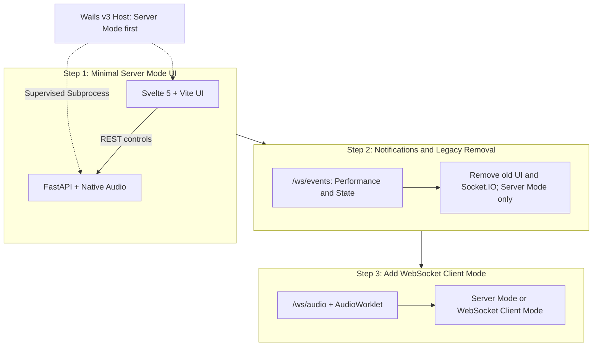

# Next-Gen Frontend Architecture: Svelte 5 Rebirth, Pure WebSocket, and Native Desktop Packaging

## Deployment Assumptions

Forge is a **local, single-user application with one active audio client**, packaged primarily with Wails v3. Users are responsible for operating it on a trusted machine/network. Multi-user hosting, application-level authentication, and per-client inference-session management are not goals of this roadmap. Server Mode and Client Mode are alternative input modes.

The Wails application connects to the loopback backend using local HTTP/WebSocket; a public HTTPS deployment is not required for the desktop workflow. Configure WebView2 and OS audio permissions for this local integration. When an optional remote browser captures microphone audio for Client Mode, it requires a secure context and user permission to access the microphone. Tailscale Serve can provide HTTPS/WSS, as described in the [remote-access notes](./deprecating-and-removing-ngrok.md). A browser that only controls Server Mode does not capture audio locally, so this microphone-access requirement does not apply to that workflow.

## 1. Anatomy of the Legacy Frontend Bottlenecks

Inspection of the current `web_front/index.js` bundle confirmed the following problems in the pitch and index settings paths. These findings support redesigning settings interaction and synchronization. Slider lockups have been reported, but the lockup itself has not yet been reproduced in a browser during this investigation; the request and state-update behavior below is directly observable in the code.

1. **Per-Change Writes and Reloads (Missing Coalescing)**:
   Pitch and index slider `onChange` handlers mutate the shared slot object and call `updateServerSlotInfo()` for each change event, without debounce or coalescing. The REST client issues a `PUT /api/slot-manager/slots/{slot_index}`; after the write succeeds, the state hook starts a `GET /api/slot-manager/slots` to reload the slot list. Thus each successful edit triggers both a write and a reload, rather than one synchronization of the latest value after a burst of edits. Request rate follows input events, not literally every pixel of pointer movement.

2. **Direct Mutation without Independent Draft State**:
   The slider `value` is derived from the shared slot object, and its element tree is memoized with that object's reference as a dependency. Changing a property directly does not trigger a React state update or invalidate that memoization. The inspected components have no independent local draft state; normal UI refresh depends on the reloaded slot list propagating through React state. This couples visual feedback to server synchronization and is consistent with the reported poor responsiveness, but is not a reproduced deadlock diagnosis.

3. **Uncoordinated Asynchronous Updates**:
   The pitch/index handlers do not await `updateServerSlotInfo()`; the downstream hook and REST client await the PUT. There is no write serialization or stale-read protection in the inspected path, and the subsequent list reload is started without awaiting it. Overlapping writes/reloads can therefore complete out of order and replace newer displayed state with an older snapshot. `await` itself does not block the UI thread or serialize separate input events.

   A mock-fetch probe using the actual bundled `RestClient` confirmed that 20 calls can issue 20 PUT requests before any response arrives, with distinct edit snapshots in their bodies. This verifies the absence of serialization/coalescing at that layer, not the real-world request rate or a browser lockup.

4. **Monolithic Bundle Footprint & Direct Array Indexing**:
   Bundled via Webpack 5 into a single ~2.6MB minified `index.js`, lacking source code. The UI directly accesses slot arrays via indexing (`serverSlotInfos[i]`), forcing the backend to generate padded dummy slots and preventing clean REST/JSON API modernization.

---

## 2. Why Backend Features Need a New UI

Backend/API changes alone do not deliver usable features: users need a UI that can operate them. The minified legacy frontend (`web_front/index.js`) is coupled to existing endpoints and slot-array conventions, and the original `web_front` source for v2.0.78-beta was not released. Keeping it as the only UI would leave new backend capabilities inaccessible or require preserving its legacy contract.

The solution is a clean-slate Svelte 5 UI, starting with Server Mode over REST. It does not implement the legacy Socket.IO Client Mode. Once native audio controls and notifications work, retire the old UI/protocol and extend the new UI incrementally. Use the previous release for rollback rather than maintaining a parallel legacy adapter in the new architecture.

---

## 3. Protocol Modernization: Ditching Socket.IO for Pure WebSocket

### 3.1 Why Keep "Client Mode" Web Audio Ingestion?

While Forge prioritizes **Server Mode** (native OS audio devices) for low latency, browser-based audio streaming (Client Mode) remains an invaluable capability:

- **Cross-Platform Portability**: Web Audio capture remains available without installing Forge's native audio backend on the client device.
- **Instant Fallback**: A reliable safety net when host audio drivers (WASAPI/CoreAudio/PortAudio) fail or conflict.

Client Mode is a later feature of the new UI, not a prerequisite for replacing the old UI. A temporary development interval with only Server Mode is explicitly accepted.

### 3.2 The Penalties of Legacy Socket.IO

Upstream's audio transport relies on `python-socketio` and `python-engineio`. Inspection of [`vcserver_socketio_namespace.py`](../backend/vcclient/server/vcserver_socketio_namespace.py) identifies avoidable conversion and protocol work:

- Incoming binary samples pass through `struct.unpack` into Python values and are copied into NumPy; output uses `struct.pack` with expanded sample arguments.
- Socket.IO/Engine.IO add event metadata, framing, and dependencies beyond the PCM payload. Binary payloads are already supported; the issue is not that every sample is JSON-encoded.
- Benchmark sample conversion and transport overhead separately before attributing a particular latency improvement to replacing the protocol.

### 3.3 The Pure WebSocket Pivot (`/ws/audio`)

Forge replaces Socket.IO with **Pure WebSocket** endpoints powered by FastAPI/Starlette and the ASGI server's WebSocket support, without adding a separate Socket.IO/Engine.IO protocol layer:

```text
[Wails / Optional Browser Web Audio]                   [FastAPI Backend]
   |                                                      |
   |---- /ws/audio: binary Float32 PCM ------------------->|--> bounded input buffer
   |<--- /ws/audio: converted Float32 PCM -----------------|<-- inference worker
   |<--- /ws/events: performance and state notifications --|
```

- **Binary PCM**: Specify little-endian Float32 PCM, channel count, and sample rates. Use binary buffers and NumPy buffer views to avoid per-sample Python unpacking; data copies may still occur across browser, ASGI, and GPU boundaries.
- **Audio Scheduling**: An async transport loop feeds a bounded buffer; a dedicated worker performs inference. WebSocket message boundaries do not define inference chunk sizes. Both native and Web Audio inputs use the [fixed-chunk pipeline](./server-first-architecture-and-static-pipeline-roadmap.md).
- **Bounded Latency**: Define frame/sample identification, send and playback buffer limits, `bufferedAmount` monitoring, and overload/disconnect recovery. Reset stream history when continuity is lost rather than playing an ever-growing backlog.
- **Separate Notifications**: `/ws/events` is introduced first for Server Mode and later reused by Client Mode alongside `/ws/audio`. It replaces `perf` and `command` notifications, scheduled outside audio callbacks on the server event loop.
- **Dependency Elimination**: Retire legacy Client Mode and remove Socket.IO/Engine.IO after Server Mode notifications and startup/shutdown have migrated, **before** adding `/ws/audio`. Do not maintain Socket.IO audio and WebSocket audio in parallel.

---

## 4. Architectural Pivot: Svelte 5 + Vite

The framework decision followed the settings investigation, rather than preceding it:

1. The legacy implementation uses React, but bypasses React's state-update model by mutating shared objects and relying on server reloads for visual feedback. Keeping that interaction design would preserve the problem regardless of framework.
2. The new UI therefore needs a fresh interaction/state/synchronization design. React could implement that design correctly, but the legacy UI's use of React is not a requirement to choose React again.
3. For this local audio-control application, Forge chooses **Svelte 5 + Vite** as a lightweight fit for reactive settings, localized meter updates, and desktop packaging. The aim is a smaller, simpler frontend, not a claim that React is inherently unsuitable or that Svelte automatically fixes synchronization bugs.

This is a deliberate framework choice after deciding to redesign the UI, rather than a like-for-like React rewrite. Bundle size, CPU/memory usage, and responsiveness will still be measured in this application.

| Dimension                   | Legacy Frontend (`web_front` / `client`)   | Next-Gen Forge Frontend (`frontend/`)                                               |
| --------------------------- | ------------------------------------------ | ----------------------------------------------------------------------------------- |
| **Framework**               | React 18/19 SPA                            | **Svelte 5** (Runes: `$state`, `$derived`, `$effect`)                               |
| **Rendering Engine**        | Virtual DOM (Varying diffing overhead)     | **No Virtual DOM** (Direct DOM updates)                                             |
| **Audio Meter Performance** | Frequent updates can cause broad rerenders | Localized updates, measured at the display refresh rate                             |
| **Bundler**                 | Webpack 5 (~2.6MB bundle)                  | **Vite**, with build time and bundle size measured in this project                  |
| **State Management**        | UI values closely coupled to API responses | **SSOT Reactive Store** with optimistic updates, debounced sync, and ordered writes |

### Settings Redesign: Decouple Interaction from REST Synchronization

This is a redesign prompted by the verified legacy behavior in Section 1, not merely a recommendation to adopt a reactive store. Pitch/index change handlers mutate shared slot state and start an asynchronous update without awaiting it. The downstream code awaits a REST PUT, then starts a GET to reload the slot list; the displayed value has no independent local draft state. This creates per-change request traffic and makes normal visual updates depend on server synchronization. Failed or out-of-order synchronization is a plausible contributor to the reported unresponsive sliders, not a browser-reproduced root cause. The underlying problem is the coupling of interaction and synchronization, not the use of `await` or React itself.

**Decision: UI interaction must not depend on a REST roundtrip.** Replacing React with Svelte, or adding a store around the same request-per-change handlers, would preserve the underlying design problem. Component handlers update local draft settings synchronously; a separate settings coordinator owns communication, ordering, and recovery.

```text
[Slider / Settings Component]
    | immediate local edit; no REST await
    v
[Reactive Draft Settings] --------> [Render Slider Immediately]
    |
    | latest pending values
    v
[Settings Coordinator: Debounce + Coalesce + Serialize]
    |                             ^
    | REST settings write         | acknowledgement / error
    v                             |
[Python Backend: Confirmed Settings]-+
```

The shared frontend settings model gives components one consistent view, but distinguishes **the user's current draft** from **the backend's confirmed settings**. Server acknowledgements must not overwrite newer local edits or gate slider movement.

- **Interaction**: No REST calls or waits for server completion in slider change handlers. Local feedback remains available while a save is pending or has failed.
- **Synchronization**: Debounce intermediate edits (initial target: 100 ms), coalesce pending changes to their latest values, and serialize settings writes through one coordinator rather than queuing every input event.
- **Final Value**: Flush the latest pending value on interaction completion, including keyboard interaction. If a write is already in flight, send it next rather than starting a concurrent write.
- **Acknowledgements**: Track local edit generations; reconcile server-normalized values only when they correspond to the current edit. A stale acknowledgement cannot replace a newer draft.
- **Recovery**: Show pending/error state and support retry or explicit reload of confirmed settings. A failed save must not silently discard edits or disable the slider.
- **Application**: Keep scalar changes separate from model/profile changes. Apply changes at inference chunk boundaries and avoid recompilation for ordinary scalar updates.
- **Acceptance**: Simulate rapid dragging, slow responses, stale acknowledgements, and failed saves. Slider movement must remain immediate, writes must be bounded/coalesced, and the latest value must reach the backend after successful synchronization. Also verify keyboard completion and model changes during conversion.

---

## 5. Preserving 100% of Community i18n Translation Assets

VCClient has accumulated translations across **13 languages** (`ar`, `de`, `el`, `en`, `es`, `fr`, `it`, `ja`, `ko`, `la`, `ms`, `ru`, `zh`), created by community contributors over several years.

### Direct Translation Asset Portability

Inspection of `web_front/assets/i18n/*/translation.json` demonstrated that:

- The translation assets are **pure key-value JSON dictionaries** (e.g., `"model_slot_edit": "編集"`).
- Upstream used `react-i18next`, which is merely a thin React adapter around the framework-agnostic **`i18next`** core engine.
- **Preserve the assets and semantics**: Reuse `i18next` core through a Svelte adapter/store first, preserving existing keys and text. A different translation engine requires explicit validation or conversion of interpolation, pluralization, fallback, and namespace behavior; JSON import alone does not guarantee compatibility.
- **Move before deleting**: Copy translations and required image/license assets into the new frontend source tree before removing `web_front`. Validate key coverage, interpolation, and RTL layout for the retained languages.

---

## 6. The UI Rebirth & Migration Roadmap

Forge replaces the UI incrementally, accepting a temporary Client Mode gap rather than requiring feature parity or dual audio protocols. Server Mode remains the working reference throughout the three steps. This is a planned compatibility break during development; users needing the old Client Mode can stay on the previous release.



### Step 1: Minimal Svelte 5 UI for Server Mode

- Scaffold `frontend/src` with Svelte 5 + Vite. Implement native input/output device selection, model selection, conversion start/stop, and core settings through REST.
- Do not implement Socket.IO Client Mode or add `/ws/audio` in this step. Native Windows audio (and the corresponding supported OS audio APIs) provides the working conversion path.
- Use optimistic local settings with serialized/coalesced writes, generation-aware acknowledgements, and failure recovery from the start.
- Move community translations and required image/license assets into the new source tree using `i18next`; validate language coverage and RTL behavior before removing the old assets.
- Point root build scripts (`npm run build:frontend`) to `vite build` outputting to `frontend/dist`.
- **Acceptance**: The new UI controls Server Mode end to end without any Socket.IO client dependency. Performance push notifications are completed in Step 2; legacy Client Mode parity is not an acceptance requirement.

### Step 2: WebSocket Notifications & Socket.IO Removal

- Add `/ws/events` and connect the new UI's performance meters and state handling. Replace existing `perf` and `command` emitters without introducing audio streaming.
- Verify native conversion, notification delivery, settings/model/device changes, and server startup/shutdown with the new UI.
- Remove legacy Client Mode, Socket.IO/Engine.IO dependencies, their ASGI startup/shutdown wiring, and obsolete emitter implementations/tests. Preserve coverage of native audio and replacement notifications.
- Delete `web_front` only after required assets have moved. Remove remaining legacy API assumptions; no new compatibility adapter is required for the old UI.
- **Acceptance**: Server Mode and notifications work with Socket.IO absent. Client Mode is temporarily unavailable, and `/ws/audio` has not yet been introduced. Rollback uses the previous release, not a second live protocol path.

### Step 3: Incremental WebSocket Client Mode

- Add `/ws/audio` for binary Float32 PCM, using the common bounded-buffer/inference-worker path rather than creating another inference engine.
- Add Web Audio capture/playback through `AudioWorklet` to the new UI. Reuse `/ws/events` for performance and state notifications in both modes.
- Validate sample-rate/channel handling, buffering, overload/disconnect recovery, and exclusive selection between native Server Mode and WebSocket Client Mode.
- Verify Wails WebView2 audio permissions and optional browser access through Tailscale Serve. Desktop packaging is already established with Wails v3.
- **Acceptance**: Client Mode is restored using WebSocket only; no Socket.IO dependencies or legacy UI return. Continue adding remaining UI features incrementally.

### Desktop Packaging: Transitioning from Tauri v2 to Wails v3 [Completed]

**Historical Context (2026-10-19)**: The project initially prototyped a desktop baseline using Tauri v2 to avoid Electron's runtime overhead and preserve size budget under GitHub Releases' 2 GiB limit.

**Architectural Decision & Completion (2026-10-25)**: The desktop host migration from Tauri v2 (Rust) to Wails v3 (Go) with Vite, TypeScript, and xterm.js has been completed (commit `b260979`). Removing `src-tauri/` eliminated **2,846 lines of net boilerplate**, sped up daily iteration by **~5× (~3–5s vs ~15–30s)**, and eliminated the requirement for MSVC C++ build tools on Windows. See the detailed record in **[Migrating Desktop Host from Tauri to Wails v3](./migrating-desktop-host-from-tauri-to-wails.md)**.

Key rationale:
1. **The Desktop Wrapper is Functionally Thin**: Because neural inference (ONNX Runtime) and audio streaming (WASAPI) run in Python, and UI execution runs in WebView2, the host process merely supervises subprocess lifecycle and navigation. The marginal runtime memory difference between Rust and Go is negligible.
2. **Elimination of Build & Toolchain Friction**: Wails v3 compiles in seconds rather than minutes, removes Tauri's extensive permission/capability configuration overhead, and compiles cleanly on Windows without CGO or MSVC build toolchains.
3. **Declarative Hook Injection (`WebviewWindowOptions.JS`)**: Wails v3 allows injecting pre-execution scripts directly into the window context, solving external link delegation (`window.open`) and legacy Electron polyfilling (`window.electronAPI.openBrowser`) transparently in user space without low-level COM/event interception.
4. **Asset Preservation**: All unbuffered bootstrap UI assets (HTML/CSS/JS) developed for Tauri are directly embedded into the Wails binary via standard `//go:embed`.
