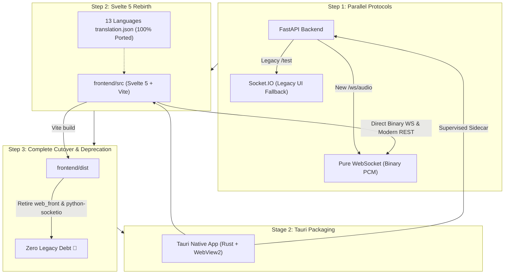

# Next-Gen Frontend Architecture: Svelte 5 Rebirth, Pure WebSocket, and Tauri Packaging

## 1. Anatomy of the Legacy Frontend Bottlenecks

Reverse-engineering the upstream `web_front` asset bundle and examining the reference implementation in `client/` revealed severe design flaws responsible for widespread user complaints (e.g., slider lockups, input lag, and UI freezes):

1. **Unbuffered Network Flood (Missing Debounce)**:
   Sliders (`<input type="range">` in `101-1_TuningArea.tsx`, `101-2_IndexArea.tsx`, etc.) triggered asynchronous HTTP POST calls (`updateServerSettings`) on *every single pixel of mouse movement* via `onChange`. Dragging a slider generated dozens of requests per second with zero throttling or debouncing.

2. **Controlled Input Deadlock (Missing Local State)**:
   Sliders did not maintain a local state (`$state` or `useState`). Instead, `value` directly bound to `serverSetting.serverSetting.tran` (the server's last acknowledged state). As a result, the slider thumb refused to move smoothly until an HTTP response arrived from Python.

3. **Asynchronous Race Conditions**:
   Rapid concurrent HTTP calls arrived and resolved out of order. A delayed response for value `15` would arrive *after* value `20`, snapping the slider backward and freezing the user interaction.

4. **Monolithic Bundle Footprint & Direct Array Indexing**:
   Bundled via Webpack 5 into a single ~2.6MB minified `index.js`, lacking source code. The UI directly accesses slot arrays via indexing (`serverSlotInfos[i]`), forcing the backend to generate padded dummy slots and preventing clean REST/JSON API modernization.

---

## 2. The Coupling Trap: Why UI Rebirth is the Prerequisite for Backend Simplicity

VCClient Forge encounters a classic architectural stalemate:
- **Backend Cleanliness Blocked by Frontend**: We cannot modernize backend REST APIs (e.g. returning only active model slots, using UUIDs or sparse IDs) or stream audio via lightweight protocols because the minified legacy frontend (`web_front/index.js`) expects rigid legacy endpoints and formats.
- **Lost Source Code**: Because upstream source code for `web_front` was never released for v2.0.78-beta, we cannot safely modify the legacy React UI.
- **The Solution**: **A clean-slate UI Rebirth**. Building the next-generation frontend in Svelte 5 is the single prerequisite that frees the Python backend from legacy backward-compatibility debt.

---

## 3. Protocol Modernization: Ditching Socket.IO for Pure WebSocket

### 3.1 Why Keep "Client Mode" Web Audio Ingestion?
While Forge prioritizes **Server Mode** (native OS audio devices) for low latency, browser-based audio streaming (Client Mode) remains an invaluable capability:
- **Cross-Platform Portability**: Zero-driver, zero-configuration audio capture on any device (including smartphones, tablets, or remote laptops accessing the server over LAN/Tailscale).
- **Instant Fallback**: A reliable safety net when host audio drivers (WASAPI/CoreAudio/PortAudio) fail or conflict.

### 3.2 The Penalties of Legacy Socket.IO
Upstream's audio transport relies on `python-socketio` and `python-engineio`. Inspection of [`vcserver_socketio_namespace.py`](../backend/vcclient/server/vcserver_socketio_namespace.py) demonstrates immense inefficiency:
- Audio samples are unpacked via `struct.unpack("<f")` and packed into Socket.IO packet wrappers (`42["response", [timestamp, bin, perf]]`).
- Adds heavy third-party dependencies (`python-socketio`, `python-engineio`, `bidict`, `simple-websocket`).
- Generates high CPU parsing overhead and network framing bloat on every 20ms audio frame.

### 3.3 The Pure WebSocket Pivot (`/ws/audio`)
Forge replaces Socket.IO with a native, zero-dependency **Pure WebSocket** endpoint powered directly by FastAPI/Starlette:

```
[Browser / Web Audio]                                    [FastAPI Backend]
       │                                                         │
       │─── Binary Float32Array PCM Frame (Zero-Parse) ─────────▶│─── Directly into Inference
       │◀── Binary Float32Array PCM Converted (Zero-Parse) ──────│◀── Converted Audio
```

- **Zero-Copy Binary Streaming**: Audio frames flow directly as raw binary buffers (`Float32Array`). No JSON wrapping, no string parsing, no Engine.IO packet headers.
- **Dependency Elimination**: Completely removes `python-socketio` and `python-engineio` from the backend requirements.
- **Radical Server Simplification**: Audio streaming logic is reduced to a concise, standard async WebSocket loop.

---

## 4. Architectural Pivot: Svelte 5 + Vite

Rather than attempting to patch the fragile legacy React codebase, VCClient Forge decided on a ground-up re-implementation using **Svelte 5** and **Vite**:

| Dimension | Legacy Frontend (`web_front` / `client`) | Next-Gen Forge Frontend (`frontend/`) |
|---|---|---|
| **Framework** | React 18/19 SPA | **Svelte 5** (Runes: `$state`, `$derived`, `$effect`) |
| **Rendering Engine** | Virtual DOM (Varying diffing overhead) | **Zero Virtual DOM** (Direct, surgical DOM updates) |
| **Audio Meter Performance** | High CPU overhead on 60fps meter updates | **Native 60fps/120fps reactivity** with negligible overhead |
| **Bundler** | Webpack 5 (~2.6MB bundle, slow rebuilds) | **Vite** (Instant ESM HMR, sub-second production builds) |
| **State Management** | None (Direct inline API calls) | **SSOT Reactive Store** with optimistic updates & debounced sync |

### Reactive Store Pattern (Single Source of Truth)

```
[UI Component (Svelte)]
      ↕  (Instant local binding / 60fps smooth drag)
[Global Reactive Store ($state)]
      ↕  (Debounced background sync / 100ms or onPointerUp)
[API Client Layer (HTTP / Socket.IO)]
      ↕
[Python Backend (FastAPI)]
```

Sliders now react instantly to user touch, while backend persistence and model updates are batched cleanly in the background.

---

## 5. Preserving 100% of Community i18n Translation Assets

VCClient has accumulated translations across **13 languages** (`ar`, `de`, `el`, `en`, `es`, `fr`, `it`, `ja`, `ko`, `la`, `ms`, `ru`, `zh`), created by community contributors over several years.

### Zero-Friction Portability

Inspection of `web_front/assets/i18n/*/translation.json` demonstrated that:
* The translation assets are **pure key-value JSON dictionaries** (e.g., `"model_slot_edit": "編集"`).
* Upstream used `react-i18next`, which is merely a thin React adapter around the framework-agnostic **`i18next`** core engine.
* **Compatibility is 100%**: The exact same JSON files can be imported into Svelte 5 using `i18next` or Svelte-native translation stores (`svelte-i18n`, `paraglide-js`). Not a single translated phrase is lost.

---

## 6. The UI Rebirth & Migration Roadmap

To prevent breaking changes while systematically retiring legacy debt, Forge executes a 3-step migration plan:



### Step 1: Backend Dual-Protocol Preparation
- Introduce a high-performance **Pure WebSocket** endpoint (`/ws/audio`) in FastAPI for raw Float32 audio ingestion and streaming.
- Temporarily retain the legacy Socket.IO server (`/test`) so existing installations and fallback tests remain operational during UI development.

### Step 2: Svelte 5 UI Rebirth (`frontend/src`)
- Scaffold a clean, modular Svelte 5 + Vite application in `frontend/`.
- Connect directly to `/ws/audio` using native browser `WebSocket` and `AudioWorklet`.
- Ingest community i18n JSON files directly.
- Build reactive stores with optimistic UI updates, completely eliminating slider lockups and race conditions.

### Step 3: Complete Cutover & Legacy Excavation
- Point root build scripts (`npm run build:frontend`) to `vite build` outputting to `frontend/dist`.
- Delete the minified legacy `web_front/` directory and remove `python-socketio` / `python-engineio` from `pyproject.toml`.
- Modernize all backend REST APIs (model slots, configuration) without fear of breaking legacy UI assumptions.

### Future Stage: Ultra-Lightweight Desktop App (Tauri v2)

Upstream v2.0.78 packaged its desktop distribution using **Electron**. Forge replaces Electron entirely with **Tauri v2 (Rust + native OS WebView)**:

| Metric / Dimension | Upstream Legacy Desktop (Electron) | VCClient Forge Desktop (Tauri v2) |
|---|---|---|
| **Bundled Browser Engine** | Bundles full Chromium runtime (~150MB+ disk footprint) | Uses OS native WebView (Edge WebView2 / WebKit) |
| **Idle Memory Consumption** | **~200MB – 400MB+ RAM** | **~20MB – 30MB RAM** (90%+ reduction) |
| **Launcher Binary Size** | ~30MB – 50MB (Electron wrapper) | **< 5MB** (Ultra-compact native executable) |
| **Process Management** | Ad-hoc Node.js child process scripts | Official Rust Sidecar architecture with guaranteed cleanup |
| **Startup Latency** | Heavy multi-second Chromium cold boot | Near-instant native window launch |

1. **Liberating System Resources for Gaming & Streaming**:
   Gamers and live streamers running demanding AAA titles (Apex, VALORANT, Genshin) cannot afford Electron swallowing hundreds of megabytes of RAM and GPU VRAM just to render a control panel. Tauri v2 runs practically invisibly in the background.
2. **First-Class Supervised Sidecar Architecture**:
   Upstream's Electron launcher frequently suffered from orphaned Python processes remaining active in the background after closing the app. Tauri's battle-tested Rust sidecar management guarantees deterministic process lifecycle supervision—cleanly terminating the Python backend on window close or system shutdown.
3. **Seamless Tray & Native Controls**:
   Native system tray controls, global push-to-talk / mute hotkeys, and audio level monitoring with zero web-engine drag.
