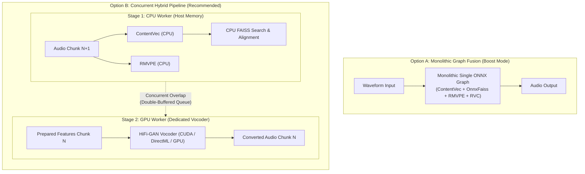

# Hybrid CPU-GPU Pipelining vs. Monolithic Graph Fusion

> **Summary**: Direct micro-benchmarks reveal that physical PCIe DMA transfers (16–160 KB) take tens of microseconds (16–86 μs across AMD and NVIDIA architectures), which does not materially impact real-time latency budgets. Small neural models (ContentVec, RMVPE) execute efficiently on modern multi-core CPUs (~19–32 ms total), with sequential operators in RMVPE executing faster on CPU than on GPU due to kernel dispatch overhead at batch=1. Meanwhile, the HiFi-GAN vocoder (156 convolutional layers) is internal VRAM-bandwidth bound. Rather than consolidating the entire pipeline into a monolithic ONNX graph ("Boost Mode"), a **concurrent hybrid pipeline** (CPU-based preprocessing overlapped with dedicated vocoder synthesis) avoids operator-fusion complexity, prevents vendor-specific reduction issues, and operates within real-time streaming constraints.

---

## 1. Background & The Original "Boost Mode" Hypothesis

In legacy voice conversion pipelines, the RVC workflow was divided into multiple sequential steps:

1. **Pitch Estimation**: RMVPE / FCPE (Audio $\to$ F0)
2. **Feature Extraction**: ContentVec / HuBERT (Audio $\to$ Embeddings)
3. **Index Retrieval**: FAISS cosine-similarity search on embeddings (CPU-only)
4. **Upscaling & Alignment**: Nearest-neighbor interpolation of embeddings
5. **Harmonic & Neural Synthesis**: RVC HiFi-GAN generator (Embeddings + F0 $\to$ Converted Waveform)

When running on GPU, intermediate data moves between host and device across multiple `InferenceSession` calls.

To streamline this, the original architectural roadmap proposed **"Boost Mode"**: compiling and fusing ContentVec, Pitch Estimation, and RVC synthesis into a single monolithic ONNX graph executed within a single `InferenceSession` on the GPU.

---

## 2. Empirical Benchmark Data & Micro-Measurements

### 2.1 Physical PCIe Transfer & Driver Dispatch Latencies
Micro-benchmarking direct memory copies and driver dispatch overhead across distinct GPU architectures (AMD Radeon RX 9060 XT via ROCm HIP and NVIDIA GeForce RTX 4090 via CUDA Runtime/Driver) on modern x86_64 host platforms yields the following physical latencies:

| Payload | Size | AMD RX 9060 XT (H2D / D2H) | AMD Roundtrip | NVIDIA RTX 4090 (H2D / D2H) | NVIDIA Roundtrip |
| :--- | :---: | :---: | :---: | :---: | :---: |
| **Audio Chunk (4096 samples)** | 16.0 KB | 43.1 / 42.8 μs | 85.9 μs (0.086 ms) | 7.8 / 11.2 μs | 18.3 μs (0.018 ms) |
| **Audio Window (16000 samples)** | 62.5 KB | 22.2 / 21.4 μs | 43.6 μs (0.044 ms) | 17.1 / 16.5 μs | 27.1 μs (0.027 ms) |
| **ContentVec Embeddings (1, 49, 768)** | 147.0 KB | 28.1 / 27.0 μs | 55.1 μs (0.055 ms) | 20.0 / 21.5 μs | 37.2 μs (0.037 ms) |
| **RMVPE Pitch Array (101 floats)** | 0.4 KB | 40.0 / 39.4 μs | 79.3 μs (0.079 ms) | 6.8 / 9.8 μs | 16.3 μs (0.016 ms) |
| **Synthesized Audio (40000 samples)** | 156.2 KB | 28.5 / 27.5 μs | 56.1 μs (0.056 ms) | 20.9 / 22.4 μs | 38.4 μs (0.038 ms) |
| **Minimal Dispatch / Sync Overhead** | - | - | 66.4 μs (ROCm) | 6.8 μs (H2D) / 0.6 μs (Sync) | ~7.4 μs (CUDA) |

*(Note: When utilizing pinned host memory via `cudaHostAlloc` / `hipHostMalloc`, RTX 4090 roundtrip latencies drop further to 18.6–30.5 μs).*

**Conclusion**: Physical PCIe bus transfer time across both AMD and NVIDIA architectures is on the order of **tens of microseconds** (16–86 μs). Even when transferring multiple intermediate tensors per chunk, total bus latency is well under **0.1 ms**. It is **not** a millisecond-level bottleneck.

### 2.2 Sub-Model Execution Times (256 ms Audio Chunk)

Benchmarking individual sub-models on a desktop testbed equipped with an **AMD Ryzen 9 7950X** (16 cores / 32 threads, Zen 4, 64 MB L3 cache, configured with 8 intra-op threads) and an **NVIDIA GeForce RTX 4090** (24 GB GDDR6X, 1008 GB/s VRAM bandwidth, CUDA 12 / cuDNN 9 via `CUDAExecutionProvider`) yields the following operator-level execution times:

| Pipeline Stage | CPU (Ryzen 9 7950X / 8 Thr) | GPU (NVIDIA RTX 4090) | GPU (AMD RX 9060 XT) | Delta & Architectural Behavior |
| :--- | :---: | :---: | :---: | :--- |
| **ContentVec (Feature Extraction)** | 12.07 ms | 4.89 ms | 8.8 ms | GPU is ~7.2 ms faster |
| **RMVPE (Pitch Estimation)** | 7.35 ms | 16.91 ms | 6.3 ms | CPU is 2.3× faster than RTX 4090 due to kernel launch overhead at batch=1 |
| **FAISS Feature Retrieval** | 3.94 ms | *N/A (CPU-native)* | 1.5 ms | CPU-native memory search (~10k vectors) |
| **Subtotal (Preparation Stage)** | 23.37 ms | 25.74 ms | 15.1 ms | CPU total is 2.37 ms faster than GPU total |
| **RVC HiFi-GAN Vocoder (Synthesis)** | 145.43 ms | 11.71 ms | 75 ~ 235 ms\* | 12.4× speedup on RTX 4090 |

*\*Note on HiFi-GAN Vocoder Latency: On hardware with 1008 GB/s memory bandwidth (RTX 4090), HiFi-GAN executes in 11.71 ms. On mid-range hardware (e.g., RX 9060 XT, 288 GB/s), FP32 HiFi-GAN takes ~75–235 ms due to internal VRAM memory bandwidth stalls across its 156 convolutional layers.*

#### Key Observations:
1. **RMVPE Execution Characteristics**:
   Because RMVPE consists of recurrent operations, dynamic indexing (`ScatterND`), and intermediate reductions evaluated at batch=1, kernel dispatch and GPU synchronization overhead result in 16.91 ms on the RTX 4090. On the Ryzen 9 7950X, Zen 4's AVX-512 execution units and 64 MB L3 cache keep intermediate activations within low-latency cache, completing in 7.35 ms.
2. **Preparation Stage Comparison**:
   Total preparation time on the Ryzen 9 7950X (23.37 ms) is 2.37 ms faster than on the RTX 4090 (25.74 ms). Running preparation on the CPU avoids GPU VRAM allocation for feature extraction models without increasing latency.
3. **HiFi-GAN Synthesis Acceleration**:
   The 156 convolutional layers of HiFi-GAN require sequential memory sweep. The RTX 4090's 1008 GB/s VRAM bandwidth completes synthesis in 11.71 ms, compared to 145.43 ms on the CPU (a 12.4× speedup).
4. **Pipelining Feasibility**:
   In a concurrent hybrid pipeline, the CPU prepares chunk $N+1$ (~23.4 ms) concurrently while the GPU synthesizes chunk $N$ (~11.7 ms). Given that physical PCIe roundtrip is 0.018–0.038 ms, transfer overhead does not constrain real-time throughput for a 256 ms audio chunk.

### 2.3 Measurement Methodology & Profiling Tools

To ensure scientific rigor and avoid conflating framework overhead with hardware limits, two distinct measurement tiers were employed:

1. **Physical PCIe Bus & Driver Dispatch Tier (ROCm HIP & CUDA Runtime C APIs)**:
   - Evaluated via `ctypes` bindings to `/opt/rocm/lib/libamdhip64.so` (`hipMemcpy`, `hipDeviceSynchronize`) on Linux/ROCm and `cudart64_110.dll` (`cudaMemcpy`, `cudaDeviceSynchronize`, `cudaHostAlloc`) on Windows/CUDA.
   - By bypassing runtime graphs, this isolates pure physical DMA transit over the PCIe bus (16–86 μs) from higher-level software stacks.
   - Dispatch overhead was measured using a minimal single-node identity graph in ONNX Runtime (`5.5 μs` on CPU vs. `66.4 μs` on ROCm) and minimal dispatch/synchronize invocations in CUDA (`0.6 μs` sync, `6.8 μs` minimal H2D).

2. **Model-Level & Operator Breakdown Tier (ONNX Runtime Profiler)**:
   - Steady-state model latencies were recorded using `onnxruntime.InferenceSession` across 50 continuous iterations after GPU warmup (discarding initial JIT/MIOpen binary compilation spikes).
   - Operator-level breakdowns (e.g., Conv1D consuming 79.2 ms / 70.3% of HiFi-GAN execution time on CPU) were gathered directly using ONNX Runtime's native profiler (`SessionOptions.enable_profiling = True`), analyzing the exported Chrome Tracing / Perfetto JSON event logs.

---

## 3. Why the Preparation Stage Belongs on CPU

Given that PCIe transfer is fast (< 0.1 ms), why should ContentVec and RMVPE remain on CPU instead of GPU?

1. **Marginal Compute Advantage (~15 ms)**:
   Modern CPUs with large L3 caches (32–64 MB) and AVX2 SIMD execute batch=1 inference for ContentVec and RMVPE in just ~30 ms total. The absolute compute difference between CPU and GPU is modest.
2. **FAISS Inherent CPU Affinity**:
   Vector database search in FAISS is CPU-native in desktop environments. Because features must reside in host RAM for FAISS retrieval, running ContentVec on CPU avoids host-device roundtrips and allows in-memory NumPy array handoffs.
3. **Immunity to Microarchitecture & Vendor Quirks**:
   Complex reduction, softmax, and normalization layers in ContentVec and RMVPE are vulnerable to vendor compiler assumptions (such as the Wave32 vs. Wave64 `GPU_WARP_SIZE=64` reduction bug in ONNX Runtime ROCm). Running them on the CPU ensures 100% mathematical precision across all platforms.
4. **VRAM Footprint & Resource Contention**:
   Keeping feature extraction on CPU frees GPU VRAM and stream queues, allowing the accelerator to dedicate 100% of its resources to the vocoder.

---

## 4. Internal VRAM Bandwidth in HiFi-GAN

The RVC HiFi-GAN generator is composed of **156 convolutional and transposed convolutional layers** across multiple dilated ResBlocks.

* **Operational Intensity**: With batch size 1 and 1D dilated convolutions, arithmetic intensity (FLOPs per byte loaded) is low. Execution time is heavily constrained by internal VRAM read/write bandwidth (reading weights and activations layer-by-layer) rather than peak ALU TFLOPS.
* **Cache Fit on CPU**: On modern CPUs, the 1D feature arrays fit comfortably within L2/L3 caches, allowing AVX2 execution to achieve ~115 ms steady-state for a 256 ms chunk.
* **Roofline on GPU**: High-bandwidth GPUs (RTX 4090 @ 1008 GB/s) sweep through the 156 layers rapidly (**11.71 ms measured**), while narrow-bus GPUs (128-bit @ 288 GB/s) spend more time in VRAM memory stalls (~75–235 ms).

---

## 5. Architectural Evaluation: Monolithic Fusion vs. Concurrent Hybrid Pipeline

### Option A: Monolithic Graph Fusion ("Boost Mode")
* **Advantages**: Single session dispatch; fully self-contained ONNX execution.
* **Drawbacks**:
  * Embedding FAISS / k-NN retrieval into ONNX requires complex custom operators or static vector tables that do not adapt dynamically to slot index changes.
  * Embedder and pitch weights permanently occupy GPU VRAM.
  * Complex attention and reduction operations in ContentVec remain exposed to hardware-specific compiler/driver bugs.

### Option B: Concurrent Hybrid Pipeline (Target Architecture)
* **Stage 1 (Host CPU)**: ContentVec, RMVPE, and FAISS run in host memory via `CPUExecutionProvider`.
  * Total preparation latency: ~30 ms.
  * In-memory array handoff into FAISS.
* **Stage 2 (Device GPU / CPU)**: HiFi-GAN synthesis runs on the accelerator (or CPU if GPU is unavailable).
* **Temporal Overlap (Pipelining)**:
  * While the GPU executes the neural vocoder for chunk $N$, the CPU concurrently prepares features for chunk $N+1$.
  * End-to-end processing time per chunk:
    $$T_{\text{effective}} \approx \max(T_{\text{CPU\_prep}}, T_{\text{GPU\_synth}})$$
  * Because $T_{\text{CPU\_prep}} \approx 23–30\text{ ms} \le T_{\text{GPU\_synth}}$ (on mid-range GPUs) or overlaps within the chunk period, preparation latency does not directly compound conversion latency.

---

## 6. Implementation Status & Roadmap

### 6.1 Formal Deprecation of Standalone ROCm EP (`--edition rocm`)
Upstream investigation revealed that Microsoft and AMD officially deprecated and **deleted `ROCmExecutionProvider` from ONNX Runtime** in [PR #25181](https://github.com/microsoft/onnxruntime/pull/25181) (`Delete ROCM EP`, ONNX Runtime 1.23+). The `onnxruntime-rocm==1.22.2.post3` package represents an abandoned final release hardcoded for Wave64 CDNA hardware (`GPU_WARP_SIZE=64`), causing silent $2\times$ reduction doubling on consumer RDNA3/RDNA4 Wave32 GPUs.

Consequently, Forge explicitly **abandons standalone ROCm support**:
* Attempting to maintain a custom ROCm build imposes fragile host dependencies (~30 GB ROCm SDKs) without upstream maintenance.
* Linux AMD users are instead directed to the bit-exact multi-threaded CPU pipeline or the upcoming WebGPU backend.

### 6.2 Production Platform Strategy
| Platform | Target Edition | Primary Acceleration Path | Latency Profile & Notes |
| :--- | :--- | :--- | :--- |
| **Windows (NVIDIA)** | `cuda` | `CUDAExecutionProvider` | Dedicated Tensor Cores; optimal throughput. |
| **Windows (AMD / Intel)** | `dml` | `DmlExecutionProvider` (DirectX 12) | Official Microsoft/AMD path; immune to Wave32 reduction issues. |
| **macOS (Apple Silicon)** | `mac` | `CoreMLExecutionProvider` | Apple Neural Engine (ANE) & Metal acceleration. |
| **Linux (NVIDIA)** | `cuda` | `CUDAExecutionProvider` | Stable Linux CUDA stack. |
| **Linux (AMD / Intel / Generic)** | `cpu` | `CPUExecutionProvider` (AVX2 / AVX-512) | **Measured latency profile (~112 ms)**; faster than RDNA GPU under current drivers; no additional driver dependencies. |

### 6.3 Pipelining Evolution (Next Steps)
1. **Concurrent Producer-Consumer Decoupling**:
   - Decouple feature extraction (`ContentVec`, `RMVPE`, `FAISS`) into a background producer worker feeding a bounded double-buffered queue.
   - The inference worker pops prepared feature tensors and executes neural vocoder synthesis concurrently, overlapping the ~23–30 ms preparation latency.
2. **Next-Generation Lightweight Vocoders (Vocos / iSTFT)**:
   - Evaluate modern vocoders (such as Vocos) that replace HiFi-GAN's 156 Conv1D layers with lightweight ConvNeXt blocks and an inverse Short-Time Fourier Transform (iSTFT) synthesis head.
   - Reduces the VRAM memory stall impact and shortens chunk conversion latency to <20 ms on modern multi-core CPUs and consumer GPUs.
3. **Hardware Backends: Native Direct APIs vs. Universal Abstraction (WebGPU / Vulkan)**:
   - While WebGPU (`--edition webgpu`) provides a universal, driver-independent GPU backend across operating systems, empirical evidence (e.g., RTX 4090 executing significantly slower under DirectML than native CUDA) confirms that **native vendor APIs (`CUDA` on NVIDIA, `CoreML` on Apple Silicon) remain indispensable**.
   - Universal abstraction layers (DirectML, WebGPU/Dawn) must translate compute shaders through intermediate representations (HLSL/WGSL), which prevents full utilization of vendor-proprietary micro-architectures (such as NVIDIA Tensor Core cuDNN fused kernels or Apple Neural Engine / ANE coprocessors).
   - Therefore, Forge adopts a tiered backend strategy:
     - **Tier 1 (Native Direct)**: `cuda` (NVIDIA) and `mac` (Apple Silicon CoreML) provide maximum throughput, lowest latency, and best power efficiency.
     - **Tier 2 (Universal Abstraction)**: `dml` (Windows AMD/Intel) and upcoming `webgpu` (Linux AMD/Intel / universal cross-platform) solve driver fragmentation where native vendor runtimes are unavailable or unstable.
     - **Tier 0 (Ubiquitous Baseline)**: `cpu` (AVX2 / AVX-512) guarantees bit-exact execution without specialized GPU driver setup.
