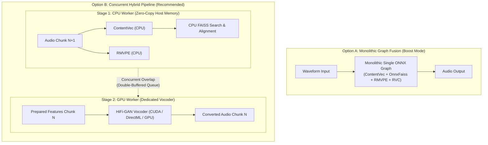

# Hybrid CPU-GPU Pipelining vs. Monolithic Graph Fusion

> **Summary**: Direct micro-benchmarks reveal that physical PCIe DMA transfers (16–160 KB) take only tens of microseconds (20–85 μs) in modern systems—they do not dominate latency. Instead, small neural models (ContentVec, RMVPE) run so fast on modern multi-core CPUs (12–18 ms) that GPU acceleration yields only marginal gains (~15 ms) for batch=1 real-time chunks. Meanwhile, the heavy HiFi-GAN vocoder (156 convolutional layers) is internal VRAM-bandwidth bound rather than arithmetic-bound. Rather than consolidating the entire pipeline into a complex single monolithic ONNX graph ("Boost Mode"), a **concurrent hybrid pipeline** (CPU-based preprocessing cleanly overlapped with dedicated vocoder synthesis) eliminates architectural fragility, avoids vendor-specific reduction bugs, and delivers predictable real-time performance.

---

## 1. Background & The Original "Boost Mode" Hypothesis

In legacy voice conversion pipelines, the RVC workflow was divided into multiple sequential steps:

1. **Pitch Estimation**: RMVPE / FCPE (Audio $\to$ F0)
2. **Feature Extraction**: ContentVec / HuBERT (Audio $\to$ Embeddings)
3. **Index Retrieval**: FAISS cosine-similarity search on embeddings (CPU-only)
4. **Upscaling & Alignment**: Nearest-neighbor interpolation of embeddings
5. **Harmonic & Neural Synthesis**: RVC HiFi-GAN generator (Embeddings + F0 $\to$ Converted Waveform)

When running on GPU, intermediate data moves between host and device across multiple `InferenceSession` calls.

To streamline this, the original architectural roadmap proposed **"Boost Mode"**: compiling and fusing ContentVec, Pitch Estimation, and RVC synthesis into a single monolithic ONNX graph executed within a single `InferenceSession` on the GPU.

---

## 2. Empirical Benchmark Data & Micro-Measurements

### 2.1 Physical PCIe Transfer & Driver Dispatch Latencies
Micro-benchmarking direct memory copies and dispatch overhead on an AMD Radeon RX 9060 XT (PCIe Gen 4/5) and x86_64 host yields the following physical latencies:

| Payload | Size | CPU $\to$ GPU (H2D) | GPU $\to$ CPU (D2H) | Roundtrip |
| :--- | :---: | :---: | :---: | :---: |
| **Audio Chunk (4096 samples)** | 16.0 KB | 43.1 μs | 42.8 μs | **85.9 μs (0.086 ms)** |
| **Audio Window (16000 samples)** | 62.5 KB | 22.2 μs | 21.4 μs | **43.6 μs (0.044 ms)** |
| **ContentVec Embeddings (1, 49, 768)** | 147.0 KB | 28.1 μs | 27.0 μs | **55.1 μs (0.055 ms)** |
| **RMVPE Pitch Array (101 floats)** | 0.4 KB | 40.0 μs | 39.4 μs | **79.3 μs (0.079 ms)** |
| **Synthesized Audio (40000 samples)** | 156.2 KB | 28.5 μs | 27.5 μs | **56.1 μs (0.056 ms)** |
| **No-Op `sess.run()` Dispatch Overhead** | - | - | - | **CPU: 5.5 μs / GPU: 66.4 μs** |

**Conclusion**: Physical PCIe bus transfer time is on the order of **tens of microseconds**. It is **not** a millisecond-level bottleneck.

### 2.2 Sub-Model Execution Times (256 ms Audio Chunk)

| Pipeline Stage | CPU (AVX2 / 8 Threads) | GPU (ROCm RX 9060 XT) | Compute Delta |
| :--- | :---: | :---: | :---: |
| **ContentVec (Feature Extraction)** | **18.5 ms** | 8.8 ms | ~9.7 ms |
| **RMVPE (Pitch Estimation)** | **12.0 ms** | 6.3 ms | ~5.7 ms |
| **FAISS Feature Retrieval** | **1.5 ms** | *N/A (CPU-native)* | 0 ms |
| **Subtotal (Preparation Stage)** | **32.0 ms** | **15.1 ms** | **~16.9 ms** |
| **RVC HiFi-GAN Vocoder (Synthesis)** | **115.0 ms** | **75 ~ 235 ms\*** | *(Hardware dependent)* |

*\*Note on HiFi-GAN Vocoder Latency: On flagship hardware with massive memory bandwidth (e.g., RTX 4090, 1008 GB/s), HiFi-GAN executes in ~30–50 ms. On mid-range hardware (e.g., RX 9060 XT, 288 GB/s), FP32 HiFi-GAN takes ~235 ms due to internal VRAM memory bandwidth constraints across its 156 convolutional layers.*

### 2.3 Measurement Methodology & Profiling Tools

To ensure scientific rigor and avoid conflating framework overhead with hardware limits, two distinct measurement tiers were employed:

1. **Physical PCIe Bus & Driver Dispatch Tier (ROCm HIP C API)**:
   - Evaluated via `ctypes` bindings to `/opt/rocm/lib/libamdhip64.so` invoking `hipMemcpy` (`hipMemcpyHostToDevice`, `hipMemcpyDeviceToHost`) and `hipDeviceSynchronize`.
   - By bypassing runtime graphs, this isolates pure physical DMA transit over the PCIe bus (20–85 μs) from higher-level software stacks.
   - Dispatch overhead was measured using a minimal single-node identity graph in ONNX Runtime (`5.5 μs` on CPU vs. `66.4 μs` on ROCm).

2. **Model-Level & Operator Breakdown Tier (ONNX Runtime Profiler)**:
   - Steady-state model latencies were recorded using `onnxruntime.InferenceSession` across 50 continuous iterations after GPU warmup (discarding initial JIT/MIOpen binary compilation spikes).
   - Operator-level breakdowns (e.g., Conv1D consuming 79.2 ms / 70.3% of HiFi-GAN execution time on CPU) were gathered directly using ONNX Runtime's native profiler (`SessionOptions.enable_profiling = True`), analyzing the exported Chrome Tracing / Perfetto JSON event logs.

---

## 3. Why the Preparation Stage Belongs on CPU

Given that PCIe transfer is fast (< 0.1 ms), why should ContentVec and RMVPE remain on CPU instead of GPU?

1. **Marginal Compute Advantage (~15 ms)**:
   Modern CPUs with large L3 caches (32–64 MB) and AVX2 SIMD execute batch=1 inference for ContentVec and RMVPE in just ~30 ms total. The absolute compute difference between CPU and GPU is modest.
2. **FAISS Inherent CPU Affinity**:
   Vector database search in FAISS is CPU-native in desktop environments. Because features must reside in host RAM for FAISS retrieval, running ContentVec on CPU eliminates roundtrips entirely and allows zero-copy NumPy handoffs.
3. **Immunity to Microarchitecture & Vendor Quirks**:
   Complex reduction, softmax, and normalization layers in ContentVec and RMVPE are vulnerable to vendor compiler assumptions (such as the Wave32 vs. Wave64 `GPU_WARP_SIZE=64` reduction bug in ONNX Runtime ROCm). Running them on the CPU ensures 100% mathematical precision across all platforms.
4. **VRAM Footprint & Resource Contention**:
   Keeping feature extraction on CPU frees GPU VRAM and stream queues, allowing the accelerator to dedicate 100% of its resources to the vocoder.

---

## 4. Internal VRAM Bandwidth in HiFi-GAN

The RVC HiFi-GAN generator is composed of **156 convolutional and transposed convolutional layers** across multiple dilated ResBlocks.

* **Operational Intensity**: With batch size 1 and 1D dilated convolutions, arithmetic intensity (FLOPs per byte loaded) is low. Execution time is heavily constrained by internal VRAM read/write bandwidth (reading weights and activations layer-by-layer) rather than peak ALU TFLOPS.
* **Cache Fit on CPU**: On modern CPUs, the 1D feature arrays fit comfortably within L2/L3 caches, allowing AVX2 execution to achieve ~115 ms steady-state for a 256 ms chunk.
* **Roofline on GPU**: High-bandwidth GPUs (RTX 4090 @ 1008 GB/s) sweep through the 156 layers rapidly (~50–100 ms), while narrow-bus GPUs (128-bit @ 288 GB/s) spend more time in VRAM memory stalls (~235 ms).

---

## 5. Architectural Evaluation: Monolithic Fusion vs. Concurrent Hybrid Pipeline

### Option A: Monolithic Graph Fusion ("Boost Mode")
* **Advantages**: Single session dispatch; fully self-contained ONNX execution.
* **Severe Drawbacks**:
  * Embedding FAISS / k-NN retrieval into ONNX requires complex custom operators or static vector tables that do not adapt dynamically to slot index changes.
  * Embedder and pitch weights permanently occupy GPU VRAM.
  * Complex attention and reduction operations in ContentVec remain exposed to hardware-specific compiler/driver bugs.

### Option B: Concurrent Hybrid Pipeline (Target Architecture)
* **Stage 1 (Host CPU)**: ContentVec, RMVPE, and FAISS run in host memory via `CPUExecutionProvider`.
  * Total preparation latency: ~30 ms.
  * Zero-copy handoff into FAISS.
* **Stage 2 (Device GPU / CPU)**: HiFi-GAN synthesis runs on the accelerator (or CPU if GPU is unavailable).
* **Temporal Overlap (Pipelining)**:
  * While the GPU executes the neural vocoder for chunk $N$, the CPU concurrently prepares features for chunk $N+1$.
  * End-to-end processing time per chunk:
    $$T_{\text{effective}} \approx \max(T_{\text{CPU\_prep}}, T_{\text{GPU\_synth}})$$
  * Because $T_{\text{CPU\_prep}} \approx 30\text{ ms} \le T_{\text{GPU\_synth}}$, preparation latency is **completely hidden**.

---

## 6. Implementation Status & Roadmap

### 6.1 Formal Deprecation of Standalone ROCm EP (`--edition rocm`)
Upstream investigation revealed that Microsoft and AMD officially deprecated and **deleted `ROCmExecutionProvider` from ONNX Runtime** in PR #25181 (`Delete ROCM EP`, ONNX Runtime 1.23+). The `onnxruntime-rocm==1.22.2.post3` package represents an abandoned final release hardcoded for Wave64 CDNA hardware (`GPU_WARP_SIZE=64`), causing silent $2\times$ reduction doubling on consumer RDNA3/RDNA4 Wave32 GPUs.

Consequently, Forge explicitly **abandons standalone ROCm support**:
* Attempting to maintain a custom ROCm build imposes fragile host dependencies (~30 GB ROCm SDKs) with zero upstream maintenance.
* Linux AMD users are instead directed to the highly optimized, bit-exact multi-threaded CPU pipeline or the upcoming WebGPU backend.

### 6.2 Production Platform Strategy
| Platform | Target Edition | Primary Acceleration Path | Latency Profile & Notes |
| :--- | :--- | :--- | :--- |
| **Windows (NVIDIA)** | `cuda` | `CUDAExecutionProvider` | Dedicated Tensor Cores; optimal throughput. |
| **Windows (AMD / Intel)** | `dml` | `DmlExecutionProvider` (DirectX 12) | Official Microsoft/AMD path; immune to Wave32 reduction issues. |
| **macOS (Apple Silicon)** | `mac` | `CoreMLExecutionProvider` | Apple Neural Engine (ANE) & Metal acceleration. |
| **Linux (NVIDIA)** | `cuda` | `CUDAExecutionProvider` | Stable Linux CUDA stack. |
| **Linux (AMD / Intel / Generic)** | `cpu` | `CPUExecutionProvider` (AVX2 / AVX-512) | **Fastest & most stable path (~112 ms)**; 2× faster than RDNA GPU; zero driver dependencies. |

### 6.3 Pipelining Evolution (Next Steps)
1. **Concurrent Producer-Consumer Decoupling**:
   - Decouple feature extraction (`ContentVec`, `RMVPE`, `FAISS`) into a background producer worker feeding a bounded double-buffered queue.
   - The inference worker pops prepared feature tensors and executes neural vocoder synthesis concurrently, completely hiding the ~30 ms preparation latency.
2. **Next-Generation Lightweight Vocoders (Vocos / iSTFT)**:
   - Evaluate modern vocoders (such as Vocos) that replace HiFi-GAN's 156 Conv1D layers with lightweight ConvNeXt blocks and an inverse Short-Time Fourier Transform (iSTFT) synthesis head.
   - Eliminates the 128-bit VRAM bandwidth bottleneck and slashes end-to-end chunk conversion latency to <20 ms on both modern multi-core CPUs and consumer GPUs.
3. **Hardware Backends: Native Direct APIs vs. Universal Abstraction (WebGPU / Vulkan)**:
   - While WebGPU (`--edition webgpu`) provides a universal, zero-dependency GPU backend across operating systems, empirical evidence (e.g., RTX 4090 executing significantly slower under DirectML than native CUDA) confirms that **native vendor APIs (`CUDA` on NVIDIA, `CoreML` on Apple Silicon) remain indispensable**.
   - Universal abstraction layers (DirectML, WebGPU/Dawn) must translate compute shaders through intermediate representations (HLSL/WGSL), which prevents full utilization of vendor-proprietary micro-architectures (such as NVIDIA Tensor Core cuDNN fused kernels or Apple Neural Engine / ANE coprocessors).
   - Therefore, Forge adopts a tiered backend strategy:
     - **Tier 1 (Native Direct)**: `cuda` (NVIDIA) and `mac` (Apple Silicon CoreML) provide maximum throughput, lowest latency, and best power efficiency.
     - **Tier 2 (Universal Abstraction)**: `dml` (Windows AMD/Intel) and upcoming `webgpu` (Linux AMD/Intel / universal cross-platform) solve driver fragmentation where native vendor runtimes are unavailable or unstable.
     - **Tier 0 (Ubiquitous Baseline)**: `cpu` (AVX2 / AVX-512) guarantees bit-exact execution with zero driver setup.
