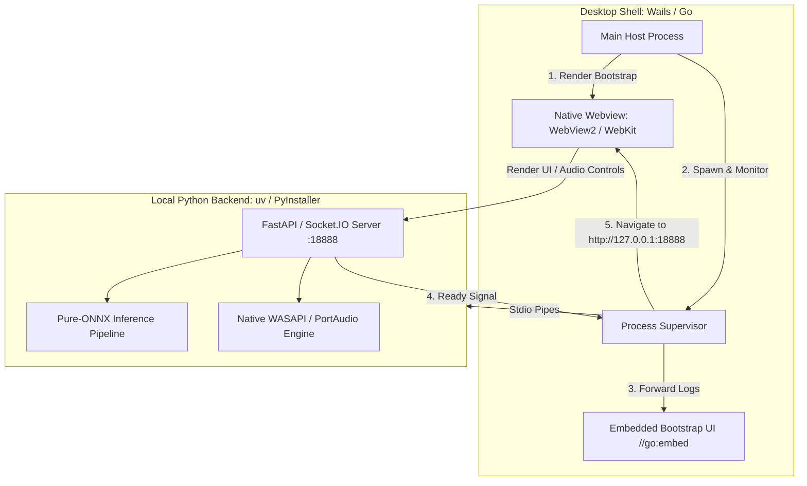

# Migrating Desktop Host from Tauri to Wails v3: Pragmatic Process Management over Unnecessary Complexity

## Executive Summary

VCClient Forge has made the architectural decision to **migrate its desktop application wrapper from Tauri v2 (Rust) to Wails v3 (Go)**.

While Tauri is a capable framework that excels at minimal binary sizes and low memory footprints for rich, logic-heavy native desktop applications, its architectural trade-offs are mismatched with the reality of VCClient Forge:

1. **The Desktop Host is Strictly a Thin Wrapper**: The actual voice conversion pipeline, neural network inference (ONNX Runtime), and real-time audio streaming (WASAPI/PortAudio) are executed entirely within the Python backend. The UI is rendered and executed within WebView2. The desktop shell exists solely to supervise the local Python child process, stream startup logs via a lightweight bootstrap page, navigate to the web server once ready, and cleanly shut down on exit.
2. **Disproportionate Maintenance and Boilerplate**: Implementing basic supervisory capabilities in Tauri v2 required navigating enterprise-grade capability schemas (`capabilities/bootstrap.json`, autogenerated permission TOMLs) and intricate IPC scoping. For a purely local, localhost-bound process wrapper, this machinery creates continuous configuration friction.
3. **Severe Build-Time Overhead**: Compiling Rust dependencies and running `tauri-build` adds substantial friction to local developer iteration and CI build pipelines. For a component whose operational logic comprises fewer than 300 lines of orchestration, multi-minute Rust compile times represent an unjustified tax.
4. **Marginal Runtime Benefit vs. Non-Marginal Cost**: In an application dominated by a 200MB+ Python/ONNX backend and a multi-process Chromium WebView2 runtime, the nominal runtime performance and memory differences between a Go host and a Rust host are pure rounding errors. Incurring significant implementation and cognitive complexity for negligible runtime gains directly contradicts the project's core philosophy:

> **「できることが同じなら、コードもドキュメントも少ないほうが正義！」**  
> _(If the outcome and capabilities are identical, less code and concise documentation is the ultimate virtue.)_

5. **Heavyweight Build Toolchain Friction**: On Windows, Tauri mandates installing the full Microsoft Visual C++ Build Tools (MSVC) and Windows SDK alongside the Rust toolchain, consuming multi-gigabytes of disk space and imposing high onboarding friction. In contrast, Go and Wails compile cleanly with lightweight prerequisites (pure Go without CGO on Windows), drastically lowering environment setup complexity.
6. **The Decisive Factor: Declarative Webview Script Injection (`WebviewWindowOptions.JS`)**: Wails v3 provides a first-class `JS: string` option in its window configuration. This enables injecting transparent compatibility polyfills (e.g. routing `window.open` to `wails.Browser.OpenURL` and polyfilling `window.electronAPI.openBrowser`) directly into the document context before DOM creation. This cleanly resolves all external link navigation and legacy Electron client compatibility in user space without low-level C++/COM event hooking or fragile platform-specific shell execution commands.

Wails v3 delivers near-instantaneous compilation, minimal configuration overhead, pure Go Windows builds, and seamless reuse of the existing HTML/JS bootstrap assets.

---

## 1. Context: The Role of the Desktop Host in VCClient Forge

In VCClient Forge's client-driven architecture (detailed in [Inversion of Control and Process Lifecycle](./inversion-of-control-and-process-lifecycle.md)), the desktop application is intentionally decoupled from core audio and inference workloads:

The desktop shell has four bounded responsibilities:

1. **Bootstrap Display**: Show a responsive splash/diagnostic screen while the backend initializes.
2. **Process Lifecycle**: Spawn `python backend/main.py` (in dev) or `main.exe` (in distribution), capture stdout/stderr, detect the readiness sentinel (`Application: http://localhost:18888`), and terminate child process trees cleanly on window close.
3. **Webview Navigation**: Direct the primary webview to the backend server upon readiness.
4. **Shell Integration**: Delegate external URLs (documentation, GitHub repositories, donation links) to the user's default OS browser.

Crucially, **no audio frames, neural tensor data, or complex business logic pass through the desktop host layer**.

---

## 2. Technical Evaluation: Key Friction Points with Tauri v2

During the development and testing of the v2.0.78-forge desktop baseline, the primary friction points of using Tauri v2 were evaluated:

### A. Compile-Time Inflation & Iteration Latency

Even with incremental compilation caches, Rust compilation and `tauri-build` introduce substantial latency during development, test cycles, and packaging. In CI environments, bootstrapping the Rust toolchain, compiling native dependencies, and linking Windows binaries impose significant waiting periods on minor cosmetic or operational fixes.

### B. Heavyweight Windows Toolchain Friction (MSVC & Windows SDK)

Building a Tauri desktop application on Windows mandates installing Microsoft Visual Studio C++ Build Tools (MSVC) along with the Windows SDK. This adds multi-gigabytes of disk footprint, complex path dependencies, and substantial onboarding overhead for contributors who simply want to build or run the client. In contrast, standard Go tooling operates with a significantly lighter prerequisite footprint.

### C. Disproportionate Capability and Permission Overhead

Tauri v2 introduces a granular, enterprise-grade capabilities system (`src-tauri/capabilities/` and `src-tauri/permissions/`). While well-suited for untrusted remote web apps, applying this machinery to a local localhost supervisor created continuous configuration drag:

- Custom commands required autogenerated TOML permissions and JSON capability mappings.
- Managing IPC scoping and webview security policies added unnecessary boilerplate for an application that runs entirely on localhost.

---

## 3. Preservation of Existing Assets

The migration to Wails preserves all frontend and UX investments made so far:

1. **The Diagnostic Bootstrap UI**: The unbuffered HTML/CSS/JS startup screen (`src-tauri/bootstrap/` or `desktop/bootstrap/`), complete with dark mode, live status messages, expandable logs, and retry buttons, will be directly mounted via Go's standard `embed.FS`.
2. **Dual-UI Architecture**: The `/ui/2.1.4/` and `/ui/2.0.78/` static web distribution remains 100% unchanged, served natively by the Python FastAPI backend.
3. **Packaging Strategy**: Standalone portable packaging using PyInstaller onedir for the backend and the compiled desktop host remains functionally identical, maintaining our sub-2GB target ([Sub-2GB Portable Distribution](./sub-2gb-portable-distribution-and-packaging.md)).

---

## 4. Migration Roadmap & Execution

1. **Phase 1: Environment & Project Scaffolding** [Completed]
   - Initialized Wails v3 project structure under `desktop/` with Vite, TypeScript, and `@xterm/xterm` (xterm.js).
   - Configured Taskfile automation (`desktop/Taskfile.yml` and `desktop/build/Taskfile.yml`) for bindings generation, Vite build, syso manifest generation, and Go compilation.
2. **Phase 2: Process Supervisor Implementation** [Completed]
   - Implemented `desktop/main.go` and `desktop/sys_windows.go` to supervise Python backend execution via `os/exec.Command`.
   - Replaced polling architecture (`StartupStatus` / `RetryBackend`) with real-time push event streaming (`app.Event.Emit("backend-log")` and `app.Event.Emit("backend-ready")`).
   - Attached hidden console session via `AllocConsole` and `windows.SW_HIDE` on Windows to enable reliable `CTRL_C_EVENT` handling, backed by `taskkill /F /T /PID` process-tree termination.
3. **Phase 3: Navigation & Window Lifecycle** [Completed]
   - Bound `app.Run()` strictly to the main OS thread for COM STA compliance (`HRESULT 0x800401f0` prevention).
   - Automated webview navigation to `http://127.0.0.1:18888/` upon backend readiness.
   - Configured declarative link delegation to OS default browser and legacy Electron polyfills via `WebviewWindowOptions.JS`.
4. **Phase 4: Toolchain & Build Script Integration** [Completed]
   - Updated `scripts/build_package.py`, `tests/desktop_bootstrap.test.cjs`, and `package.json` to replace Tauri tasks with `wails3 task --dir desktop build`.
   - Completely deleted `src-tauri/` and pruned Rust dependencies.
5. **Phase 5: Release Verification & Quality Gates** [Completed]
   - Verified pure Go CGO-free Windows compilation (`CGO_ENABLED=0`), generating `desktop/bin/vcclient-forge.exe` (10.18 MB) in ~8 seconds.
   - Integrated native Git pre-commit hook (`.githooks/pre-commit`) to guarantee Ruff and `gofmt` code formatting before every commit.
   - Passed all 105 backend pytest cases, 8 desktop bootstrap test cases, and Go unit tests.

---

## 5. Migration Outcome & Quantitative Impact

On October 25, 2026, the migration from Tauri v2 to Wails v3 was completed and merged (commit `b260979`). The technical and organizational benefits directly align with the core philosophy **"If the outcome and capabilities are identical, less code and concise documentation is the ultimate virtue."**:

| Metric                                | Tauri v2 (Rust)                                                        | Wails v3 (Go)                                                            | Impact / Savings                                                                                           |
| :------------------------------------ | :--------------------------------------------------------------------- | :----------------------------------------------------------------------- | :--------------------------------------------------------------------------------------------------------- |
| **Lines of Code**                     | ~5,324 lines across 40+ files                                          | ~2,478 lines across 20 files                                             | **-2,846 lines net reduction** (massive elimination of configuration & wrapper boilerplate)                |
| **Build Toolchain**                   | Rust + Cargo + MSVC C++ Build Tools + Windows SDK (multi-GB footprint) | Pure Go 1.25+ (`CGO_ENABLED=0`)                                          | **Zero C++ compiler requirement** on Windows; lightweight developer onboarding                             |
| **Desktop Build Time (Daily Rhythm)** | **~15–30s** (incremental turnaround) _(~2–4 min clean/CI build)_    | **~3–5s** (full pipeline: Vite + Go build) _(~10–15s fresh/CI setup)_ | **~5× faster iteration loop**; keeps developer concentration and rhythm uninterrupted without idle waiting |
