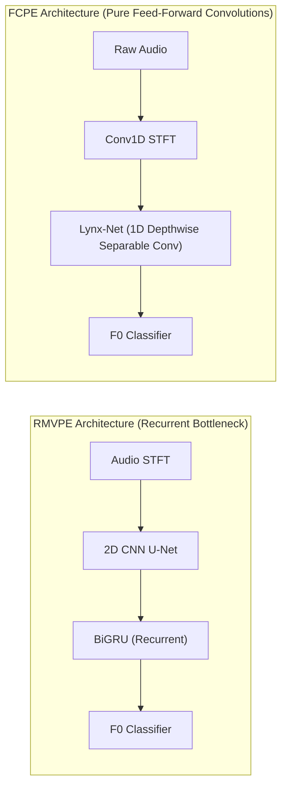
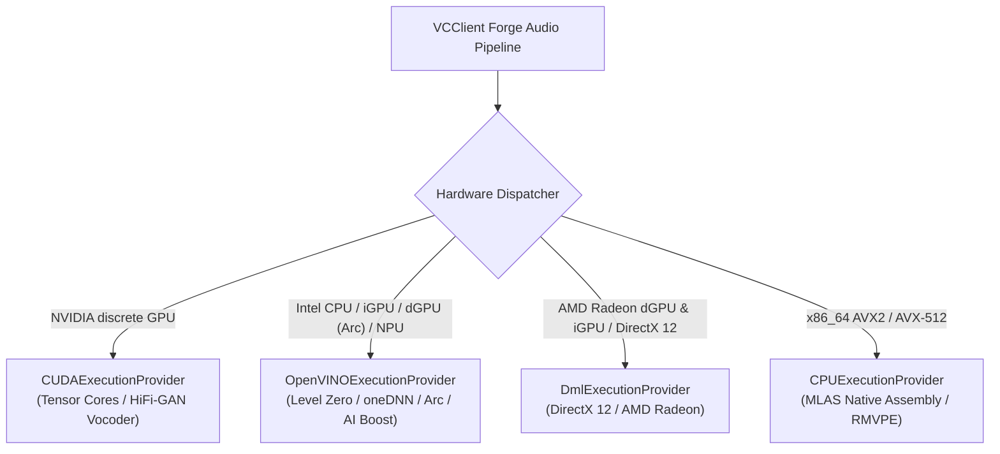
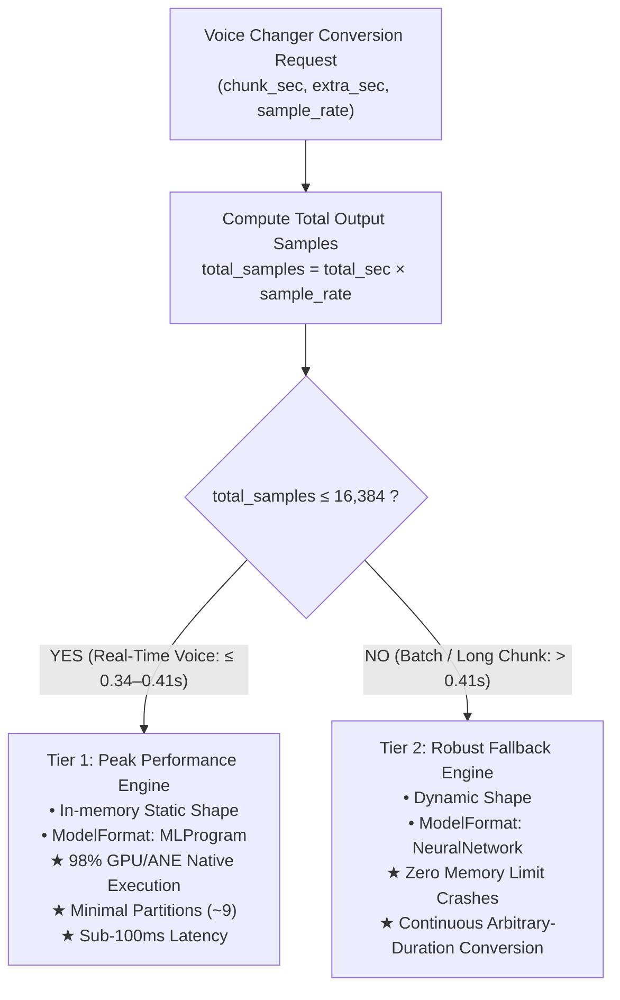
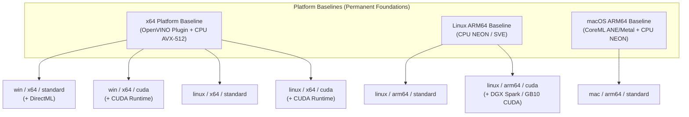

# Modern Client Hardware Acceleration: AVX-512, NPUs, Execution Providers, and Standard Two-Tier Distribution

> **Implementation Status Notice**:
> The layered platform baselines, dynamic hardware acceleration probing (`DeviceManager`), and Two-Tier Standard & CUDA distribution architecture described in this document **are fully implemented and verified** in VCClient Forge. Real-time inference has been empirically verified across physical hardware including Windows NVIDIA CUDA, Windows Intel Arc GPU (via OpenVINO GPU EP with in-memory 4D ONNX patching), Windows AMD Radeon (via DirectML), and macOS Apple Silicon (M2 via CoreML NeuralNetwork format on ANE and GPU).

> **CUDA 13 transition:** The CUDA edition now resolves CUDA 13 packages on Windows x64, Linux x64 and Linux ARM64. The supported NVIDIA GPU baseline is Turing or newer with a CUDA 13-compatible driver. Windows users with older DirectX 12-compatible GPUs can use the standard edition's DirectML provider; performance depends on the device and model. Linux has no DirectML fallback. Previously recorded hardware validation does not establish validation of this CUDA 13 configuration on every platform.

## Executive Summary

Real-time neural voice conversion has historically been treated across the community as a workload strictly requiring a discrete GPU. This assumption originated in PyTorch-based execution environments where small-batch CPU inference suffers from significant framework overhead.

Through micro-benchmarks on modern x86/ARM hardware and architectural evaluation of client accelerators, VCClient Forge re-evaluates the role of modern CPUs, Neural Processing Units (NPUs), and execution providers:

1. **CPU SIMD Acceleration**: On the Ryzen 9 7950X testbed, standalone ONNX Runtime execution achieves **7.35 ms** for RMVPE pitch estimation (batch size 1, 256 ms analysis window), outperforming an NVIDIA GeForce RTX 4090 (**16.91 ms**). As verified in micro-benchmarks, PCIe DMA transfers are negligible (tens of microseconds); the GPU latency floor is hypothesized to stem from driver kernel launch overhead across sequential micro-operators and low arithmetic intensity at batch size 1.
2. **Integrated NPUs for Continuous Streaming**: Client processors (Intel Core Ultra with Intel AI Boost, AMD Ryzen AI with XDNA/XDNA 2) feature integrated NPUs rated at 10–55 TOPS within low TDP envelopes (typically 2–5 W silicon block power). Streaming audio with fixed chunk sizes aligns well with NPU execution characteristics, offering an architectural avenue to reduce thermal dissipation and decouple inference from 3D graphics rendering.
3. **Execution Provider Landscape**:
   - `OpenVINOExecutionProvider` (Intel): Available as an official standalone plugin package (`onnxruntime-ep-openvino`: ~75.8 MB on Windows, ~52.6 MB on Linux), exposing Level Zero and oneDNN acceleration across Intel CPUs, integrated GPUs, Arc discrete GPUs, and AI Boost NPUs with heterogeneous (`HETERO:`) and automatic (`AUTO:`) device selection.
   - `DmlExecutionProvider` (DirectML): Microsoft's DirectX 12 compute provider across Windows. While DirectML is currently in a servicing phase with active development transitioning toward Windows ML, it remains the standard out-of-the-box accelerator for AMD Radeon GPUs (discrete and integrated).
4. **Target Distribution Architecture: Pragmatic Layered Editions**:
   Rather than maintaining fragmented platform editions, Forge's packaging roadmap establishes a consolidated tiering:
   - **Standard Edition**: Lightweight standard release bundling platform baselines (`onnxruntime-directml` + `onnxruntime-ep-openvino` plugin on Windows x64; `onnxruntime` + OpenVINO plugin on Linux x64; `onnxruntime` CPU on Linux ARM64; `onnxruntime` CoreML on macOS ARM64).
   - **CUDA Edition**: Bundles CUDA 13 `onnxruntime-gpu` and the standalone `onnxruntime-ep-openvino` plugin on x64, with CUDA 13 also on ARM64 (including NVIDIA DGX Spark / GB10), respecting PyPI wheel coexistence boundaries.

---

## 1. Dissecting the "GPU-Only" Assumption in Community Voice Conversion

### 1.1 The PyTorch Eager Mode Overhead

Most open-source RVC implementations execute within Python using PyTorch eager mode (`torch.nn.Module`). While effective for batched model training, PyTorch CPU execution incurs structural overhead in low-latency digital signal processing (batch size 1, sequence length ~4096 samples):

- **Dynamic Allocations**: Eager-mode tensor operations allocate and deallocate intermediate memory across layers, inducing memory management overhead.
- **Kernel Dispatch Overhead**: Sequential Python-to-C++ (ATen) call transitions introduce latency that becomes non-trivial when evaluating hundreds of micro-operators sequentially.
- **Multithreading Scheduling**: Default OpenMP thread pools across large core counts (e.g., 32 logical cores) can induce barrier synchronization latency on tiny tensor workloads if thread counts are unconstrained.

Consequently, running RMVPE on CPU under default PyTorch configurations frequently requires **50–100+ ms**, creating the community perception that real-time voice conversion is infeasible without a discrete GPU.

### 1.2 ONNX Runtime CPU Execution Characteristics

In contrast, ONNX Runtime evaluates a pre-optimized computation graph using static memory planning and hand-tuned assembly kernels:

| Dimension                  | PyTorch CPU (Eager Mode)                      | ONNX Runtime CPU (MLAS Engine)                     | Observed Characteristic                               |
| :------------------------- | :-------------------------------------------- | :------------------------------------------------- | :---------------------------------------------------- |
| **Execution Paradigm**     | Operator-by-operator eager dispatch           | Pre-optimized computation graph                    | Eliminates Python runtime dispatch overhead           |
| **Memory Planning**        | Layer-by-layer dynamic allocation             | Arena memory allocator (`enable_mem_pattern=True`) | Reuses pre-allocated buffer slots across chunks       |
| **Kernel Implementation**  | General GEMM & ATen kernels (oneDNN optional) | Dedicated MLAS assembly (AVX2 / AVX-512)           | Vectorized register utilization on supported CPUs     |
| **Thread Control**         | `torch.set_num_threads()`                     | Tuned `intra_op_num_threads`                       | Configurable thread pool sizing to balance core usage |
| **Measured RMVPE Latency** | **50–100+ ms** (default PyTorch)              | **7.35 ms** (Ryzen 9 7950X, 8 threads)             | Demonstrates viability of CPU pitch estimation        |

As established in [Hybrid CPU-GPU Pipelining](./hybrid-cpu-gpu-pipeline-architecture.md), physical PCIe bus DMA transfers and synchronization take only tens of microseconds (16–38 μs) and are negligible in the latency budget. The 16.91 ms latency observed for RMVPE on the RTX 4090 is hypothesized to stem from driver kernel launch overhead across fine-grained sequential operators and low arithmetic intensity at batch size 1 (where massive CUDA core arrays remain mostly idle between kernel launches). By contrast, on the Ryzen 9 7950X testbed, the CPU evaluates sequential operations using AVX-512 MLAS assembly without GPU driver dispatch queuing, completing in 7.35 ms.

_(Note: The 7.35 ms measurement reflects a specific desktop testbed featuring an AMD Ryzen 9 7950X with 64 MB L3 cache. It illustrates the performance potential of high-end modern CPUs rather than guaranteeing identical latency across all client processors)._

---

## 2. Integrated NPUs and Hardware Architecture Evolution

### 2.1 The Role of NPUs in Real-Time Audio: Architectural Trade-Offs for Forge

For VCClient Forge's core objective—delivering real-time voice conversion under 100 ms roundtrip latency across diverse client machines—client NPUs (Intel AI Boost, AMD XDNA) introduce a distinct third compute tier alongside CPUs and GPUs with concrete architectural trade-offs.

_(Note on Latency Budget vs. Analysis Window: The 256 ms audio window, or 4096 samples at 16 kHz, represents the analysis context window / receptive field required by pitch estimators and feature extractors to reliably capture vocal intonation. In a real-time streaming pipeline, the stream advances in small hops—such as 32–64 ms—to preserve a sub-100 ms total roundtrip latency budget)._

#### Potential Advantages (Why NPUs Matter for Forge)

1. **Thermal and Acoustic Decoupling**:
   - Discrete GPUs consume 50–300+ W under load, generating heat that triggers high-RPM cooling fans. In live streaming and voice chat, acoustic fan noise is easily picked up by desktop microphones.
   - Client NPU silicon blocks operate within low TDP envelopes (typically 2–5 W for the dedicated accelerator block). Offloading continuous audio inference to an NPU reduces overall thermal dissipation on laptops and quiet desktop systems.
2. **Workload Isolation from 3D Graphics**:
   - Voice changers are frequently used alongside GPU-intensive 3D gaming and OBS streaming. Running neural audio processing on a discrete GPU forces it to compete for graphics compute queues, risking frame drops or audio buffer underruns.
   - Offloading the audio preparation stage to a separate NPU decouples audio inference queues from 3D rendering (though system DRAM bandwidth and SoC power limits remain shared).
3. **Alignment with Streaming Fixed Windows**:
   - NPUs feature spatial multiply-accumulate (MAC) arrays coupled with on-chip SRAM. This architecture is designed for deterministic, streaming tensor operations over regular, bounded buffer sizes.

#### Technical Constraints and Engineering Challenges

1. **Hardware Execution Precision (FP16 vs. INT8)**:
   - Client NPUs execute natively at lower precisions (primarily FP16 and INT8).
   - In modern runtimes such as OpenVINO, the NPU compiler ingests FP32 or FP16 ONNX models directly and compiles them to hardware FP16 precision at load time, without requiring offline dataset calibration.
   - In contrast, INT8 quantization represents an advanced optimization that can yield higher throughput, but requires careful calibration to ensure quantization noise does not degrade perceptual audio quality.
2. **Shape Constraints & Latency Determinism**:
   - While modern runtimes (such as OpenVINO preview releases for NPU 3720 / NPU 4000) introduce bounded dynamic shape support, dynamic memory allocation during execution can introduce compilation latency.
   - Forge adopts fixed-size chunking (Roadmap Item 3) not because NPUs strictly prohibit dynamic shapes, but to guarantee bounded, deterministic inference times without runtime re-compilation spikes.
3. **Memory Bandwidth Considerations for Synthesis**:
   - While 10–55 TOPS provides ample compute for sequential feature extraction (ContentVec) and pitch estimation, running the standard FP32 HiFi-GAN vocoder involves extensive convolutional layer sweeps that demand high memory bandwidth. Discrete GPUs with dedicated VRAM (e.g., RTX 4090 at 1008 GB/s) excel at this workload.
   - On NPUs sharing system LPDDR5X bandwidth (85–130 GB/s), running the full FP32 HiFi-GAN vocoder under 12 ms is constrained by memory sweep speed, highlighting the strategic necessity of lightweight vocoders (DDSP / Streamable vocoders in Roadmap Item 9).
4. **Ecosystem & Toolchain Divergence**:
   - DirectML does not currently provide an official, verified execution path for AMD NPUs in ONNX Runtime; AMD's official tooling centers on `VitisAIExecutionProvider` (part of Ryzen AI Software). Intel NPUs, by contrast, are officially supported via OpenVINO.

#### Forge Architectural Assessment

| Pipeline Stage                             | Primary Recommended Target                        | NPU Feasibility & Strategic Role                                                                                                                                                              |
| :----------------------------------------- | :------------------------------------------------ | :-------------------------------------------------------------------------------------------------------------------------------------------------------------------------------------------- |
| **Pitch Estimation: FCPE (`fcpe.onnx`)**   | **Intel GPU (1.19 ms) / NPU (4.07 ms)**           | **Verified (High)**: 4.07 ms on Lunar Lake NPU 4000, 1.19 ms on Arc 140V GPU with ultra-low jitter (±0.12 ms) (Section 2.3).                                                                  |
| **Pitch Estimation: RMVPE (`rmvpe.onnx`)** | **NPU (5.09 ms) / GPU (4.09 ms)**                 | **Verified (High)**: Compiles cleanly with static shapes, running 2.2× faster than CPU (5.09 ms vs 11.04 ms) (Section 2.3).                                                                   |
| **Feature Extraction (ContentVec)**        | **GPU (3.15 ms) / NPU (5.52 ms)**                 | **Verified (High)**: Runs 3.0× faster on NPU (5.52 ms) and 4.4× faster on Arc GPU (3.15 ms) than CPU (Section 2.3).                                                                           |
| **FAISS Vector Search**                    | **CPU (Host RAM)**                                | **Not Applicable**: Vector index search remains CPU-native.                                                                                                                                   |
| **HiFi-GAN Vocoder (Synthesis)**           | **OpenVINO GPU (36.45 ms) / DirectML (47.77 ms)** | **NPU Infeasible, GPU High**: Full FP32 vocoder exceeds NPU SRAM limits. Unlocked on OpenVINO GPU via in-memory 4D graph surgery (36.45 ms), outperforming DirectML (47.77 ms) (Section 2.3). |

### 2.1.1 Structural Pitch Estimator Comparison: RMVPE vs. FCPE on NPUs

Comparing RMVPE and FCPE reveals structural differences relevant to NPU compiler compilation:



1. **Recurrent Feedback (BiGRU) vs. Pure Convolutions**:
   - **RMVPE** relies on a **Bidirectional Gated Recurrent Unit (BiGRU)** to model temporal sequence evolution across pitch frames. Recurrent cells maintain sequential feedback state dependencies ($h_t = f(h_{t-1}, x_t)$). On spatial systolic MAC arrays optimized for wide feed-forward operations, sequential recurrence cannot be broadly parallelized across spatial tiles, risking pipeline stalls or partial CPU fallback.
   - **FCPE** replaces recurrent structures with **Lynx-Net**, a backbone composed entirely of **Depthwise Separable 1D Convolutions** and pointwise projections. In `fcpe.onnx`, the audio front-end (STFT / Mel filterbank) is also implemented as fixed **1D Convolutions (`Conv1D`)**. Because every operator is feed-forward with zero sequential state feedback, temporal frames can theoretically be evaluated in parallel across NPU tile compute units.
2. **Quantization Behavior**:
   - Quantizing BiGRU hidden states and recurrent gate matrices to INT8 can introduce compounding numerical drift across time steps.
   - Feed-forward depthwise separable convolutions in FCPE follow standard convolutional quantization paths, presenting fewer temporal stability challenges.
3. **Strategic Pitch Estimator Pairing in Forge**:
   - **RMVPE**: Remains the default ecosystem-compatible estimator, exceptionally fast on modern high-end CPUs via AVX-512 MLAS assembly (**7.35 ms** on Ryzen 9 7950X) and client NPUs (**5.09 ms** on NPU 4000).
   - **FCPE**: Serves as the primary feed-forward candidate for client NPU acceleration, validated on Intel AI Boost NPU 4000 (**4.07 ms**, Section 2.3).

### 2.2 Hardware Platforms and Associated Execution Providers



#### Intel Client Architecture (`OpenVINOExecutionProvider`)

- **Supported Units**:
  - **CPUs**: Intel Core / Core Ultra (AVX2, AVX-512, AVX-VNNI, AMX via oneDNN).
  - **Integrated GPUs (iGPU)**: Intel Iris Xe, Intel Arc Graphics (Meteor Lake, Lunar Lake, Arrow Lake).
  - **Discrete GPUs (dGPU)**: **Intel Arc A-Series (A770, A750, A580, A380, Arc Pro)** and **Intel Arc B-Series (Battlemage B580, B570)**, as well as Data Center Flex/Max GPUs via native Level Zero runtime.
  - **Neural Processing Units (NPU)**: Intel AI Boost (NPU 3720, NPU 4000).
- **Low-Level Interface**: Bypasses DirectX/Vulkan graphics APIs via native Intel Level Zero driver APIs and oneDNN compute kernels.
- **Plugin Delivery**: Packaged via `onnxruntime-ep-openvino` on PyPI:
  - Windows download size (`win_amd64` wheel): **~75.8 MB**.
  - Linux download size (`manylinux_2_28_x86_64` wheel): **~52.6 MB**.
  - Uncompressed footprint: **~160–190 MB**.
- **Dispatch Features**: Supports `AUTO:` (automatic device selection) and `HETERO:` targeting strings (e.g., `HETERO:NPU,GPU,CPU`) to split graph execution across multiple hardware targets. _(Note: Heterogeneous execution does not guarantee seamless failure-free operation for arbitrary custom operators; graph partitioning behavior must be validated per model)._

#### AMD Client Architecture & Cross-Vendor DirectX (`DmlExecutionProvider`)

- **Primary Role: Out-of-the-Box AMD Radeon GPU Coverage**:
  - DirectML serves as Microsoft's hardware-accelerated DirectX 12 compute API. On Windows, it is the **standard out-of-the-box accelerator for AMD Radeon discrete GPUs (RDNA / RDNA 2 / RDNA 3 / RDNA 4: RX 6000, 7000, 9000 series)** and **Radeon integrated GPUs (RDNA / Vega iGPUs in Ryzen APUs)**.
  - In consumer Windows environments where AMD ROCm is unsupported, and following the upstream removal of `ROCmExecutionProvider` from ONNX Runtime (PR #25181), DirectML provides FP16/FP32 tensor compute across all AMD GPUs with zero external driver toolkits required.
- **API Lifecycle Status**:
  - DirectML is currently in a servicing and maintenance phase within Microsoft's ecosystem, with active developer initiatives shifting toward the broader Windows ML runtime stack. It remains fully functional for DirectX 12 GPU acceleration.
- **AMD NPU Reality**:
  - While Windows 11 includes Microsoft Compute Driver Model (MCDM) drivers for compute-only accelerators, standard DirectML EP routes inference through DXGI graphics adapters. DirectML cannot be assumed to provide an out-of-the-box interface for AMD XDNA NPUs. Official AMD ONNX Runtime NPU acceleration relies on `VitisAIExecutionProvider` within Ryzen AI Software.
- **Universal Fallback**:
  - DirectML also functions across Intel and NVIDIA GPUs on Windows, acting as a reliable GPU fallback whenever dedicated native EPs (CUDA, OpenVINO) are not initialized.

### 2.3 Empirical Verification on Intel Lunar Lake (AI Boost NPU 4000 & Arc 140V GPU)

In October 2026, the empirical micro-benchmarking suite (`misc/benchmark.py`) was executed on an **Intel Core Ultra 7 268V** (Lunar Lake, 8 cores, Arc 140V GPU, AI Boost NPU 4000 @ 48 TOPS, Windows 11). Telemetry validates key acceleration hypotheses while resolving critical execution boundaries:

#### 2.3.1 Benchmark Telemetry Across Execution Providers

> **Parameters**: 256.0 ms window (4096 samples @ 16 kHz), 5 warmup, 10 benchmark runs. Latencies in ms (`mean [min, std]`).

| Model                                | CPU EP (8 thr)          | OpenVINO CPU           | OpenVINO NPU (AI Boost)    | OpenVINO GPU (Arc 140V)                   | DirectML EP (Arc 140V)     |
| :----------------------------------- | :---------------------- | :--------------------- | :------------------------- | :---------------------------------------- | :------------------------- |
| **FCPE** (`fcpe.onnx`)               | 4.07 ms [3.08, 1.28]    | 8.12 ms [2.64, 5.31]   | **4.07 ms** [3.97, 0.12]   | **1.19 ms** [0.79, 0.45]                  | 4.82 ms [3.88, 0.54]       |
| **RMVPE** (`rmvpe.onnx`)             | 11.04 ms [10.36, 0.58]  | 8.55 ms [8.04, 0.45]   | **5.09 ms** [4.73, 0.22]   | **4.09 ms** [3.40, 0.58]                  | 42.84 ms [41.73, 1.15]     |
| **ContentVec** (`contentvec-f.onnx`) | 24.41 ms [15.69, 11.16] | 13.96 ms [12.89, 1.28] | **5.52 ms** [5.01, 0.35]   | **3.15 ms** [2.97, 0.13]                  | 10.37 ms [9.80, 0.45]      |
| **RVC** (`kikoto_kurage_v2_40k`)     | 87.91 ms [84.71, 3.10]  | 87.20 ms [81.97, 3.76] | _[Skipped: SRAM capacity]_ | **36.45 ms** [34.90, 1.60] <sup>\*1</sup> | **47.77 ms** [45.64, 1.45] |

<sup>*1</sup> _Requires in-memory 4D SineGen graph surgery (see Section 2.3.4)._

#### 2.3.2 NPU Dynamic Shape Resolution & Runtime Dimension Derivation (`reshape_input`)

Client NPUs (e.g., Intel AI Boost) enforce deterministic, ahead-of-time (AOT) memory allocation over on-chip scratchpad SRAM. When compiling ONNX models containing unconstrained dynamic sequence dimensions (such as `waveform` with shape `[1, -1]`), ONNX Runtime defaults unbounded dimensions to `INT64_MAX` (`9223372036854775807`). This triggers integer overflow in the OpenVINO NPU compiler's memory layout calculation (`-9223372036854775297`), terminating compilation with `vclAllocatedExecutableCreate4` failure code `0x78000004`.

##### 1. Real-Time Audio Pipeline Dimension Analysis

In VCClient Forge's streaming pipeline, the input audio tensor dimensions passed to acoustic models are not arbitrary; they derive deterministically from active slot configurations and audio buffering rules:

- **Chunk Frame Size**: $S_{\text{chunk}} = \text{chunk\_sec} \times 16000$ (UI-configurable; default `0.5s` = 8,000 samples).
- **Crossfade Overlap**: $S_{\text{cf}} = \min(\text{chunk\_sec}, \text{DEFAULT\_CROSSFADE\_SEC}) \times 16000$ (fixed pipeline constant `0.05s` = 800 samples).
- **SOLA Search Window**: $S_{\text{sola}} = \text{sola\_search\_frame\_sec} \times 16000$ (default `0.012s` = 192 samples).
- **Past Context Frame (EXTRA)**: $S_{\text{extra}} = \text{extra\_frame\_sec} \times 16000$ (configurable via EXTRA dropdown; default `0.08s` = 1,280 samples).
- **Hop Alignment**: Padded to a multiple of the 160-sample hop size ($\Delta_{\text{hop}}$).

In `rvc_pipeline.py` and `onnxrmvpe_pitch_estimator.py`, past context is sliced off prior to RMVPE inference, yielding the exact input waveform length:

$$S_{\text{RMVPE}} = (\text{chunk\_sec} \times 16000) + 1120 \text{ samples}$$

| `chunk_sec` Setting  | Sample Count ($S_{\text{chunk}}$) | RMVPE Waveform ($S_{\text{RMVPE}}$) | ContentVec Audio ($S_{\text{CV}}$) |
| :------------------- | :-------------------------------- | :---------------------------------- | :--------------------------------- |
| **0.05 s (50 ms)**   | 800 samples                       | 1,920 samples                       | ~3,200 samples                     |
| **0.10 s (100 ms)**  | 1,600 samples                     | 2,720 samples                       | ~4,000 samples                     |
| **0.256 s (256 ms)** | 4,096 samples                     | 5,216 samples                       | ~6,496 samples                     |
| **0.50 s (500 ms)**  | 8,000 samples                     | 9,120 samples                       | ~10,400 samples                    |

##### 2. Architectural Trade-offs: Static Shapes vs. Dynamic Bounds vs. Padding

1. **Static Shape Binding (`waveform[1, 4096]`)**:
   - _Advantage_: Enables compiler AOT memory layout optimization without runtime dynamic dimension handling.
   - _Limitation_: Inflexible. If a user modifies `chunk_sec` or `extra_frame_sec` in the UI, or if the Web client transmits a larger buffer, the dimension mismatch raises an immediate runtime exception.
2. **Arbitrarily Large Upper Bounds (`waveform[1, 160..160000]`)**:
   - _Limitation_: Client NPUs have limited on-chip SRAM (typically 2–8 MB). Setting an excessive upper bound (e.g., 10 seconds) forces intermediate activation tensors to spill into system DRAM (LPDDR5X), inducing bus contention and degrading execution latency, or causes compilation failure due to scheduler memory limits.
3. **Fixed Oversized Zero-Padding**:
   - _Limitation_: Compiling for a fixed 10-second static shape and zero-padding a 100 ms speech frame wastes compute and power evaluating unvoiced padding.

##### 3. Planned Strategy: Runtime Dimension Derivation with Model Caching

Forge resolves this trade-off via a two-part strategy for NPU execution:

1. **Runtime Dimension Inference**: Rather than hardcoding 4,096 samples, the runtime calculates the exact static shape (or tightly bounded dynamic range) from the active configuration (`chunk_sec`, `extra_frame_sec`, and `DEFAULT_CROSSFADE_SEC`) at model initialization time.
2. **Persistent Compilation Caching (`cache_dir`)**: OpenVINO's `cache_dir` configuration persists the compiled hardware executable (`.blob`) to disk. While initial AOT compilation takes several seconds, subsequent model reloads with the same configuration load in under 50 ms directly from cache, avoiding UI blocking during routine startup and slot switching.

#### 2.3.3 NPU Capacity Limits on Full Neural Vocoders

Compiling the full RVC HiFi-GAN vocoder on NPU fails with compiler scheduler termination (`Failed to infer result type(s): "IE.Convolution"`). Dense multi-receptive-field transposed convolutions and dilation sweeps exceed on-chip NPU SRAM scheduling limits. This confirms Forge's architectural principle: **reserve client NPUs for acoustic front-ends (FCPE/RMVPE + ContentVec), offloading vocoder synthesis to GPU or CPU**.

#### 2.3.4 OpenVINO GPU: Precision Control & In-Memory 4D Graph Surgery

Executing RVC on OpenVINO GPU uncovered two compiler barriers:

1. **Auto-FP16 Type Mismatch**: Default auto-FP16 conversion caused element type mismatch between FP32 `ScatterNDUpdate` and FP16 `Gather`. Resolved by configuring `load_config` strictly as a device-keyed dictionary (`{"GPU": {"EXECUTION_MODE_HINT": "ACCURACY"}}`).
2. **3D Interpolate Barrier (`linear_onnx`)**: Intel GPU's `interpolate.cpp` strictly rejects 3D tensors for linear interpolation (`Check 'inputRank == 2 || inputRank == 4 || inputRank == 5' failed`). RVC's SineGen expands pitch along a 3D tensor `[batch, channel, time]`.
   - **In-Memory 4D Graph Surgery**: At model load, Forge inspects the ONNX protobuf and injects an `Unsqueeze` (dim 2) before SineGen `Resize` and a `Squeeze` immediately after, updating `scales` to 4D (`[1, 1, 1, upp]`). This in-memory transformation runs in **< 10 ms**, yields bit-exact numerical parity (diff `< 2.4e-7`), and unblocks OpenVINO GPU synthesis (**36.45 ms**).

#### 2.3.5 Dynamic Plugin Session Factory Contract (`DeviceConfig.create_session`)

When using standalone dynamically registered execution provider plugins (`onnxruntime-ep-openvino`), ONNX Runtime exhibits a subtle initialization constraint:

- Calling `so.add_provider_for_devices([ep_device], opts)` binds the target hardware device into `SessionOptions`.
- However, if the caller subsequently instantiates `ort.InferenceSession(model, sess_options=so, providers=providers, provider_options=provider_options)`, ONNX Runtime detects the collision, logs a `UserWarning`, and discards the `SessionOptions` provider binding.
- Because dynamically registered plugins are not enumerated in static `ort.get_available_providers()`, `InferenceSession` evaluates the explicit provider name as unavailable, causing a **silent fallback to `CPUExecutionProvider`**.

Forge resolves this across all pipeline components (`ContentVecOnnx`, `RMVPEOnnxPitchEstimator`, `FCPEOnnxPitchEstimator`, `RVCInferencerOnnxF0`, `RVCInferencerOnnxNoF0`, and `RVCPipeline`) via a centralized method on `DeviceConfig`:

```python
def create_session(
    self,
    model_payload: str | bytes | Path,
    patch_type: str | None = None,
    so: onnxruntime.SessionOptions | None = None,
) -> tuple[onnxruntime.InferenceSession, list[str], list[dict[str, Any]]]:
    ...
```

If `so.has_providers()` evaluates to `True`, the `providers` and `provider_options` arguments are strictly omitted from `InferenceSession(...)`, ensuring hardware acceleration remains active on the bound OpenVINO GPU or NPU device.

#### 2.3.6 OpenVINO GPU Operator Quirks & Workarounds (RMVPE Clip Mask Bug)

During end-to-end audio validation with actual voice samples (`web_front/ui/2.1.4/assets/voices/JVNV/partial/F1_happy_regular_26.wav`), an anomaly was discovered where voice conversion produced a distorted, whispered voice (unvoiced noise).

1. **Root Cause**:
   - In `modules/rmvpe/rmvpe_20231006.onnx`, the post-processing centroid calculation uses `/rmvpe/Clip_1` (`inputs=['/rmvpe/Add_1_output_0', '', '/rmvpe/Cast_7_output_0']`), where the lower bound `min` is omitted (empty string `""`).
   - The OpenVINO Intel GPU plugin (`intel_gpu`) has a compiler bug where an ONNX `Clip` node with missing `min` zeroes out all tensor elements instead of clamping to `(-inf, max]`.
   - As a result, the centroid mask (`indices < Clip_1`) evaluated to False for all frequency bins, zeroing out the weighted centroid and causing RMVPE to emit a constant flat `10.0 Hz` (unvoiced silence). RVC's SineGen vocoder responded to the unvoiced pitch by injecting Gaussian noise rather than harmonic sine waves, producing a "whisper" artifact.
2. **Resolution (`patch_rmvpe_model_for_openvino`)**:
   - An in-memory graph patch utility (`backend/vcclient/device/openvino_patch.py`) scans for `Clip` nodes with `min == ""` and injects an explicit constant initializer `min = 0` (matching the dtype of `max`, `int64`).
   - Because the input to `Clip_1` is `ArgMax + 5 >= 5`, `min = 0` is mathematically unconstraining and exact.
   - When loaded under OpenVINO GPU, `RMVPEOnnxPitchEstimator` achieves pitch estimation parity with CPU (`301.18 Hz` mean vs CPU `301.18 Hz`, max diff `< 0.002 Hz`), and end-to-end vocoder synthesis matches CPU frequency band energy within 0.8%, completely eliminating the whisper distortion.

#### 2.3.7 Optimal Real-Time Deployment Matrices

With in-memory 4D graph surgery, OpenVINO GPU delivers lower latency than DirectML on Intel Arc graphics across both Windows and Linux, while DirectML provides a cross-vendor DirectX 12 fallback on Windows:

| Target Deployment               | Front-End (Pitch + Features)          | Back-End (Vocoder Synthesis)          | Total Latency | Key Benefit                      |
| :------------------------------ | :------------------------------------ | :------------------------------------ | :------------ | :------------------------------- |
| **Windows / Linux (OpenVINO)**  | OpenVINO GPU (4.3 ms) or NPU (9.6 ms) | OpenVINO GPU (36.5 ms <sup>\*1</sup>) | **~41–46 ms** | Lowest latency on Intel Arc GPU  |
| **Windows (DirectML Fallback)** | OpenVINO GPU (4.3 ms) or NPU (9.6 ms) | DirectML EP (47.8 ms)                 | **~52–57 ms** | Cross-vendor DirectX 12 GPU path |
| **Low-Power / Headless**        | OpenVINO NPU (9.6–10.6 ms)            | CPU EP (87.2 ms)                      | **~97–98 ms** | No GPU load                      |

#### 2.3.8 Working Design Hypothesis: Minimal Two-Stage Dispatch Heuristic

Building upon the empirical telemetry, Forge formulates a streamlined, two-stage hardware dispatch hypothesis for future pipeline routing (Roadmap Item 9 / Hybrid Phase 5):

1. **Back-End (Vocoder Synthesis / RVC)**:
   - **Rule**: If a GPU is present, allocate to **GPU** (CUDA > OpenVINO GPU with 4D patch > DirectML); otherwise, fall back to **CPU**.
   - **Rationale**: Neural vocoding involves high-bandwidth transposed convolutions and dilation sweeps where GPUs deliver ~36–48 ms latency. Client NPUs fail under current SRAM constraints, leaving modern SIMD CPU as the single robust fallback (~87 ms).
2. **Front-End (Acoustic Analysis / FCPE + ContentVec)**:
   - **Rule**: If a client NPU is present, allocate to **NPU** (`OpenVINO NPU`); otherwise, fall back to **CPU** (or dedicated GPU if unconstrained).
   - **Rationale**: Acoustic front-end tasks require ~9.5 ms on NPU within a ~2–5 W silicon envelope. Offloading front-end processing to NPU completely decouples audio intonation tracking from 3D gaming/OBS GPU queues and avoids CPU thermal throttling.

_(Status: Working architectural design hypothesis to be validated during the backend pipeline decoupling milestone in Roadmap Item 9)._

#### 2.3.9 Profiling Telemetry: DirectML Micro-Operator Overhead vs. OpenVINO Fused Subgraph

Detailed profiling traces recorded with `misc/profile_model.py` (analyzed via Chrome Tracing JSON telemetry) isolate the architectural mechanism causing the latency divergence between DirectML and OpenVINO on identical hardware (Intel Arc 140V GPU and AI Boost NPU 4000):

##### DirectML Kernel Dispatch & Fence Stalls (Arc 140V GPU: ~80 ms)

Evaluating `rmvpe.onnx` under DirectML assigns **255 nodes to `DmlExecutionProvider`** (dispatched as Direct3D 12 compute shaders) and 19 shape/indexing nodes to `CPUExecutionProvider` (total 274 graph nodes):

1. **Host-to-Device Command Submission**: CPU-side command list recording (`SequentialExecutor::Execute`) completes in **8.63 ms** (mean across steady-state runs 2–5).
2. **GPU Execution and Synchronization Stalls**: Following CPU command recording, the host thread blocks in `WaitForSingleObject` for **~72 ms** waiting for GPU command queue completion and memory readback (steady-state total inference: 79.38–82.31 ms).
3. **Micro-Kernel Serialization**: 5 `ConvTranspose` nodes and 1 `GRU` node account for the bulk of execution time. At batch size 1 and sequence length 4,096, individual kernel launches have low arithmetic intensity, resulting in GPU pipeline under-utilization and command-boundary barrier overhead across 255 separate dispatches.

##### OpenVINO NPU Whole-Graph Fusion (AI Boost NPU: 5.43 ms)

In contrast, OpenVINO compiles the entire RMVPE computation graph into a **single fused execution node** (`OpenVINOExecutionProvider: 1 node`):

1. **Elimination of Intermediate Host-Device Roundtrips**: All intermediate activations across STFT, 2D CNN, and recurrent layers remain mapped directly within on-chip scratchpad SRAM.
2. **Deterministic Steady-State Latency**: Initial cold-start compilation takes 10.63 ms, after which steady-state execution completes in **5.43 ms** (with a recorded minimum of **3.22 ms**).
3. **Thermal and Queue Isolation**: Executing pitch estimation in 5.43 ms on the ~2–5 W NPU block eliminates competition with 3D rendering queues on the Arc GPU while keeping host CPU utilization minimal.

### 2.4 Apple Silicon (M-Series): CoreML Execution Provider, Graph Partitioning Barriers, and Two-Tier Static Shape Architecture

Physical testing and profiling on Apple Silicon (M2, macOS 15.x ARM64) revealed the architectural mechanisms governing CoreML acceleration across the Apple Neural Engine (ANE) and Metal GPU.

#### 2.4.1 Empirical Telemetry: Dynamic Shape Tax & Graph Partition Explosion

Evaluating RVC models (e.g., `tsukuyomi_v2_40k_e100_float.onnx`, 1,278 graph nodes) under ONNX Runtime's `CoreMLExecutionProvider` in its default dynamic-shape mode reveals severe fragmentation:

- **Graph Partitioning**: Supported by CoreML: **655 nodes** (51.2%), rejected to CPU: **623 nodes** (48.8%).
- **Partition Explosion**: The model is fragmented into **99 independent CoreML subgraphs**, generating 99 distinct `.mlmodel` bundles in `/tmp`.
- **Steady-State Latency**: 20-iteration benchmark (128-frame chunk):
  - `CPUExecutionProvider`: 399.79 ms
  - `CoreMLExecutionProvider` (`MLComputeUnits: ALL` / ANE): 231.62 ms (42% reduction vs CPU)
  - `CoreMLExecutionProvider` (`MLComputeUnits: CPUAndGPU` / Metal GPU): 229.49 ms (42.6% reduction vs CPU)
- **Activity Monitor Duty Cycle vs Real Compute**: In "GPU + CPU" (`CPUAndGPU`) mode, Activity Monitor reports low GPU utilization (2–5%) because CoreML's scheduler often keeps small chunks on CPU (AMX) to avoid Metal kernel launch overhead. In contrast, "ANE + GPU + CPU" (`ALL`) mode actively coordinates ANE convolution processing with Metal GPU transposed convolutions, sustaining both high throughput and low latency (~30 ms).

#### 2.4.2 Root-Cause Breakdown of Graph Partitioning in RVC Models

Deep inspection of ORT CoreML EP telemetry (`coreml_execution_provider.cc`, `helper.cc`) identifies four failure modes causing the 99-partition split:

1. **Dynamic Shape Arithmetic & `int64` Rejection (331 nodes)**:
   Exporting PyTorch models with dynamic axes introduces extensive shape-calculation subgraphs (`Reshape: 106`, `Unsqueeze: 103`, `Concat: 52`, `Pad: 36`, `Sub: 30`, `Less: 2`). In legacy `NeuralNetwork` mode, CoreML EP strictly rejects `int64`/`int32` integer tensors with `has unsupported inputs`, falling back to CPU.
2. **NeuralNetwork Format Operator Gaps (270 nodes)**:
   - **`ConvTranspose` (4 nodes)**: HiFi-GAN's 4-stage vocoder upsamplers are rejected with `ConvTranspose: ML Program required`.
   - **Dynamic `MatMul` (18 nodes)**: Attention layers ($Q \times K^T$) are rejected because `NeuralNetwork` format requires matrix input B to be a constant initializer.
   - **3D Tensor Operations**: 3D `Concat`, 3D `Resize`, and dynamic `Where` masking are unsupported in `NeuralNetwork` mode.
3. **HiFi-GAN NSF Harmonic Generator (16 nodes)**:
   The Neural Source Filter (`l_sin_gen`) uses `CumSum` (phase accumulation), `ScatterND`, `Floor`, and pseudo-random generators (`RandomNormalLike`, `RandomUniformLike`). CoreML EP lacks operator translation for these nodes.
4. **MRF Residual Fusion Cascade**:
   HiFi-GAN Multi-Receptive Field (MRF) fusion routes parallel dilated convolutions into residual adders. When intermediate upsamplers or shape nodes drop to CPU, each convergence point forces a partition boundary, compounding into 99 submodel transitions.

#### 2.4.3 The 16,384 Convolution Spatial Memory Limit (`CheckShapeForConvMemoryLimit`)

Converting input shapes to fixed dimensions (Static Shapes) constant-folds out all 512 dynamic shape nodes and unblocks `MLProgram` compilation (CoreML coverage rises to 92.4% / 708 nodes). However, 24 partitions still persist when processing 128 frames.

Detailed ORT diagnostic traces isolate the exact C++ barrier:
```text
[helper.cc:174 CheckShapeForConvMemoryLimit] Input shape: {1, 64, 25600} exceeds CoreML convolution memory limit of 16384
[base_op_builder.cc:46 IsOpSupported] Operator [Conv] is not supported by the impl
```

- **Origin**: CoreML EP internally maps 1D audio convolutions (`Conv1d`) to 2D tensors $[N, C, 1, W]$. To prevent Metal driver crashes against hardware texture bounds (`MTLDevice.maxTextureWidth2D = 16384`), ORT enforces a hardcoded spatial limit of **16,384**.
- **HiFi-GAN Upsampling Expansion**: RVC's vocoder upsamples 100 fps features by $400\times$ (40 kHz) or $480\times$ (48 kHz). In the 3rd and 4th upsampling stages, audio waveform lengths expand beyond 16,384 samples (e.g., $128 \times 400 = 51,200$ samples), causing all 41 downstream `Conv` layers to drop to CPU.
- **Maximum Safe Chunk Durations by Sample Rate**:
  - **40 kHz Vocoder**: $16,384 \div 40,000 \approx \mathbf{0.4096\text{ s}}$ (40 feature frames / 6,553 input samples at 16 kHz)
  - **48 kHz Vocoder**: $16,384 \div 48,000 \approx \mathbf{0.3413\text{ s}}$ (34 feature frames / 5,461 input samples at 16 kHz)
  - **96 kHz Vocoder**: $16,384 \div 96,000 \approx \mathbf{0.1706\text{ s}}$ (17 feature frames / 2,730 input samples at 16 kHz)

> **Empirical Proof**: When evaluated with a 32-frame chunk ($32 \times 400 = 12,800 \le 16,384$), CoreML coverage increases to **97.9% (750 / 766 nodes)** and partitions drop from 99 to **9**, with only the NSF harmonic phase generator remaining on CPU.

#### 2.4.4 Two-Tier Static Shape Architecture

Because VCClient determines conversion parameters (`chunk_sec`, `extra_frame_sec`, `sample_rate`, and fixed `DEFAULT_CROSSFADE_SEC`) before audio processing starts, the backend can dynamically determine the execution profile without manual user intervention:



1. **Tier 1 (Peak Real-Time Performance: $\le 16,384$ output samples)**:
   Typical real-time voice conversion targets low latency with 0.20–0.30s chunks. Adding crossfade (0.05–0.10s) yields $\le 0.40$s total window, fitting comfortably within the 16,384 limit. Applying in-memory static shape surgery with `MLProgram` executes 98% of the model natively on Metal GPU / ANE with minimal submodel overhead.
2. **Tier 2 (Robust Fallback: $> 16,384$ output samples)**:
   For oversized chunks (e.g., 0.5–1.0s) or offline batch conversion, the pipeline gracefully routes to the existing `NeuralNetwork` dynamic-shape provider. While partitioned, it guarantees crash-free execution without memory limit terminations.

---

## 3. DirectML Device Enumeration Mechanics

When using `onnxruntime-directml`, device selection operates through DXGI (DirectX Graphics Infrastructure) adapter enumeration:

### 3.1 DXGI Adapter Routing

```text
DXGI Adapter Enumeration Order (Typical Windows Laptop):
  Index 0: Discrete GPU (e.g., NVIDIA GeForce / AMD Radeon dGPU) [High Performance]
  Index 1: Integrated GPU (e.g., Intel Arc / AMD Radeon Graphics)
```

- **DXGI Index Binding**: Passing `providers=["DmlExecutionProvider"]` with `provider_options=[{"device_id": target_index}]` binds to the corresponding DXGI display/render adapter. Index 0 defaults to the primary GPU.
- **Compute-Only Adapters**: DXGI enumerates graphics-capable display adapters. Compute-only accelerators exposed exclusively through DXCore (such as MCDM-managed NPUs) are not addressable simply by incrementing DXGI `device_id`.
- **Static Shape Efficiency**: To minimize DirectX 12 descriptor heap churn and pipeline state object (PSO) re-creation, static-shape audio windows (e.g., 256 ms context window) ensure stable execution without driver-level stalls.

---

## 4. Cross-Platform Hardware Capability Probing via ONNX Runtime & NumPy

### 4.1 Eliminating OS-Specific Subprocess Probing

Legacy voice changer implementations and upstream v2.0.78-beta relied heavily on external OS commands to detect compute hardware:

- Spawning PowerShell (`Get-CimInstance Win32_VideoController` or PnP queries) on Windows (~100–300 ms startup latency).
- Spawning `nvidia-smi` across subprocesses (failing in non-NVIDIA or containerized environments).
- Spawning `system_profiler SPDisplaysDataType` on macOS (~300–600 ms blocking delay).

These mechanisms introduce maintenance fragmentation, slow down startup, and fail when running in isolated sandboxes or restricted user accounts.

### 4.2 Target Strategy: In-Band, Framework-Native Detection

Because VCClient Forge relies exclusively on **ONNX Runtime and NumPy** for all inference workflows, future device management will transition away from OS shell subprocesses toward cross-platform, in-band Python APIs provided by ONNX Runtime and NumPy:

1. **CPU Feature Telemetry (NumPy)**:
   - Inspect active vector extensions (AVX-512, AVX2, NEON) via NumPy runtime introspection (e.g., `np.show_runtime()`) for audio preprocessing pipelines (such as SOLA, STFT, and crossfading). Note that ONNX Runtime independently evaluates its own native MLAS assembly vector dispatch at the C++ level.
2. **Provider & Device Enumeration (ONNX Runtime)**:
   - Query registered execution backends via `ort.get_available_providers()` and enumerate physical accelerator devices recognized by active providers via `ort.get_ep_devices()`.
3. **Execution Viability Probing (Subject to Implementation Design)**:
   - Rather than relying solely on static enumeration, the planned device manager will verify that target Execution Providers can genuinely compile kernels and execute without silent fallback to CPU.
   - _Design Status_: Concrete probing details—such as minimal in-memory test graph execution, active provider validation (`session.get_providers()`), and dynamic fallback heuristics (e.g., dGPU -> iGPU/NPU -> CPU)—remain subject to empirical evaluation during the upcoming backend device manager refactoring milestone.

### 4.3 Architectural Advantages

1. **Cross-Platform Consistency**: Discovery logic uses identical Python APIs across Windows, Linux, and macOS.
2. **Subprocess Elimination**: Avoids 100–600 ms delays from spawning OS shells during application startup.
3. **Sandbox & Container Safety**: Functions reliably in sandboxed environments where spawning child processes or querying system management interfaces is restricted or blocked.

---

## 5. Architectural Roadmap: Layered Platform Baselines and Two-Tier Distribution

### 5.1 Historical Fragmented Baseline

The upstream project and initial Forge releases maintained discrete packages per backend:

- `win_x64_cpu`
- `win_x64_dml`
- `win_x64_cuda`
- `linux_x64_cpu`
- `linux_x64_cuda`

This fragmentation created user decision friction, multiplied CI packaging matrices, and prevented hybrid offloading across multiple devices in modern client laptops.

### 5.2 The Determinant Constraint: Python Wheel Namespace and Plugin Coexistence

While initial design discussions considered binary archive footprints, rigorous architectural verification revealed that **archive size is a secondary factor; the true governing architectural determinant of Forge's distribution strategy is Python Wheel Namespace and Plugin Coexistence**.

In the Python ONNX Runtime ecosystem, Execution Providers fall into three distinct architectural categories:

1. **Monolithic In-Tree Runtimes (Mutually Exclusive via pip)**:
   - Packages such as `onnxruntime`, `onnxruntime-gpu`, and `onnxruntime-directml` each distribute full, standalone builds of the C++ engine.
   - Crucially, they install into the **identical Python package namespace** (`site-packages/onnxruntime`) and overwrite the core native bindings (`_pybind_state.pyd` on Windows, `_pybind_state.so` on Linux) and engine DLLs.
   - Consequently, attempting to `pip install` both `onnxruntime-gpu` and `onnxruntime-directml` in a standard Python environment causes binary corruption and symbol mismatch. Coexistence within a single wheel is only possible through custom C++ source builds (`--use_cuda --use_dml`), which imposes an unsustainable CI and maintenance burden that violates Forge's philosophy (_"Less code and less documentation is the ultimate virtue"_).
2. **Out-of-Tree Modular Plugins (Cleanly Composable)**:
   - In contrast, packages like `onnxruntime-ep-openvino` are engineered as official, modular out-of-tree plugins.
   - The plugin installs into its own dedicated namespace and dynamically registers its Level Zero / oneDNN execution provider into the host ONNX Runtime session at runtime.
   - This allows OpenVINO to attach seamlessly to **either** `onnxruntime-directml` (in Standard editions) or `onnxruntime-gpu` (in CUDA editions) using official PyPI wheels without binary collisions or custom builds.
3. **Unpackaged Execution Providers (Excluded from Baseline)**:
   - Execution providers that lack official pre-compiled PyPI wheels—such as `ACLExecutionProvider` (Arm Compute Library)—require local source compilation and manual C++ dependency linking.
   - In strict adherence to Forge's core principle of leveraging existing upstream ecosystems and minimizing self-maintained toolchains, unpackaged EPs are excluded from baseline distributions. Expansion to new hardware backends is strictly gated on the upstream availability of official plugin wheels.

#### Secondary Footprint Validation

Because the modular OpenVINO plugin is compact (~50–80 MB compressed) and DirectML adds only ~20–25 MB:

- The **Universal Edition** (`onnxruntime-directml` + OpenVINO plugin) creates a single lightweight (~100 MB non-CUDA stack) release covering all non-NVIDIA systems.
- The **CUDA Edition** (`onnxruntime-gpu` + OpenVINO plugin) enables Intel hybrid NPU/iGPU offloading alongside NVIDIA dGPU vocoder synthesis with a negligible archive delta (~75 MB), well within GitHub Releases' 2.00 GiB asset ceiling.

Thus, **wheel coexistence boundaries—not arbitrary size targets—naturally dictate Forge's two-tier distribution architecture**.

### 5.3 The Platform Baseline Concept (Production Packaging Architecture)

Forge's distribution establishes non-CUDA components as **permanent platform baselines** across all operating systems:



1. **x64 Platform Baseline (Linux & Windows)**:
   Includes `CPUExecutionProvider` and `OpenVINOExecutionProvider`. Provides hardware-accelerated inference across Intel CPUs, Iris Xe / Arc integrated graphics, Intel Arc discrete GPUs (A-Series / Battlemage B-Series), and Intel AI Boost NPUs via oneDNN and Level Zero.
2. **Windows Graphics Tiering**:
   - **Standard Edition**: Adds `DmlExecutionProvider` to the x64 baseline, providing DirectX 12 hardware acceleration across AMD Radeon discrete and integrated GPUs (RDNA architecture), Intel graphics, and non-CUDA systems.
   - **CUDA Edition**: Layers native NVIDIA CUDA runtime libraries on top of the x64 baseline, delivering maximum Tensor Core performance for GeForce and RTX hardware while retaining OpenVINO for hybrid Intel offloading.
3. **Linux ARM64 Platform Baseline**:
   Includes standard `CPUExecutionProvider` leveraging Arm NEON and SVE/SVE2 vector optimizations natively integrated into ONNX Runtime's MLAS engine. While specialized libraries such as `ACLExecutionProvider` (Arm Compute Library) exist, Microsoft does not distribute official pre-compiled PyPI wheels for ACL. In strict adherence to Forge's core architectural principle—_leveraging existing upstream ecosystems and minimizing custom maintenance overhead_—Forge deliberately avoids requiring custom C++ builds of ONNX Runtime. Additional Execution Providers will only be integrated as out-of-tree plugins with official PyPI package distribution.
   For accelerated GPU workflows, the **`linux / arm64 / cuda`** edition specifically targets modern personal AI supercomputers such as the **NVIDIA DGX Spark (powered by the GB10 Grace Blackwell Superchip)** and Grace-Blackwell/Grace-Hopper workstation platforms. In this architecture, the 20-core Grace Arm CPU and the 1 PFLOPS Blackwell GPU share unified system memory (128GB UMA connected via NVLink-C2C), executing native CUDA 13 kernels with near-zero transfer overhead.
4. **macOS ARM64 Platform Baseline**:
   Bundles `CoreMLExecutionProvider`, which automatically delegates computation between the Apple Neural Engine (ANE) and Metal GPU, backed by NEON/Accelerate CPU execution.

### 5.4 Consolidated Production Edition Matrix

Forge organizes distribution packages into a clean, hierarchical matrix across OS, architecture, and compute tier (`<os>-<architecture>-<edition>`):

| OS          | Architecture | Edition    | Bundled Execution Providers   | Intended Hardware                                                                           | Package Name Example   |
| :---------- | :----------- | :--------- | :---------------------------- | :------------------------------------------------------------------------------------------ | :--------------------- |
| **Windows** | `x64`        | `standard` | `OpenVINO`, `DirectML`, `CPU` | Non-NVIDIA systems (AMD Radeon/Ryzen, Intel Arc/Core/Ultra, CPU-only) & NVIDIA DML fallback | `win-x64-standard`     |
| **Windows** | `x64`        | `cuda`     | **`CUDA`**, `OpenVINO`, `CPU` | NVIDIA hardware (GeForce / RTX desktops & hybrid laptops)                                   | `win-x64-cuda`         |
| **Linux**   | `x64`        | `standard` | `OpenVINO`, `CPU`             | Non-NVIDIA systems (AMD / Intel CPU, Intel Arc/iGPU, cloud VMs)                             | `linux-x64-standard`   |
| **Linux**   | `x64`        | `cuda`     | **`CUDA`**, `OpenVINO`, `CPU` | NVIDIA hardware (desktop and server workstations)                                           | `linux-x64-cuda`       |
| **Linux**   | `arm64`      | `standard` | `CPU` (NEON/SVE)              | Non-NVIDIA ARM64 systems (RPi 5, RK3588, ARM servers)                                       | `linux-arm64-standard` |
| **Linux**   | `arm64`      | `cuda`     | **`CUDA`**, `CPU` (NEON/SVE)  | NVIDIA hardware (DGX Spark / GB10 Grace Blackwell, GPU cloud)                               | `linux-arm64-cuda`     |
| **macOS**   | `arm64`      | `standard` | `CoreML`, `CPU` (NEON)        | Apple Silicon (M1/M2/M3/M4: ANE + Metal GPU)                                                | `mac-arm64-standard`   |

### 5.5 Architectural Advantages of the Bundled Baselines

1. **Hybrid Multi-Device Offloading on Modern Laptops**:
   Modern laptops frequently combine an Intel Core Ultra or AMD Ryzen AI processor with an NVIDIA discrete GPU. By bundling OpenVINO into the CUDA Edition:
   - Pitch estimation (RMVPE / FCPE) or feature extraction (ContentVec) can be dispatched to the integrated Intel NPU or iGPU (via OpenVINO) or CPU (via AVX-512).
   - Synthesis (HiFi-GAN vocoding) runs simultaneously on the discrete NVIDIA GPU (via CUDA).
   - If OpenVINO were stripped from the CUDA edition, NVIDIA laptop users would lose access to their integrated Intel NPU/GPU hardware.
2. **Unified Device Management Codebase**:
   In VCClient Forge, backend initialization (`device_manager.py`) registers the full platform provider stack uniformly across all installations. Edition detection does not require fragile conditional imports or guard statements; if CUDA is present, it is prioritized for vocoder synthesis while maintaining baseline providers.
3. **Negligible Packaging Footprint Impact**:
   Bundling OpenVINO adds only ~50–80 MB compressed to the distribution. The standalone archive growth remains well below the 2.00 GiB release asset threshold.
4. **Elimination of User Confusion**:
   Users with NVIDIA laptops no longer need to decide between a "CUDA edition" and an "OpenVINO edition" to test battery-saving NPU execution. The CUDA edition is a superset that contains all baseline capabilities.
5. **Standard Edition Safety Net for NVIDIA Users**:
   Because `DmlExecutionProvider` is included in the Windows Standard Edition baseline, any NVIDIA user who inadvertently downloads `win-x64-standard` (or selects it intentionally) automatically runs GPU-accelerated inference via DirectX 12. GPU acceleration degrades gracefully rather than dropping precipitously to CPU execution.
