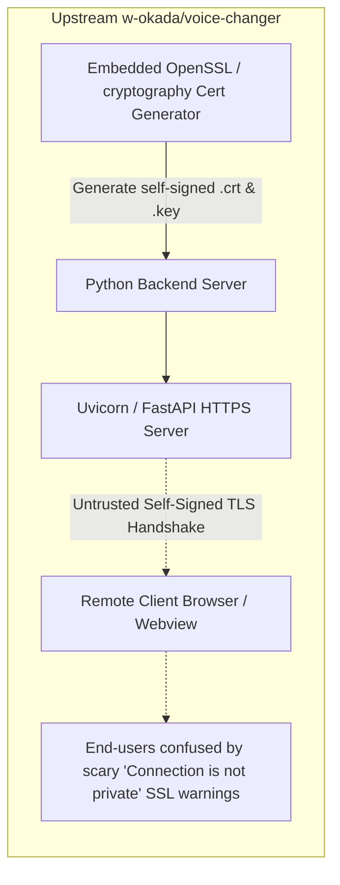

# Remote Backend TCP Proxy & Zero-Config Secure Context: Solving Remote WebAudio without Certificate Hell

## Executive Summary

VCClient Forge introduces a transparent **Client-Side TCP Proxy (`--remote <host:port>`)** in its desktop host ([`desktop/proxy.go`](file:///C:/Users/Daisu/voice-changer/desktop/proxy.go)), fundamentally redefining how remote server setups interact with modern WebAudio APIs.

Historically, running real-time voice conversion on a dedicated remote machine (e.g., a powerful GPU desktop or home server in the local network) while capturing audio from a lightweight client laptop hit an immovable architectural wall: **The WebAudio Secure Context Barrier**. Modern browser engines (Chromium/WebView2, WebKit, Gecko) mandate that sensitive hardware APIs—specifically microphone capture via `navigator.mediaDevices.getUserMedia` and low-latency audio processing in `AudioWorklet`—must execute exclusively within a **Secure Context** (`https://*` or `http://localhost` / `http://127.0.0.1`). Accessing a plain HTTP remote server (such as `http://192.168.1.50:18888`) across a local area network causes the browser to disable microphone access immediately.

To circumvent this, upstream `w-okada/voice-changer` introduced dedicated server-side code to generate self-signed TLS certificates on the fly in Python (`--https True`) and spin up an HTTPS server. While this technically satisfied the Secure Context check, it inevitably triggered prominent red browser warning screens (`NET::ERR_CERT_AUTHORITY_INVALID`). For everyday users unfamiliar with web security mechanics, scary warnings claiming their connection was "not private" caused significant confusion and operational hesitation.

VCClient Forge resolves this entire dilemma with a radical architectural inversion: **solve the problem on the client side using a lightweight TCP proxy**. When launched with `--remote <host:port>` (or `-r`), the desktop host bypasses local backend process startup, establishes a local TCP listener on `127.0.0.1:18888`, and bi-directionally streams all traffic to the designated remote server.

Because the embedded Webview loads `http://127.0.0.1:18888`, the browser natively recognizes the session as a Secure Context. WebAudio and microphone capture work instantly out of the box with zero certificates, zero security warnings, and zero user friction—delivered in barely 100 lines of standard Go code.

This design is a direct manifestation of VCClient Forge's core philosophy:

> **「できることが同じなら、コードもドキュメントも少ないほうが正義！」**  
> _(If the outcome and capabilities are identical, less code and concise documentation is the ultimate virtue.)_

---

## 1. The Problem: The Secure Context Barrier in Upstream Architecture

### The W3C Secure Context Specification

Under modern W3C security standards implemented across all major browser engines, sensitive capabilities are strictly gated behind Secure Contexts:

| Feature / API                         | `http://localhost` or `http://127.0.0.1` | `https://<domain-or-ip>` | `http://<lan-ip>:18888` (e.g. `http://192.168.1.50:18888`) |
| ------------------------------------- | ---------------------------------------- | ------------------------ | ---------------------------------------------------------- |
| `navigator.mediaDevices.getUserMedia` | ✅ Allowed                               | ✅ Allowed               | ❌ **Blocked (`undefined` or Permission Denied)**          |
| `AudioWorkletNode`                    | ✅ Allowed                               | ✅ Allowed               | ❌ **Blocked in non-secure contexts**                      |
| WebRTC / DataChannel                  | ✅ Allowed                               | ✅ Allowed               | ⚠️ Severely restricted                                     |

When an upstream user ran the voice changer on a powerful secondary computer and opened `http://192.168.1.50:18888` in a browser or webview on their laptop, microphone access failed immediately.

### Upstream's Fragile Workaround: The HTTPS & Self-Signed CA Trap

To allow remote WebAudio access, upstream attempted to turn the Python backend into an HTTPS server:



This approach created cascading architectural and usability defects:

1. **Unnecessary Backend Complexity**: The Python backend had to maintain dedicated certificate generation utilities and custom HTTPS server launch arguments.
2. **Untrusted Certificate Warnings**: Browsers displayed prominent red warning screens (`NET::ERR_CERT_AUTHORITY_INVALID`). Non-technical users were understandably confused and alarmed by security prompts warning of potential interception.
3. **Webview Rejection**: Embedded webviews (like Windows WebView2 or macOS WebKit) often block self-signed certificates entirely by default unless low-level native certificate validation callbacks are explicitly overridden in native host code.
4. **Cognitive Overhead**: Explaining how to safely bypass certificate warning screens created recurring user hesitation and support inquiries.

---

## 2. Forge's Architectural Inversion: The Client-Side TCP Proxy

Instead of forcing the backend server to masquerade as an HTTPS authority, Forge observes a fundamental truth: **`127.0.0.1` and `localhost` are intrinsically trusted as Secure Contexts by definition**.

Therefore, if the client desktop application presents the remote backend to its own internal Webview as `http://127.0.0.1:18888`, all Secure Context constraints are satisfied unconditionally.


### Operational Workflow

1. The user launches the desktop host targeting their remote server:
   ```bash
   vcclient-forge --remote 192.168.1.50:18888
   # or with auto-defaulted port 18888:
   vcclient-forge -r 192.168.1.50
   ```
2. **Local Backend Bypassed**: The desktop supervisor recognizes `--remote` and skips resolving and spawning the bundled local Python process.
3. **TCP Proxy Initialized**: A pure-Go TCP listener binds to `127.0.0.1:18888`.
4. **Readiness Probe**: The desktop host pings the remote server via a lightweight TCP dialer while displaying connection status in the terminal log.
5. **Seamless Navigation**: As soon as the remote server responds, the bootstrap page transitions cleanly and navigates to `http://127.0.0.1:18888`.
6. **Transparent Bi-Directional Streaming**: All incoming browser connections (HTTP requests, asset loads, WebSocket upgrades, Socket.IO handshakes) are streamed verbatim to the remote machine via `io.Copy`.

---

## 3. Core Architectural Advantages

### 1. Zero-Configuration Secure Context

Because WebView2 connects to `127.0.0.1`, it classifies the origin as secure immediately. `navigator.mediaDevices.getUserMedia` and WebAudio initialize without prompt errors, security dialogues, or manual certificate installations.

### 2. Complete Origin Invariance

Because the embedded frontend always loads from and connects to `http://127.0.0.1:18888`, the Webview and client code require zero knowledge of the actual remote server IP. Webview configuration, WebSocket connections, and REST API calls remain 100% identical between local execution and remote execution.

### 3. Protocol Agnostic Layer-4 Forwarding

Because the proxy operates at Layer 4 (raw TCP) rather than Layer 7 (HTTP reverse proxy):

- It forwards standard HTTP/1.1 requests, server-sent events, chunked transfer encoding, and WebSocket upgrades without parsing HTTP headers.
- It introduces zero protocol-level latency or HTTP parsing overhead.
- It requires no external reverse proxy packages or complex HTTP client libraries—just standard Go `net` and `io`.

### 4. Implementation Economy (~100 Lines of Code)

The entire proxy logic in [`desktop/proxy.go`](file:///C:/Users/Daisu/voice-changer/desktop/proxy.go) is contained in approximately 100 lines:

```go
func proxyConnection(src net.Conn, target string) {
	defer src.Close()
	dst, err := net.DialTimeout("tcp", target, 5*time.Second)
	if err != nil {
		return
	}
	defer dst.Close()

	done := make(chan struct{}, 2)
	go func() {
		_, _ = io.Copy(dst, src)
		done <- struct{}{}
	}()
	go func() {
		_, _ = io.Copy(src, dst)
		done <- struct{}{}
	}()
	<-done
}
```

This tiny footprint replaces server-side Python certificate generation logic and completely eliminates user confusion surrounding untrusted HTTPS warnings.

---

## 4. Lifecycle Integration

The TCP proxy is fully integrated into the desktop application's unified process lifecycle (detailed in [Migrating Desktop Host from Tauri to Wails v3](./migrating-desktop-host-from-tauri-to-wails.md)):

```go
func main() {
	var (
		cleanupMu sync.Mutex
		cleanup   func()
	)

	doCleanup := func() {
		cleanupMu.Lock()
		defer cleanupMu.Unlock()
		if cleanup != nil {
			cleanup()
			cleanup = nil
		}
	}

	app := application.New(application.Options{
		// ...
		OnShutdown: doCleanup,
	})

	// ...
	window.OnWindowEvent(events.Common.WindowClosing, func(*application.WindowEvent) {
		doCleanup()
	})

	err := app.Run()
	doCleanup()
}
```

When operating in local mode, `cleanup` terminates the Python child process (`stopProcess(c)`). When operating in remote proxy mode, `cleanup` closes the TCP listener and unblocks active accept loops:

```go
	stopCh := make(chan struct{})
	cleanupMu.Lock()
	*cleanup = func() {
		select {
		case <-stopCh:
		default:
			close(stopCh)
		}
		_ = ln.Close()
	}
	cleanupMu.Unlock()
```

Across Windows, macOS, and Linux, whether closed via the window title bar (`X`), `Alt+F4`, application menu, or OS termination signals, resources are freed reliably and instantly.

---

## 5. Architectural Comparison Matrix

| Dimension                 | Upstream (`w-okada/voice-changer`)             | VCClient Forge (`--remote`)                    |
| ------------------------- | ---------------------------------------------- | ---------------------------------------------- |
| **Mechanism**             | Server-side self-signed TLS + HTTPS web server | Client-side Layer 4 TCP proxy to `127.0.0.1`   |
| **Secure Context**        | Satisfied via HTTPS                            | Native (all browsers trust `127.0.0.1`)        |
| **Certificate Setup**     | Python-generated self-signed certificate       | **Zero setup required**                        |
| **Security Warnings**     | `NET::ERR_CERT_AUTHORITY_INVALID` screens      | **None**                                       |
| **Webview Support**       | Fragile without native TLS bypass code         | **Fully native & out-of-the-box**              |
| **Backend Code Overhead** | Dedicated Python TLS/cert generation logic     | **0 lines on backend**                         |
| **End-User Experience**   | Confusing SSL warning prompts on every launch  | **1 simple CLI flag (`--remote <host:port>`)** |
