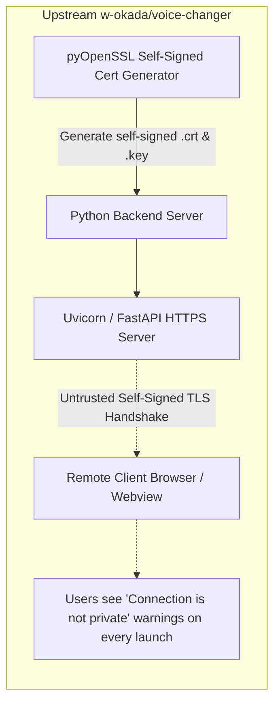
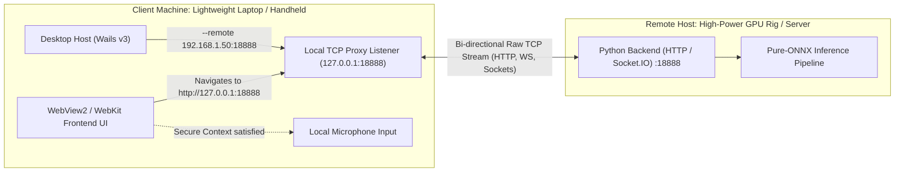

# Remote Backend TCP Proxy & Localhost Secure Context: Satisfying Remote WebAudio Requirements Without Certificates

## Executive Summary

VCClient Forge introduces a transparent **Client-Side TCP Proxy (`--remote <host:port>`)** in its desktop host ([`desktop/proxy.go`](file:///C:/Users/Daisu/voice-changer/desktop/proxy.go)), changing how remote server setups satisfy modern WebAudio security requirements.

Historically, running real-time voice conversion on a dedicated remote machine (e.g., a powerful GPU desktop or home server in the local network) while capturing audio from a lightweight client laptop hit a practical barrier: **the WebAudio Secure Context requirement**. Modern browser engines (Chromium/WebView2, WebKit, Gecko) mandate that sensitive hardware APIs—specifically microphone capture via `navigator.mediaDevices.getUserMedia` and low-latency audio processing in `AudioWorklet`—must execute exclusively within a **Secure Context** (`https://*` or `http://localhost` / `http://127.0.0.1`). Accessing a plain HTTP remote server (such as `http://192.168.1.50:18888`) across a local area network causes the browser to disable microphone access immediately.

To circumvent this, upstream `w-okada/voice-changer` introduced dedicated server-side code to generate self-signed TLS certificates on the fly in Python (`--https True`) and spin up an HTTPS server. While this satisfied the Secure Context check, it triggered browser warning screens (`NET::ERR_CERT_AUTHORITY_INVALID`). For users unfamiliar with web security mechanics, "not private" warnings caused confusion.

VCClient Forge addresses this by solving the problem on the client side: **a lightweight TCP proxy in the desktop host**. When launched with `--remote <host:port>` (or `-r`), the desktop host bypasses local backend process startup, establishes a local TCP listener on `127.0.0.1:18888`, and bi-directionally streams all traffic to the designated remote server.

Because the embedded Webview loads `http://127.0.0.1:18888`, the browser treats the session as a Secure Context. WebAudio and microphone capture work without certificates or browser security warnings, implemented in about 120 lines of Go.

This design is a direct manifestation of VCClient Forge's core philosophy:

> **「できることが同じなら、コードもドキュメントも少ないほうが正義！」**  
> _(If the outcome and capabilities are identical, less code and concise documentation is a guiding principle.)_

---

## 1. The Problem: The Secure Context Barrier in Upstream Architecture

### The W3C Secure Context Specification

Under modern W3C security standards implemented across all major browser engines, sensitive capabilities are strictly gated behind Secure Contexts:

| Feature / API                         | `http://localhost` or `http://127.0.0.1` | `https://<domain-or-ip>` | `http://<lan-ip>:18888` (e.g. `http://192.168.1.50:18888`) |
| ------------------------------------- | ---------------------------------------- | ------------------------ | ---------------------------------------------------------- |
| `navigator.mediaDevices.getUserMedia` | ✅ Allowed                               | ✅ Allowed               | ❌ **Blocked (`undefined` or Permission Denied)**          |
| `AudioWorkletNode`                    | ✅ Allowed                               | ✅ Allowed               | ❌ **Blocked in non-secure contexts**                      |
| WebRTC / DataChannel                  | ✅ Allowed                               | ✅ Allowed               | ⚠️ Severely restricted                                     |

When an upstream user ran the voice changer on a powerful secondary computer and opened `http://192.168.1.50:18888` in a browser or webview on their laptop, microphone access failed immediately.

### Upstream's Approach: HTTPS with Self-Signed Certificates

To allow remote WebAudio access, upstream attempted to turn the Python backend into an HTTPS server:



This approach had several drawbacks:

1. **Backend Complexity**: The Python backend had to maintain certificate generation utilities (`mods/ssl.py`, pyOpenSSL) and custom HTTPS server launch arguments.
2. **Untrusted Certificate Warnings**: Browsers displayed warning screens (`NET::ERR_CERT_AUTHORITY_INVALID`) on every launch, which confused users unfamiliar with web security.
3. **Webview Friction**: Embedded webviews (Windows WebView2, macOS WebKit) may block self-signed certificates unless native certificate validation callbacks are handled in host code.
4. **Support Overhead**: Explaining how to proceed past certificate warnings generated recurring questions.

---

## 2. Forge's Architectural Inversion: The Client-Side TCP Proxy

Instead of making the backend server present itself as an HTTPS authority, Forge relies on a property of the Secure Context specification: **`127.0.0.1` and `localhost` are treated as potentially trustworthy origins by definition**.

Therefore, if the client desktop application presents the remote backend to its own internal webview as `http://127.0.0.1:18888`, the Secure Context requirement is satisfied without TLS.



### Operational Workflow

1. The user launches the desktop host targeting their remote server:
   ```bash
   vcclient-forge --remote 192.168.1.50:18888
   # or with auto-defaulted port 18888:
   vcclient-forge -r 192.168.1.50
   ```
2. **Local Backend Bypassed**: The desktop supervisor recognizes `--remote` and skips resolving and spawning the bundled local Python process.
3. **TCP Proxy Initialized**: A pure-Go TCP listener binds to `127.0.0.1:18888`.
4. **Readiness Probe**: The desktop host pings the remote server via a lightweight TCP dialer while displaying connection status in the terminal log.
5. **Navigation**: Once the remote server responds, the bootstrap page navigates to `http://127.0.0.1:18888`.
6. **Bi-Directional Streaming**: Incoming browser connections (HTTP requests, asset loads, WebSocket upgrades, Socket.IO handshakes) are forwarded byte-for-byte to the remote machine via `io.Copy`.

---

## 3. Core Architectural Advantages

### 1. Plaintext Localhost Secure Context

Because the webview connects to `127.0.0.1`, it classifies the origin as secure. `navigator.mediaDevices.getUserMedia` and WebAudio initialize without certificate warnings or manual certificate installation; the normal OS/browser microphone permission prompt still applies.

### 2. Complete Origin Invariance

Because the embedded frontend always loads from and connects to `http://127.0.0.1:18888`, the webview and client code do not need to know the actual remote server address. Webview configuration, WebSocket connections, and REST API calls are identical between local and remote execution.

### 3. Protocol Agnostic Layer-4 Forwarding

Because the proxy operates at Layer 4 (raw TCP) rather than Layer 7 (HTTP reverse proxy):

- It forwards standard HTTP/1.1 requests, server-sent events, chunked transfer encoding, and WebSocket upgrades without parsing HTTP headers.
- It adds no HTTP parsing overhead; the cost per connection is one TCP dial and byte copying, which is negligible for LAN use.
- It requires no external reverse proxy packages or HTTP client libraries—just standard Go `net` and `io`.
- Note: traffic between the client machine and the remote host remains plain HTTP. The proxy solves the Secure Context requirement, not transport confidentiality; on an untrusted network, tunneling (e.g., Tailscale) is the appropriate complement.

### 4. Implementation Economy

The entire proxy in [`desktop/proxy.go`](desktop/proxy.go) is about 120 lines, including argument parsing and the readiness probe. The per-connection forwarding core is only this:

```go
func proxyConnection(src net.Conn, target string) {
	defer src.Close()
	dst, err := net.DialTimeout("tcp", target, 5*time.Second)
	if err != nil {
		return
	}
	defer dst.Close()

	done := make(chan struct{}, 2)
	go func() {
		_, _ = io.Copy(dst, src)
		done <- struct{}{}
	}()
	go func() {
		_, _ = io.Copy(src, dst)
		done <- struct{}{}
	}()
	<-done
}
```

This small footprint replaces the server-side certificate generation logic and removes the untrusted-HTTPS warning step from the user's workflow.

---

## 4. Lifecycle Integration

The TCP proxy is fully integrated into the desktop application's unified process lifecycle (detailed in [Migrating Desktop Host from Tauri to Wails v3](./migrating-desktop-host-from-tauri-to-wails.md)):

```go
func main() {
	var (
		cleanupMu sync.Mutex
		cleanup   func()
	)

	doCleanup := func() {
		cleanupMu.Lock()
		defer cleanupMu.Unlock()
		if cleanup != nil {
			cleanup()
			cleanup = nil
		}
	}

	app := application.New(application.Options{
		// ...
		OnShutdown: doCleanup,
	})

	// ...
	window.OnWindowEvent(events.Common.WindowClosing, func(*application.WindowEvent) {
		doCleanup()
	})

	err := app.Run()
	doCleanup()
}
```

When operating in local mode, `cleanup` terminates the Python child process (`stopProcess(c)`). When operating in remote proxy mode, `cleanup` closes the TCP listener and unblocks active accept loops:

```go
	stopCh := make(chan struct{})
	cleanupMu.Lock()
	*cleanup = func() {
		select {
		case <-stopCh:
		default:
			close(stopCh)
		}
		_ = ln.Close()
	}
	cleanupMu.Unlock()
```

Across Windows, macOS, and Linux, closing the application via the window title bar (`X`), `Alt+F4`, or the application menu releases the listener and any active backend process.

---

## 5. Architectural Comparison Matrix

| Dimension                 | Upstream (`w-okada/voice-changer`)               | VCClient Forge (`--remote`)                    |
| ------------------------- | ------------------------------------------------ | ---------------------------------------------- |
| **Mechanism**             | Server-side self-signed TLS + HTTPS web server   | Client-side Layer 4 TCP proxy to `127.0.0.1`   |
| **Secure Context**        | Satisfied via HTTPS                              | Satisfied via `127.0.0.1` (trustworthy origin) |
| **Certificate Setup**     | Python-generated self-signed certificate         | None required                                  |
| **Security Warnings**     | `NET::ERR_CERT_AUTHORITY_INVALID` on each launch | None (localhost origin)                        |
| **Webview Support**       | May need native TLS bypass handling              | Works without webview-specific code            |
| **Backend Code Overhead** | Dedicated Python TLS/cert generation logic       | No backend changes                             |
| **End-User Experience**   | Certificate warning prompts on every launch      | One CLI flag (`--remote <host:port>`)          |
