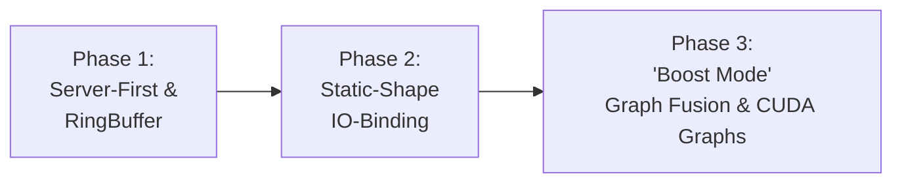

# Server-First Audio Architecture & Static-Shape Pipeline Roadmap

## 1. Executive Summary

VCClient Forge is engineered with a singular, uncompromising vision: **delivering ultra-low latency, crystal-clear, real-time voice conversion for local desktop environments (Discord, gaming, live streaming, and stage performance)**.

To realize this vision, Forge is executing a fundamental architectural transformation:
- **Demoting the legacy "Client Mode"** (browser Web Audio capture designed for the Google Colab era) to a secondary fallback.
- **Elevating "Server Mode"** (native OS audio devices via PortAudio/WASAPI/CoreAudio) as the default, first-class citizen.
- **Eliminating the "Dynamic Shape Tax"**: Migrating the RVC inference pipeline from variable-length chunk handling to a **deterministic, fixed-chunk, zero-allocation static-shape architecture**.

This transition unleashes unprecedented performance gains from ONNX Runtime, hardware accelerators (CUDA, DirectML), and enables advanced GPU kernel optimizations (such as CUDA Graphs) that were previously impossible.

---

## 2. Historical Context & The "Dynamic Shape Tax"

### 2.1 The Legacy Heritage of Google Colab
Upstream `voice-changer` was initially conceived in an era where deep learning models ran remotely on Google Colab or external GPU compute instances while the user interacted through a web browser:
- **Browser Web Audio Fluctuations**: The browser's `AudioWorklet` and network transport jitter meant that audio chunk sizes arrived at irregular intervals and in varying lengths.
- **Defensive Variable-Length Design**: The backend's `RVCPipeline` was designed defensively to accept any arbitrary chunk size (`audio.shape[0]`).
- **Inverted Defaults**: `ConfigurationManager` defaulted `voice_changer_input_mode` to `"client"`. Server mode was retrofitted as an auxiliary background thread monitored via an odd 0.3-second polling loop in `main.py`.

### 2.2 The Technical Penalties of Variable Chunks
Inspection of [`rvc_pipeline.py`](../backend/vcclient/voice_changer/voice_change_manager/vc_pipelines/rvc_pipeline.py) reveals severe performance penalties imposed by variable chunk sizes:

```python
# The Dynamic Allocation Loop in rvc_pipeline.py
new_frame_size = audio.shape[0]  # Fluctuates every single frame
self.audio_buffer = np.concatenate([self.audio_buffer, audio], 0)  # Continuous heap allocations & memory copying
convert_size = new_frame_size + crossfade_overlap_size + sola_search_frame_size + extra_frame_sec
...
self.audio_buffer = np.concatenate([np.zeros([convert_size]), self.audio_buffer])
self.audio_buffer = self.audio_buffer[-1 * convert_size :]
```

1. **Continuous Heap Reallocation (Zero-Copy Impossible)**:
   Calling `np.concatenate` every 10–20 milliseconds forces constant dynamic allocation and memory copying in Python/NumPy, causing memory fragmentation and cache misses.
2. **Dynamic Tensor Shape Inefficiency in ONNX Runtime**:
   When tensor dimensions change dynamically:
   - GPU memory allocators inside ONNX Runtime / CUDA cannot reuse fixed memory arenas without reallocation overhead.
   - Execution providers cannot lock in optimal hardware kernel configurations (kernel auto-tuning).
3. **Barrier to Next-Gen GPU Acceleration**:
   Technologies that eliminate kernel launching overhead—specifically **CUDA Graphs** and **TensorRT engine optimizations**—strictly require **Static Shapes**. Dynamic shapes completely lock Forge out of these zero-overhead execution models.
4. **Latency Jitter & Audio Popping**:
   Because variable-length frames take non-deterministic amounts of time to compute, occasional inference spikes cause buffer underruns, producing the dreaded "audio crackle" (popping).

---

## 3. The Server-First Architectural Shift

Forge pivots the runtime hierarchy to place native local execution at the very core:

```
┌────────────────────────────────────────────────────────┐
│                   VCClient Forge                       │
├───────────────────────────┬────────────────────────────┤
│   Primary (First-Class)   │   Secondary (Fallback)     │
│       SERVER MODE         │        CLIENT MODE         │
├───────────────────────────┼────────────────────────────┤
│ • Native Microphone (OS)  │ • Browser Web Audio        │
│ • Deterministic Buffer    │ • Variable-rate Network    │
│ • Zero-Copy RingBuffer    │ • HTTP/WebSocket Chunking  │
│ • Static-Shape ONNX       │ • Remote Fallback (Colab)  │
│ • Target Latency: < 15ms  │ • Legacy Compatibility     │
└───────────────────────────┴────────────────────────────┘
```

### 3.1 Direct Event-Driven Audio Ingestion
- **Defaulting to `"server"` Mode**: New installations and configurations default to `voice_changer_input_mode = "server"`.
- **SoundDevice Direct Streaming**: Audio callbacks from `sounddevice.InputStream` deliver fixed-size frames (`blocksize`), providing an unbroken stream of uniform audio chunks directly into the inference engine without intermediate polling or busy-waits.

---

## 4. The Ultimate Vision: "Boost Mode" (End-to-End Graph Fusion)

### 4.1 The Core Insight: Real-Time Audio Demands Static Invariance
In everyday real-world use (streaming, voice chat in games, stage performance), **users do not adjust parameters while actively speaking**. Once a user dials in their preferred voice conversion settings:
- Pitch Estimator (e.g. RMVPE)
- Feature Extractor (e.g. ContentVec)
- RVC Model (Slot checkpoint)
- Audio Chunk Size & Sample Rate
- Pitch Shift & Index Ratio

**All of these operational parameters become invariant constants.**

Treating these stable parameters as dynamic runtime variables is the single greatest source of latency and inefficiency in upstream `voice-changer`.

### 4.2 The "Boost Mode" Architecture
Forge introduces **"Boost Mode"**: an ultra-optimized execution state where invariant pipeline parameters are frozen into constants, fusing the entire inference pipeline into a **single static GPU-resident workflow**:

```
[Standard Pipeline: Fragmented Sessions & CPU-GPU Ping-Pong]
Audio (CPU) ──► RMVPE (GPU) ──► F0 (CPU)
            ──► ContentVec (GPU) ──► Feats (CPU) ──► RVC Net (GPU) ──► Audio (CPU)
            (Multiple kernel launches, CPU-GPU copies, synchronization stalls)

                                      ▼

["Boost Mode": Unified Single-Session / Graph Fusion]
Audio (GPU) ──► ┌─────────────────────────────────────────────────────────┐ ──► Audio (GPU)
                │ Single Unified Computation Graph / Zero-Copy GPU Arena  │
                │ • Static Shape [1, N]                                   │
                │ • F0 + ContentVec + RVC Decoder Fully Fused in VRAM     │
                │ • Captured into a Single CUDA Graph                     │
                └─────────────────────────────────────────────────────────┘
                (1 Launch: cudaGraphLaunch, 0 Host-Device Roundtrips, Sub-10ms)
```

1. **End-to-End Graph Fusion (Single Session Execution)**:
   Instead of three disjointed inference sessions (Pitch Estimator + Feature Extractor + Synthesizer) constantly bouncing intermediate tensors back and forth between host (CPU RAM) and device (GPU VRAM), the stages are unified into a single computation graph or chained within a shared GPU memory arena.
2. **Full Pipeline CUDA Graphs Capture**:
   Because all tensor dimensions and operators are 100% deterministic (Static Shape), the entire sequence of GPU kernels across the entire pipeline can be captured into a single **CUDA Graph** during warmup.
3. **Zero Host-Device Roundtrips**:
   The CPU simply populates the input audio buffer and issues a single `cudaGraphLaunch`. The entire transformation—from raw waveform to pitch analysis, phonetic extraction, and acoustic synthesis—executes statically inside the GPU with zero kernel launch latency and zero CPU intervention.

---

## 5. Optimization Roadmap



### Phase 1: Server-First Defaults & Pre-Allocated RingBuffer
- **Milestone 1.1**: Set `voice_changer_input_mode` default to `"server"`.
- **Milestone 1.2**: Replace dynamic `np.concatenate` in `rvc_pipeline.py` with a fixed-capacity, circular **RingBuffer**.
- **Milestone 1.3**: Normalize audio ingestion so that downstream feature extraction and F0 estimation always receive a constant frame length $N$.
- **Outcome**: Elimination of per-frame Python memory allocations; CPU usage reduced; stable GC behavior.

### Phase 2: Static-Shape Normalization & GPU IO-Binding
- **Milestone 2.1**: Update ONNX exporter (`onnx_exporter.py`) to support models with fixed batch and sequence length dimensions (`[1, N]`).
- **Milestone 2.2**: Configure ONNX Runtime session options:
  - `enable_memory_pattern = True` (reusing static memory allocation patterns).
  - Pre-allocated input/output GPU buffers using `OrtValue` (Direct IO Binding), bypassing Python-to-C++ tensor copying.
- **Milestone 2.3**: Align pitch estimators (RMVPE, FCPE) and embedders (ContentVec) to fixed-slice processing.
- **Outcome**: Consistent inference timing across frames; elimination of GPU allocator thrashing.

### Phase 3: The "Boost Mode" Engine (Graph Fusion & CUDA Graphs)
- **Milestone 3.1**: Implement parameter freeze & pipeline compilation for "Boost Mode" when settings are locked.
- **Milestone 3.2**: Fuse feature extraction, pitch estimation, and voice synthesis into a unified GPU-resident execution chain (zero CPU-GPU intermediate hops).
- **Milestone 3.3**: Capture the entire unified pipeline into a single **CUDA Graph** during warmup.
- **Milestone 3.4**: Tune audio stream buffer sizes down to 64–128 samples (WASAPI Exclusive / Low-latency ASIO/PortAudio).
- **Outcome**: True sub-10ms round-trip voice conversion on modern GPUs, matching or exceeding dedicated DSP hardware appliances.

---

## 6. Summary

By transitioning from a Colab-era "variable-chunk web listener" to a dedicated **"Server-First, Static-Shape DSP Engine"** equipped with **"Boost Mode"**, VCClient Forge eliminates historical overheads and optimizes for local desktop execution. Freezing invariant parameters and executing a fully fused static graph directly inside the GPU brings real-time voice conversion to its true hardware performance limits.
