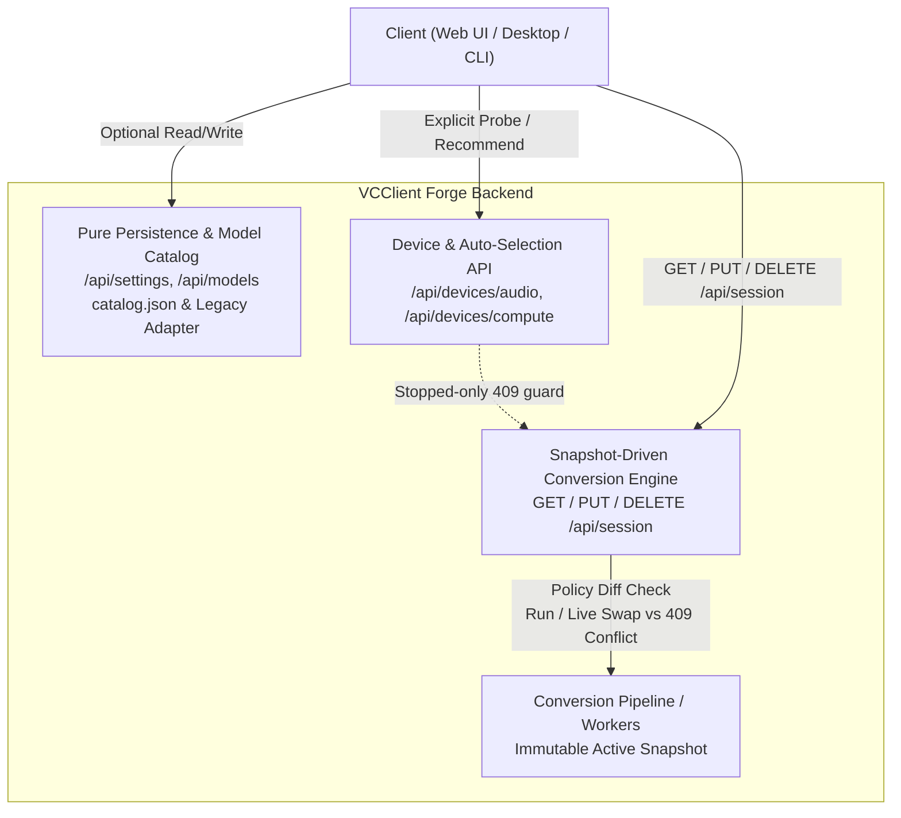
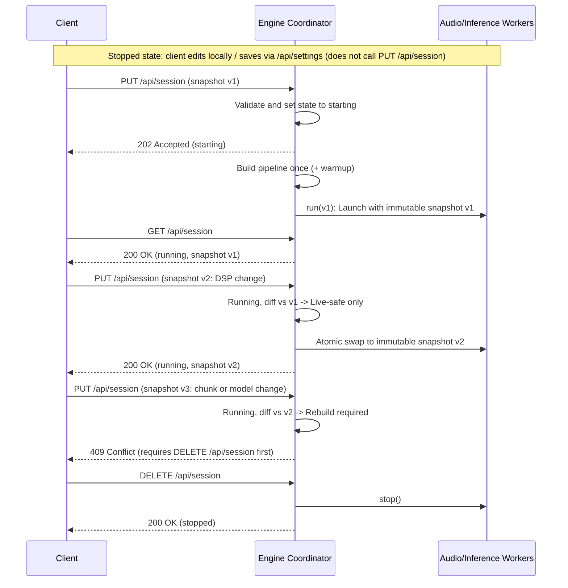

# Snapshot-Driven Conversion Engine & Decoupled Storage/Device APIs

> **Implementation Status Notice (Implemented)**:
> This architecture is **implemented** across `backend/vcclient/voice_changer/session_manager/`, `backend/vcclient/voice_changer/model_catalog/`, `backend/vcclient/voice_changer/settings_manager/`, `backend/vcclient/server/vcserver_rest_api*.py`, `backend/vcclient/server/vcserver_websocket.py`, and the Svelte 5 frontend (`frontend/`). All legacy `/api/*-manager/*`, `/output.wav`, `/vcclient.log`, and raw `/model_dir/` HTTP routes have been removed, while backward compatibility with existing `settings/vc_conf.json` and `model_dir/<slot>/params.json` files is preserved inside the storage and startup-migration layer.

---

## 1. Executive Summary

To prepare VCClient Forge for **concurrent hybrid pipelining** and **alternative client UIs**, the backend control layer is abstracted behind voice-conversion domain contracts and decoupled into three orthogonal concerns:

1. **Snapshot-Driven Conversion Engine**: The conversion backend exposes a declarative REST session resource—**`PUT /api/session`** (engine `run(snapshot)`), **`DELETE /api/session`** (engine `stop()`), and **`GET /api/session`**—rather than reading persisted `settings/` or model catalog files. When stopped, `PUT /api/session` builds and runs the pipeline; while active, calling `PUT /api/session` again either applies live-safe changes atomically or rejects rebuild-requiring changes with `409 Conflict`. The client simply does not call `PUT /api/session` while conversion is intended to stay stopped (only persisting via storage).
2. **Side-Effect-Free Storage API (Legacy Config Compatibility)**: Persisting `vc_conf.json` and per-slot `params.json` becomes purely a storage service—primarily to preserve configuration-file backward compatibility with earlier versions and portable upgrades—never touching `VoiceChanger`, pipelines, or audio streams.
3. **Explicit Compute-Device Auto-Selection API**: Hardware probing and verification (`_select_initial_compute_device()`) is promoted from a first-launch-only startup hook into an explicit stopped-only API, laying the groundwork for future per-stage accelerator assignment (pitch estimation, feature extraction, vocoder synthesis).

Across all three subsystems, two **API boundary principles** govern the contract: **(a) domain abstraction** (routes, DTOs, and identifiers hide Python manager classes, legacy disk schemas, and ONNX runtime internals) and **(b) server-enforced safety** (all validation, concurrency serialization, and state invariants live in the backend so the conversion core stays safe even under uncoordinated, out-of-order, or invalid UI requests).

---

## 2. Historical Motivation: Pre-Refactor Control Coupling

Prior to the Domain API refactoring, inspection of the legacy codebase revealed six structural couplings that hindered thread safety, API abstraction, alternative UIs, and parallel pipelining:

### 2.1 Mixed Responsibilities in Single DTOs

- **`VoiceChangerConfiguration`** ([`data_types.py`](../backend/vcclient/voice_changer/data_types/data_types.py)) mixes:
  - **Topology / lifecycle parameters**: `current_slot_index`, `gpu_device_id_int`, `extra_frame_sec`, `voice_changer_input_mode`, native audio device indices/sample rates, `wasapi_exclusive_enabled`
  - **Live DSP scalars**: gains, `noise_gate`, HPF/LPF toggles & cutoffs, `pass_through`
  - **Imperative commands**: `recording_started` (excluded from disk persistence in [`configuration_manager.py`](../backend/vcclient/voice_changer/configuration_manager/configuration_manager.py))
  - **Monitoring & UI telemetry config**: `enable_performance_monitor`, `realtime_*_status_enabled`
  - **Read-only runtime state**: `input_sample_rate`, `output_sample_rate`, `monitor_sample_rate` (preserved across `PUT` overwrites)
- **`RVCSlotInfo`** ([`slot_manager_data_types.py`](../backend/vcclient/voice_changer/data_types/slot_manager_data_types.py)) mixes immutable model metadata (`model_file`, `sample_rate`, `is_f0`, `embedder`) with structural parameters (`chunk_sec`, `pitch_estimator`) and live tuning scalars (`pitch_shift`, `index_ratio`).

### 2.2 Implicit Rebuilds & Double-Build Hazards

- `PipelineManager.get_pipeline()` ([`pipeline_manager.py`](../backend/vcclient/voice_changer/voice_change_manager/vc_pipelines/pipeline_manager.py)) builds `RVCPipeline` and immediately invokes `warmup()`.
- `PUT /api/configuration-manager/configuration`, `PUT /api/slot-manager/slots/{index}`, `GET /api/voice-changer-manager/information`, and even `VoiceChanger.get_instance()` implicitly run `check_and_update_pipeline()`.
- Changing `current_slot_index` and then updating the selected model's `chunk_sec` or `pitch_estimator`, or the global `extra_frame_sec`, can trigger additional pipeline construction or warmup. The Svelte 5 frontend ([`session.svelte.ts`](../frontend/src/lib/session.svelte.ts)) reduces redundant work by sending non-selected slot edits before updating `current_slot_index`.

### 2.3 Incomplete Server-Side Active Guards

- `ConfigurationManager.set_voice_changer_configuration()` checks `LocalVoiceChangerInterface` activity for `voice_changer_input_mode`, implicitly restarts native audio (`stop()` -> `sleep()` -> `setup()` -> `start()`) for audio device changes, and performs **no** backend active check for `current_slot_index`, `gpu_device_id_int`, or `extra_frame_sec`.
- `PUT /api/slot-manager/slots/{index}` similarly lacks active-pipeline guards (unlike `POST /api/slot-manager/operation/organize` in [`vcserver_rest_api_slot_manager.py`](../backend/vcclient/server/vcserver_rest_api_slot_manager.py), which enforces `lifecycle_lock` and returns HTTP `409`).
- Client Mode lacks an explicit server-side start/stop lifecycle (the WebSocket `/api/ws/audio` handler lazily calls `vc.start_convert_chunk_bulk()`), so the backend cannot reject Client Mode topology mutations consistently (`frontend/src/lib/api.ts` relies on client-side `readNativeActive()` guards).

### 2.4 Non-Thread-Safe Runtime Mutation

- `VoiceChanger.check_and_update_pipeline()` mutates `vc_pipeline`, `resampler_in/out/monitor`, and filter coefficients (`bh/ah`, `bl/al`, `bb/ab`) from HTTP worker threads without synchronization against `convert_chunk_bulk_internal()` or `_convert_chunk()`.
- `_convert_chunk()` and `RVCPipeline.run()` repeatedly query mutable `ConfigurationManager` and `SlotManager` state mid-chunk (`RVCPipeline.slot_info` dynamically reads `SlotManager.get_instance().get_slot_info()`). Concurrent writes during a chunk can split a single audio block across mismatched settings.

### 2.5 Startup-Only Device Auto-Selection

- [`initializer.py`](../backend/vcclient/initializer.py) and [`main.py`](../backend/main.py) execute `_select_initial_compute_device()` only when `ConfigFile` (`settings/vc_conf.json`) does not yet exist. Users cannot re-run hardware probing through the API after changing GPUs, updating drivers, or migrating settings, nor does the boundary accommodate future per-stage device selection.

### 2.6 Implementation-Exposed Contracts & Client-Enforced Safety

- **Backend-class URLs and leaked internals**: Route namespaces mirror Python class names (`/api/slot-manager/*`, `/api/configuration-manager/configuration`, `/api/voice-changer-manager/information`, `/api/local-voice-changer-interface/*`, `/api/audio-device-manager/*`, `/api/gpu-device-manager/devices`; see [`api-reference.md`](./api-reference.md)). Schemas expose internal runtime flags (`local_voice_changer_interface_active`, `bulk_process_start_flag`) and ONNX execution structures (`candidate_onnx_providers`, `onnx_providers`).
- **Directory-coupled model IDs**: Models are identified by mutable disk slot indices (`0..198` under `model_dir/<slot>`), so deletions and drag-and-drop compaction via [`ModelTransaction`](../backend/vcclient/voice_changer/slot_manager/reorder_transaction.py) shift caller-held references.
- **Safety and ordering workarounds pushed to the UI**: Because `PUT` writes return `null`, omit server-side active guards or sample-rate cutoff validation on key paths, and silently roll back `conf.current_slot_index` on model-load failure ([`voice_changer.py`](../backend/vcclient/voice_changer/voice_change_manager/voice_changer.py)), [`api.ts`](../frontend/src/lib/api.ts) performs pre-checks (`readNativeActive()`, `filterKeys` bounds), preserves unknown fields across full-DTO `PUT` writes followed by readback confirmation, and [`session.svelte.ts`](../frontend/src/lib/session.svelte.ts) orders staged writes (`applyStagedSettings()`) client-side to avoid double rebuilds.

---

## 3. API Boundary Principles

Any control-plane redesign—and any new domain API routes replacing the legacy `*-manager` endpoints—should satisfy two core boundary contracts so alternative UIs (desktop shells, custom Web UIs, CLI scripts, or automated tests) can be built cleanly without replicating backend guard logic:

### 3.1 Domain-Oriented Service Abstraction

1. **Domain resources over internal Python topology**: Public routes, request/response schemas, and identifiers model voice-conversion domain concepts—conversion session, audio/compute devices, model catalog, and optional persisted settings—rather than mirroring internal Python classes (`ConfigurationManager`, `SlotManager`, `VoiceChanger`, `LocalVoiceChangerInterface`).
2. **Isolate disk compatibility and execution details**: Legacy config file formats (`settings/vc_conf.json`, `model_dir/<slot>/params.json`), legacy field spellings, and inference-runtime internals (ONNX Execution Provider selection, buffer shapes, internal worker flags) stay behind storage and engine adapters rather than shaping wire DTOs.
3. **Stable, opaque model identifiers**: Public APIs reference models by immutable NanoIDs (`id` in `params.json`), decoupled from mutable numeric directory indices. Target storage places each model in `model_dir/{sanitized_name} - {id}/` and persists display order in `model_dir/catalog.json`, while legacy `model_dir/<slot>` directories are handled through startup migration/storage adapters.
4. **Transport-agnostic session contract**: Local audio I/O (PortAudio/WASAPI) and browser/WebSocket client streaming share the same declarative session lifecycle rather than exposing separate control endpoints or `LocalVoiceChangerInterface`-specific flags.

### 3.2 API-Enforced Safety & Caller-Independent Invariants

1. **Zero reliance on caller discipline**: The conversion core remains safe even if a client sends concurrent, rapid-fire, out-of-order, or malformed requests. UI clients may still debounce gestures or track pending edits for smoother UX, but correctness never depends on frontend pre-checks or careful request sequencing.
2. **Validate-before-mutate with atomic failure**: Every mutating operation validates schema types, domain invariants (such as HPF/LPF cutoffs against active or configured sample rates, device selection validity, and model availability), and session-state constraints *before* altering persisted files or runtime state. Violations return deterministic `4xx` or `409 Conflict` errors cleanly—never half-applying writes or silently rolling back fields behind `200 OK`.
3. **Server-owned state serialization**: The backend coordinator lock and session state machine (`stopped` / `starting` / `running`) serialize or deterministically fence overlapping control requests (`PUT /api/session`, `DELETE /api/session`, model rename/delete, device reload/auto-selection), preventing audio-worker races or partial pipeline teardown regardless of client timing.
4. **Side-effect isolation & self-contained responses**: `GET` reads never rebuild pipelines or alter device/audio state; persistence writes never mutate active conversion sessions; and mutating endpoints return the canonical updated resource representation (or explicit failure detail) rather than `null`, eliminating client-side readback verification loops.

---

## 4. Target Architecture: Three Orthogonal Subsystems



### 4.1 Snapshot-Driven Conversion Engine

1. **Unified REST Session Resource (`GET` / `PUT` / `DELETE /api/session`)**:
   - Aligning with resource-oriented REST conventions, both Server Mode and Client Mode share an explicit conversion session resource backed by **`run(snapshot)`** and **`stop()`** inside the engine:
     - **`PUT /api/session` (`run(snapshot)`)**: Declares *"the active conversion session should be running with this snapshot."*
     - **`DELETE /api/session` (`stop()`)**: Stops a running conversion session and tears down active resources (idempotent if already `stopped`; rejected with `409 Conflict` while `starting`).
     - **`GET /api/session`**: Returns lifecycle status (`stopped` / `starting` / `running`), the accepted snapshot while starting or the active snapshot while running, locked field hints, and the latest start failure, if any. This lets the UI synchronize after a reload or request timeout.
   - There is intentionally **no separate `update(snapshot)` operation** (and no `PATCH /api/session`):
     - Because HTTP `PUT` already means idempotent create-or-replace of the active session state, using `PUT /api/session` avoids the ambiguity of calling an operation named `start` while already running.
     - While **stopped**: the client only updates its local draft and/or calls the pure storage API; it does not call `PUT /api/session` until conversion should begin.
     - Calling `PUT /api/session` while **stopped** validates and accepts the snapshot, transitions to `starting`, and returns `202 Accepted` with the `SessionState` payload. The engine then builds the pipeline once, warms it up, and transitions to `running`. On failure, it releases partially created resources, returns to `stopped`, and exposes the failure through `GET /api/session`.
     - While **starting**, `DELETE /api/session`, conflicting session changes, and renaming or deleting the model referenced by the starting session are rejected with `409 Conflict`. The UI waits for startup to finish before offering stop or another start; if the start request times out, it checks `GET /api/session` instead of assuming startup failed. A reloaded UI can similarly show startup progress or the failure.
     - Calling `PUT /api/session` while **running** diffs the snapshot against the active configuration: live-safe changes apply immediately via an immutable snapshot swap returning `200 OK`, whereas rebuild-required changes return **`409 Conflict`** without disrupting the running pipeline.
     - Clients may still coalesce high-frequency UI gestures (such as slider drags) or defer stop calls for smoother UX, **but backend correctness does not rely on caller serialization**. The coordinator lock and session state machine serialize or reject concurrent calls deterministically: overlapping `PUT /api/session` requests resolve cleanly in lock acquisition order without tearing down or mixing worker snapshots (and optional `ETag` / `If-Match` preconditions prevent stale overwrites, returning `409 Conflict` with `code: "etag_mismatch"` on mismatch), while `DELETE /api/session` waits on the coordinator lock if `running` or returns `409 Conflict` while `starting`.
   - Recording is controlled by a non-persistent boolean in the session snapshot. Starting with recording enabled starts recording with conversion; while running, changing the value from false to true starts recording and true to false finalizes it. Repeating an unchanged snapshot does not restart or finalize recording again.
   - `DELETE /api/session` stops audio and finalizes any active recording before the session is torn down. The completed recording remains retrievable after the session ends via `GET /api/recordings/latest` (retaining the latest single recording on disk; returning `409 Conflict` with `code: "recording_in_progress"` while recording is active and `404 Not Found` when absent). Empty recordings do not trigger a download in the UI. If client audio fails to start after a session has begun, the client stops the session so recording and other resources are finalized or released.
   - In Client Mode, a newly accepted audio WebSocket replaces and closes the previous audio connection using application-defined WebSocket close code `4001` (reason `"superseded"`), allowing the replaced client to distinguish handoff from an unexpected disconnect (`1006`) and avoid reconnect loops (`DELETE /api/session` closes cleanly with code `1000`). The conversion session and recording continue across this handoff and across an unexpected audio-socket disconnect, allowing a reloaded browser to reconnect. Cleanup from the old connection must not stop the session or close the replacement connection, and stale output from the previous connection must not be played after handoff. Audio not sent while disconnected is not recorded.
   - Separate `POST /api/voice-changer/operation/start_recording` and `POST /api/voice-changer/operation/stop_recording` endpoints are removed; recording is controlled directly through the non-persistent `recording` boolean on `/api/session`.
2. **Self-Contained Runtime Snapshot**:
   - The client passes a complete snapshot containing everything needed to configure and run conversion: selected `model_id` (immutable NanoID), model conversion parameters (`pitch_shift`, `index_ratio`, `chunk_sec`, `pitch_estimator`), inference/timing parameters (`compute_device_id`, `extra_frame_sec`), DSP parameters (gains, filters, noise gate, `pass_through`), `recording` state, audio routing (`input_mode`, device IDs, rates, `wasapi_exclusive`, monitor enablement), and telemetry flags (see [Section 5.4](#54-clean-domain-schemas--legacy-field-retirement)). Recording and passthrough state are excluded from persisted configuration and default to off after application startup.
   - `RVCPipeline` and worker threads read **only** from the engine-owned active snapshot—never querying `ConfigurationManager` or `SlotManager.get_slot_info()` during inference. Model catalog metadata (`model_file`, `sample_rate`, `is_f0`, `embedder`, `.index` path) is resolved cleanly from the catalog when constructing a session on stopped `PUT /api/session`.
3. **Encapsulation & Policy-Based `409 Conflict`**:
   - **Backend-owned rebuild classification**: Only the backend knows which snapshot fields require stopping and rebuilding the pipeline under the active execution engine and hardware providers.
   - This distinction is intentionally **not** encoded into separate REST URLs or separate client schemas because hardware constraints evolve over time—for example, `chunk_sec` used to allow live updates in upstream builds before static-shape accelerators (CoreML `MLProgram`, OpenVINO NPU, potential CUDA Graph capture) made mid-stream shape changes impractical.
   - When `PUT /api/session` arrives while conversion is already active:
     - Backend computes the field diff against the active snapshot under a coordinator lock.
     - If any field classified as rebuild-required changed, the backend rejects the entire request with **`409 Conflict`** (identifying the conflicting fields in `details.conflicting_fields`) without mutating runtime state.
     - If only live-safe fields changed (or nothing changed), the backend precomputes derived state (such as new IIR filter coefficients) and swaps an **immutable snapshot object** atomically for chunk boundaries (or delivers it over a worker control queue).



### 4.2 Pure Persistence API (Legacy Config Compatibility & Client-Owned Storage)

- Saving user configuration is conceptually the **client's responsibility**: an external API caller, web client (`localStorage`), CLI script, or test suite may manage and store snapshots however it chooses—or pass ephemeral snapshots without touching backend storage.
- The **primary reason** Forge retains backend persistence endpoints backed by `settings/vc_conf.json`, per-model `params.json`, and `model_dir/catalog.json` is **backward compatibility with configuration files from earlier versions**:
  1. **Legacy File Layout & Schema Compatibility**: Existing users and upgraded installations rely on `settings/vc_conf.json` and legacy `model_dir/<slot>/params.json` files migrating/loading cleanly across versions. Retaining backend persistence keeps legacy path migration, default-filling, and old-value normalization isolated inside the storage layer rather than leaking legacy file-format compatibility branches into the snapshot-driven conversion engine or wire DTOs.
  2. **Portable Folder Upgrades**: Users can continue upgrading by copying `settings/` and `model_dir/` from older versions into a new release folder ([`README.txt`](../docs/README.txt)).
  3. **Manual Preference Reset**: Users can reset broken preferences by renaming `settings/` to `settings.bak/` without clearing WebView caches.
  4. **Model Directory & Catalog Integrity**: Naming each model folder `model_dir/{sanitized_name} - {id}/` and storing display order in `model_dir/catalog.json` keeps per-model defaults (`pitch_shift`, `index_ratio`, `chunk_sec`, etc.) co-located in each model's `params.json` while eliminating [`ModelTransaction`](../backend/vcclient/voice_changer/slot_manager/reorder_transaction.py) numeric folder compaction and `.model-order-transaction/` recovery journals on reorder.
  5. **Cross-Origin Local Sharing**: Desktop WebView windows and regular browser tabs on the same host share stored presets regardless of port or browser origin.
- Crucially, reading or writing these storage files (`/api/settings`, `/api/models*`) is **pure persistence**: it **never** triggers pipeline rebuilds, device checks, or audio restarts, leaving the conversion engine coupled only to the active runtime snapshot schema.

### 4.3 Explicit Compute-Device Auto-Selection API

- Promote device probing (`_select_initial_compute_device()`) to **`POST /api/devices/compute/auto-select`**, which runs hardware/pipeline verification and **returns recommended device assignments only without modifying `/api/settings` (`settings/vc_conf.json`)**; applying or persisting the recommendation remains the caller's choice.
- Enforces the same stopped-only `409 Conflict` guard if audio conversion is `starting` or `running`.
- Preserves first-launch out-of-box usability (either invoked during startup bootstrap when no saved preference exists, or via initial client setup) while allowing users to re-run auto-selection after GPU upgrades, driver updates, or hardware changes.
- Provides the clean abstraction boundary for **future per-stage accelerator selection**—where pitch estimation, feature extraction, and vocoder synthesis may target distinct devices (such as CPU/NPU preparation paired with CUDA synthesis).

---

## 5. Domain API Specification

> **Implemented Specification ([`api-reference.md`](./api-reference.md))**:
> This section documents the Domain HTTP and WebSocket API design implemented in `backend/vcclient/server/` to replace all legacy `/api/*-manager/*` routes.

### 5.1 Common Contract Rules

1. **Uniform `PUT` for updates**: All updates to existing resources—`/api/session`, `/api/settings`, `/api/models/{id}`, `/api/models/{id}/icon`, and `/api/models/order`—use idempotent `PUT` (no `PATCH`). `POST` is reserved for model creation (`POST /api/models`), explicit hardware re-probing (`POST /api/devices/audio/reload`, `POST /api/devices/compute/reload`), and compute auto-selection (`POST /api/devices/compute/auto-select`).
2. **Self-contained responses**: Successful mutations return the canonical updated JSON representation (never `null`). Specifically, `PUT /api/session` returns `202 Accepted` on `stopped -> starting` or `200 OK` on live `running` updates (both returning `SessionState`); `DELETE /api/session` returns `200 OK` with `stopped` `SessionState`; `PUT`/`DELETE /api/models/{id}/icon` return `200 OK` with updated `Model` metadata; and `DELETE /api/models/{id}` returns `204 No Content`.
3. **Optional optimistic concurrency (`ETag` / `If-Match`)**: Mutable resources (`/api/session`, `/api/settings`, `/api/models/{id}`, `/api/models/order`) return an `ETag` response header. When a caller provides `If-Match`, the backend validates the version under its coordinator/storage lock and rejects stale updates with `409 Conflict` (`code: "etag_mismatch"`). When omitted, writes execute safely in server lock acquisition order (last-writer-wins) so CLI tools and lightweight clients can make single-request updates.
4. **Unified error envelope**: All HTTP error responses (`400`, `404`, `409`, `422` schema/domain validation, `500`) use one consistent JSON envelope instead of mixing numeric `VCClientError` codes with FastAPI `{"detail": ...}` payloads:

```json
{
  "code": "session_rebuild_required",
  "message": "Session must be stopped before changing rebuild-required fields.",
  "details": {
    "conflicting_fields": ["chunk_sec", "model_id"]
  }
}
```

Representative snake-case error `code` values include: `validation_error`, `etag_mismatch`, `session_starting`, `session_rebuild_required`, `session_active`, `model_not_found`, `model_in_use`, `invalid_filter_cutoff`, `invalid_audio_device`, `invalid_compute_device`, `recording_not_found`, and `recording_in_progress`.

### 5.2 Endpoint Summary

| Group | Method / Protocol | Path | Request Type & Preconditions | Success Response & Policy Notes |
| --- | --- | --- | --- | --- |
| Session | `GET` | `/api/session` | — | `200` `SessionState` (`ETag`); read-only, never builds or mutates pipelines |
| Session | `PUT` | `/api/session` | JSON `SessionSnapshot` (optional `If-Match`) | `202` (`starting`) or `200` (`running`) `SessionState` (`ETag`); `409` if `starting`, rebuild-required diff while `running`, or `etag_mismatch` |
| Session | `DELETE` | `/api/session` | Optional `If-Match` | `200` `SessionState` (`stopped`); idempotent if `stopped`; `409` while `starting` or on `etag_mismatch` |
| Models | `GET` | `/api/models` | — | `200` `Model[]` ordered according to `model_dir/catalog.json` |
| Models | `POST` | `/api/models` | `multipart/form-data` (`.onnx`/`.pth`, optional `.index`, optional icon, metadata) | `201` `Model` (`ETag`); assigns immutable NanoID and creates `model_dir/{sanitized_name} - {id}/` |
| Models | `GET` | `/api/models/{id}` | — | `200` `Model` (`ETag`); `404` (`model_not_found`) if absent |
| Models | `PUT` | `/api/models/{id}` | JSON `ModelUpdate` (optional `If-Match`) | `200` `Model` (`ETag`); `409` (`model_in_use`) if `name` changes while `{id}` is active in a `starting`/`running` session; parameter updates allowed anytime (pure persistence) |
| Models | `DELETE` | `/api/models/{id}` | Optional `If-Match` | `204 No Content`; `409` (`model_in_use`) if `{id}` is active in a `starting`/`running` session |
| Models | `GET` | `/api/models/{id}/icon` | — | `200` image binary (`image/*`); `404` if model or icon absent |
| Models | `PUT` | `/api/models/{id}/icon` | Image upload (`image/*` or `multipart/form-data`, optional `If-Match`) | `200` `Model` (`ETag`); atomically replaces previous icon file |
| Models | `DELETE` | `/api/models/{id}/icon` | Optional `If-Match` | `200` `Model` (`ETag`); idempotent if no icon exists |
| Models | `PUT` | `/api/models/order` | JSON `{"model_ids": string[]}` (optional `If-Match`) | `200` `{"model_ids": string[]}` (`ETag`); persists only to `model_dir/catalog.json` (no folder moves; safe while `running`) |
| Settings | `GET` | `/api/settings` | — | `200` `UserSettings` (`ETag`); pure read |
| Settings | `PUT` | `/api/settings` | JSON `UserSettings` (optional `If-Match`) | `200` `UserSettings` (`ETag`); validates domain constraints before persisting; never touches active session or audio |
| Devices | `GET` | `/api/devices/audio` | — | `200` `{"inputs": AudioDevice[], "outputs": AudioDevice[]}`; returns cached device list initialized at startup without re-initializing PortAudio (safe while active) |
| Devices | `POST` | `/api/devices/audio/reload` | — | `200` `{"inputs": AudioDevice[], "outputs": AudioDevice[]}`; re-detects audio devices; `409` (`session_active`) while session is `starting`/`running` |
| Devices | `GET` | `/api/devices/compute` | — | `200` `ComputeDevice[]`; returns cached compute device catalog without side effects |
| Devices | `POST` | `/api/devices/compute/reload` | — | `200` `ComputeDevice[]`; re-detects compute devices; `409` (`session_active`) while session is `starting`/`running` |
| Devices | `POST` | `/api/devices/compute/auto-select` | — | `200` `ComputeDeviceRecommendation`; `409` while session is `starting`/`running`; returns recommendation without mutating `/api/settings` |
| Recordings | `GET` | `/api/recordings/latest` | — | `200` `audio/wav` (single latest file); `404` (`recording_not_found`) if absent; `409` (`recording_in_progress`) while recording is active |
| Logs | `GET` | `/api/logs` | — | `200` `text/plain`; `404` if log file absent |
| WebSocket | `WS` | `/api/ws/audio` | Bidirectional binary `<f4` PCM frames | Accepted only while Client Mode session is `running`; a new connection replaces the previous socket and closes it with code `4001` (`"superseded"`) without stopping the session; rejected/closed when `stopped`/`starting` or in Server Mode; `DELETE /api/session` closes with code `1000` |
| WebSocket | `WS` | `/api/ws/status` | Server -> Client JSON frames | Realtime telemetry and session lifecycle events |

### 5.3 Model Storage Layout, Icon Serving & Legacy Migration

- **Model ID (`NanoID`)**: Each model carries a short URL- and filename-safe alphanumeric NanoID stored as `id` inside `params.json`. Because `id` never changes on rename, reorder, or sibling deletion, client selections and `/api/session` snapshots remain stable.
- **Human-readable directories (`model_dir/{sanitized_name} - {id}/`)**: Storing models under `{sanitized_name} - {id}` lets users locate models directly in file explorers for backup or sharing without relying on binary model inspection or numeric prefixes. Updating `name` via `PUT /api/models/{id}` renames the directory; renaming or deleting a model currently held by a `starting`/`running` session returns `409 Conflict` (`code: "model_in_use"`) to avoid Windows open file-handle failures.
- **Catalog file (`model_dir/catalog.json`)**: Stores model ordering (`order: string[]`) and future catalog-level metadata outside individual `params.json` files. On scan, missing IDs are pruned and newly present model folders are appended cleanly, retiring `ModelTransaction` and `.model-order-transaction/` journals.
- **Icon serving without `/model_dir/` exposure**: Removing the raw `/model_dir/` `StaticFiles` mount and serving icons exclusively through `GET /api/models/{id}/icon` isolates internal filenames, prevents unmediated access to `.onnx`/`.index` artifacts, and pairs with `icon_revision` for cache safety across renames and icon swaps.
- **Startup legacy migration**: Existing `model_dir/<0..198>/params.json` folders and `settings/vc_conf.json` (`current_slot_index` and legacy spellings) are migrated/adapted inside the storage layer at startup so user assets upgrade cleanly without keeping legacy HTTP routes or schema keys.

### 5.4 Clean Domain Schemas & Legacy Field Retirement

Wire schemas organize settings around domain concepts rather than legacy class attributes:

- **`SessionSnapshot`**: Self-contained payload passed to `PUT /api/session`, covering `model_id`, model conversion parameters (`pitch_shift`, `index_ratio`, `chunk_sec`, `pitch_estimator`), timing (`extra_frame_sec`), compute selection (`compute_device_id`, extensible to per-stage assignment), audio routing (`input_mode`, device IDs/sample rates, `wasapi_exclusive`, monitor routing), DSP (`input_gain`, `output_gain`, HPF/LPF toggles & cutoffs, `noise_gate`, `pass_through`), non-persistent `recording`, and telemetry flags.
- **`SessionState`**: Returned by `GET / PUT / DELETE /api/session`, containing `status` (`"stopped" | "starting" | "running"`), `snapshot` (`SessionSnapshot | null`), `locked_fields` (backend-owned list of fields requiring stop while active), `input_sample_rate`, `output_sample_rate`, and `monitor_sample_rate` (`integer | null`, Hz), and `last_error` (error object matching Section 5.1 when the latest startup failed, else `null`). `input_sample_rate` and `output_sample_rate` report the actual rates used by the running session (including Client Mode WebSocket audio) and are `null` while stopped or before determined during startup; `monitor_sample_rate` is populated only while `running` in Server Mode with a monitor output enabled (`null` in Client Mode, when monitor output is disabled, or while not running).
- **`Model`**: Read-only attributes (`id`, `sample_rate`, `supports_f0`, `has_index`, `embedder`, `has_icon`, `icon_revision`), mutable catalog metadata (`name`), and per-model default parameters (`pitch_shift`, `index_ratio`, `chunk_sec`, `pitch_estimator`). `PUT /api/models/{id}` accepts `ModelUpdate` (the mutable metadata and default parameter fields).
- **`UserSettings`**: Persisted defaults managed by `GET / PUT /api/settings` (selected `model_id` plus audio, compute, DSP, timing, and telemetry defaults; excludes runtime-only `recording` and `pass_through`).
- **Retired legacy names & internal leaks**: Domain DTOs retire internal runtime/Python fields from HTTP wire contracts, including `gpu_device_id_int`, `local_voice_changer_interface_active`, `bulk_process_start_flag`, `candidate_onnx_providers`, and `onnx_providers`.

---

## 6. Relationship to Concurrent Hybrid Pipelining & Optimization Priorities

1. **Prerequisite for Multi-Worker Pipelines**: Concurrent hybrid pipelining overlaps Stage 1 preparation (chunk $N+1$: ContentVec, RMVPE/FCPE, FAISS) with Stage 2 synthesis (chunk $N$: RVC vocoder). Guaranteeing via `409 Conflict` that tensor shapes, model weights, and device bindings remain invariant while running—and reading scalar parameters only from chunk-scoped immutable snapshots—prevents cross-stage shape mismatches and thread races.
2. **Alignment with CUDA / Static-Shape Findings**: Separating session construction on stopped `PUT /api/session` (`run(snapshot)`) from live execution establishes a single-shape, warmed-up execution boundary for static-shape runtimes (CoreML `MLProgram`, OpenVINO NPU) and future CUDA IOBinding / scoped CUDA Graph experiments. Concurrent pipelining may improve throughput; its effect on end-to-end audio latency and its comparison with other optimizations require measurement after implementation (see [Hybrid CPU-GPU Pipelining](./hybrid-cpu-gpu-pipeline-architecture.md)).

---

## 7. Scope Boundary, Tradeoffs & Migration Considerations

| Concern | Consideration / Design Decision |
| :--- | :--- |
| **Single-stream product scope vs. caller safety** | Like the rest of VCClient Forge (see [`implementation-roadmap.md`](./implementation-roadmap.md)), the application targets **single-user local audio** (one active input stream and conversion session at a time; multi-tenant hosting and collaborative multi-tab UI conflict resolution are out of scope). However, **core invariants never depend on caller obedience**: concurrent, rapid, or out-of-order requests from any UI or multiple clients are serialized or rejected (`4xx`/`409`) server-side without corrupting worker or storage state. |
| **Page reloads & UI sync** | Because the engine holds no permanent config file dependency, it must still keep the *currently active runtime snapshot* in memory and expose it via `GET /api/session` so reconnecting UIs accurately reflect running audio. |
| **Model identification & reordering** | Public APIs identify models by immutable NanoIDs stored in `params.json`, with directories named `model_dir/{sanitized_name} - {id}/` and display order persisted in `model_dir/catalog.json`. Reordering via `PUT /api/models/order` writes only `catalog.json` without moving folders and is therefore safe while `running`, whereas renaming or deleting a model actively used by a `starting` or `running` session returns `409 Conflict` (`model_in_use`), retiring `ModelTransaction` numeric folder compaction. |
| **First-launch out-of-box UX** | Startup bootstrap (`main.py` or first UI connection) must still ensure a verified compute device recommendation is populated when no user preference exists yet. |
| **Legacy route retirement** | Because `desktop/` does not call `/api/*` directly, all in-repo API consumers live in `frontend/` and `backend/tests/`. Legacy `/api/*-manager/*`, `/output.wav`, `/vcclient.log`, and raw `/model_dir/` HTTP routes have been removed alongside migrating the Svelte UI and test suite, keeping backward compatibility strictly at the disk storage layer (`settings/vc_conf.json` and startup migration of `model_dir/<slot>/params.json`). |

---

## 8. Related Documents

- [HTTP & WebSocket API Reference](./api-reference.md) (currently implemented endpoints and schemas)
- [Server-First Audio Architecture & Pipeline Roadmap](./server-first-architecture-and-static-pipeline-roadmap.md) (Section 3.7 audio adapter/routing contracts and Section 4 concurrent hybrid pipelining)
- [Consolidated Implementation Roadmap](./implementation-roadmap.md) (Item 2 control refactoring and Item 9 inference optimization)
- [Architectural & Design Rationales](./rationales.md)
- [Inversion of Control](./inversion-of-control-and-process-lifecycle.md)
- [DeviceConfig & Catalog Index Architecture](./device-config-and-unified-hardware-descriptor.md)
