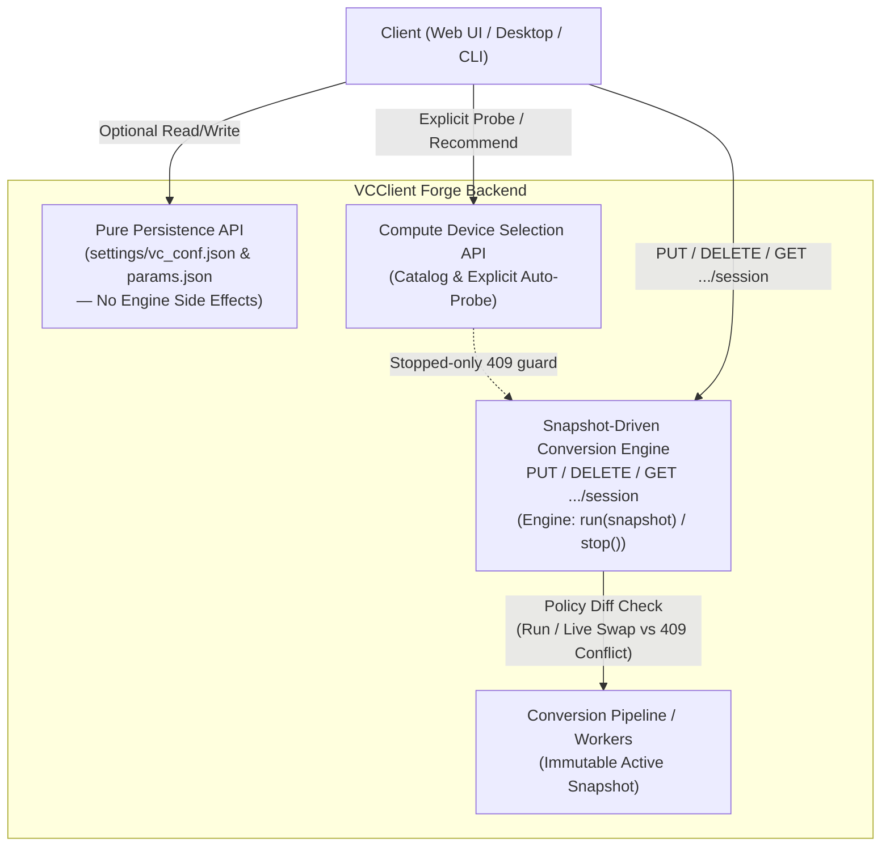
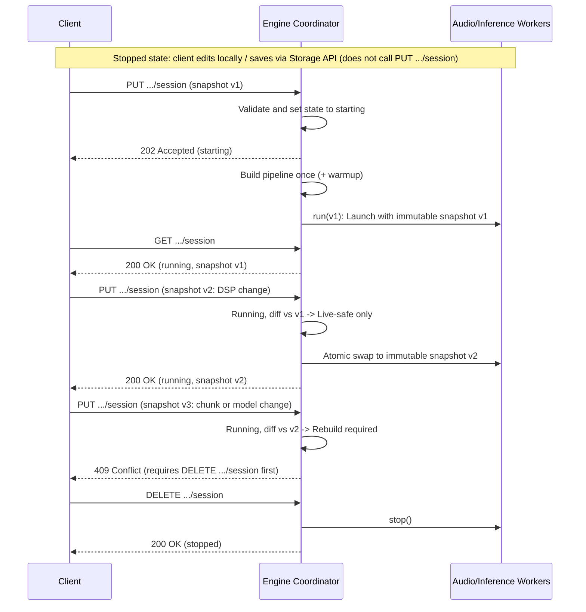

# Snapshot-Driven Conversion Engine & Decoupled Storage/Device APIs

> **Implementation Status Notice (as of `v2.0.78-forge.0.3.0`)**:
> This document defines a **planned target architecture** and is **not yet implemented**.
> Currently (`v2.0.78-forge.0.3.0`), backend runtime state remains coupled to `ConfigurationManager` (`settings/vc_conf.json`) and `SlotManager` (`model_dir/<slot>/params.json`), `PUT` configuration/slot updates trigger implicit `VoiceChanger.check_and_update_pipeline()` calls without full synchronization against conversion threads, and compute-device auto-selection (`initializer._select_initial_compute_device()`) runs only when `vc_conf.json` is absent on startup.

---

## 1. Executive Summary

To prepare VCClient Forge for **concurrent hybrid pipelining** (overlapping preparation stages and synthesis across dedicated workers), the backend control layer should be decoupled into three independent concerns:

1. **Snapshot-Driven Conversion Engine**: The conversion backend exposes a declarative REST session resource—**`PUT .../session`** (engine `run(snapshot)`), **`DELETE .../session`** (engine `stop()`), and **`GET .../session`**—rather than reading persisted `settings/` or per-slot `params.json` files. When stopped, `PUT .../session` builds and runs the pipeline; while active, calling `PUT .../session` again either applies live-safe changes atomically or rejects rebuild-requiring changes with `409 Conflict`. The client simply does not call `PUT .../session` while conversion is intended to stay stopped (only persisting via storage).
2. **Side-Effect-Free Storage API (Legacy Config Compatibility)**: Persisting `vc_conf.json` and per-slot `params.json` becomes purely a storage service—primarily to preserve configuration-file backward compatibility with earlier versions and portable upgrades—never touching `VoiceChanger`, pipelines, or audio streams.
3. **Explicit Compute-Device Auto-Selection API**: Hardware probing and verification (`_select_initial_compute_device()`) is promoted from a first-launch-only startup hook into an explicit stopped-only API, laying the groundwork for future per-stage accelerator assignment (pitch estimation, feature extraction, vocoder synthesis).

---

## 2. Diagnosis of the Current Architecture

Inspection of the `v2.0.78-forge.0.3.0` codebase reveals five structural couplings that hinder thread safety, API clarity, and parallel pipelining:

### 2.1 Mixed Responsibilities in Single DTOs

- **`VoiceChangerConfiguration`** ([`data_types.py`](../backend/vcclient/voice_changer/data_types/data_types.py)) mixes:
  - **Topology / lifecycle parameters**: `current_slot_index`, `gpu_device_id_int`, `extra_frame_sec`, `sola_search_frame_sec`, `voice_changer_input_mode`, native audio device indices/sample rates, `wasapi_exclude_emabled`
  - **Live DSP scalars**: gains, `noise_gate`, `volume_tuning_type`, HPF/LPF toggles & cutoffs, `pass_through`
  - **Imperative commands**: `recording_started` (excluded from disk persistence in [`configuration_manager.py`](../backend/vcclient/voice_changer/configuration_manager/configuration_manager.py))
  - **Monitoring & UI telemetry config**: `enable_performance_monitor`, `realtime_*_status_*`, `sio_broadcast`, `server_device_trancate_buffer_ratio`
  - **Read-only runtime state**: `input_sample_rate`, `output_sample_rate`, `monitor_sample_rate` (preserved across `PUT` overwrites)
- **`RVCSlotInfo`** ([`slot_manager_data_types.py`](../backend/vcclient/voice_changer/data_types/slot_manager_data_types.py)) mixes immutable model metadata (`model_file`, `sample_rate`, `is_f0`, `embedder`) with structural parameters (`chunk_sec`, `pitch_estimator`) and live tuning scalars (`pitch_shift`, `index_ratio`, `protect_ratio`).

### 2.2 Implicit Rebuilds & Double-Build Hazards

- `PipelineManager.get_pipeline()` ([`pipeline_manager.py`](../backend/vcclient/voice_changer/voice_change_manager/vc_pipelines/pipeline_manager.py)) builds `RVCPipeline` and immediately invokes `warmup()`.
- `PUT /api/configuration-manager/configuration`, `PUT /api/slot-manager/slots/{index}`, `GET /api/voice-changer-manager/information`, and even `VoiceChanger.get_instance()` implicitly run `check_and_update_pipeline()`.
- Changing `current_slot_index` and then updating the selected model's `chunk_sec` or `pitch_estimator`, or the global `extra_frame_sec`, can trigger additional pipeline construction or warmup. The Svelte 5 frontend ([`session.svelte.ts`](../frontend/src/lib/session.svelte.ts)) reduces redundant work by sending non-selected slot edits before updating `current_slot_index`.

### 2.3 Incomplete Server-Side Active Guards

- `ConfigurationManager.set_voice_changer_configuration()` checks `LocalVoiceChangerInterface` activity for `voice_changer_input_mode`, implicitly restarts native audio (`stop()` -> `sleep()` -> `setup()` -> `start()`) for audio device changes, and performs **no** backend active check for `current_slot_index`, `gpu_device_id_int`, or `extra_frame_sec`.
- `PUT /api/slot-manager/slots/{index}` similarly lacks active-pipeline guards (unlike `POST /api/slot-manager/operation/organize` in [`vcserver_rest_api_slot_manager.py`](../backend/vcclient/server/vcserver_rest_api_slot_manager.py), which enforces `lifecycle_lock` and returns HTTP `409`).
- Client Mode lacks an explicit server-side start/stop lifecycle (`post_convert_chunk_bulk` lazily calls `vc.start_convert_chunk_bulk()`), so the backend cannot reject Client Mode topology mutations consistently (`frontend/src/lib/api.ts` relies on client-side `readNativeActive()` guards).

### 2.4 Non-Thread-Safe Runtime Mutation

- `VoiceChanger.check_and_update_pipeline()` mutates `vc_pipeline`, `resampler_in/out/monitor`, and filter coefficients (`bh/ah`, `bl/al`, `bb/ab`) from HTTP worker threads without synchronization against `convert_chunk_bulk_internal()` or `_convert_chunk()`.
- `_convert_chunk()` and `RVCPipeline.run()` repeatedly query mutable `ConfigurationManager` and `SlotManager` state mid-chunk (`RVCPipeline.slot_info` dynamically reads `SlotManager.get_instance().get_slot_info()`). Concurrent writes during a chunk can split a single audio block across mismatched settings.

### 2.5 Startup-Only Device Auto-Selection

- [`initializer.py`](../backend/vcclient/initializer.py) and [`main.py`](../backend/main.py) execute `_select_initial_compute_device()` only when `ConfigFile` (`settings/vc_conf.json`) does not yet exist. Users cannot re-run hardware probing through the API after changing GPUs, updating drivers, or migrating settings, nor does the boundary accommodate future per-stage device selection.

---

## 3. Target Architecture: Three Orthogonal Subsystems

### 3.1 Snapshot-Driven Conversion Engine

1. **Unified REST Session Resource (`GET` / `PUT` / `DELETE .../session`)**:
   - Aligning with the RESTful resource convention already used by [`vcserver_rest_api_slot_manager.py`](../backend/vcclient/server/vcserver_rest_api_slot_manager.py), both Server Mode and Client Mode share an explicit conversion session resource backed by **`run(snapshot)`** and **`stop()`** inside the engine:
     - **`PUT .../session` (`run(snapshot)`)**: Declares *"the active conversion session should be running with this snapshot."*
     - **`DELETE .../session` (`stop()`)**: Stops a running conversion session and tears down active resources (idempotent if already `stopped`; rejected with `409 Conflict` while `starting`).
     - **`GET .../session`**: Returns lifecycle status (`stopped` / `starting` / `running`), the accepted snapshot while starting or the active snapshot while running, and the latest start failure, if any. This lets the UI synchronize after a reload or request timeout. It may also return fields currently locked while active.
   - There is intentionally **no separate `update(snapshot)` operation**:
     - Because HTTP `PUT` already means idempotent create-or-replace of the active session state, using `PUT .../session` avoids the ambiguity of calling an operation named `start` while already running.
     - While **stopped**: the client only updates its local draft and/or calls the pure storage API; it does not call `PUT .../session` until conversion should begin.
     - Calling `PUT .../session` while **stopped** validates and accepts the snapshot, transitions to `starting`, and returns `202 Accepted`. The engine then builds the pipeline once, warms it up, and transitions to `running`. On failure, it releases partially created resources, returns to `stopped`, and exposes the failure through `GET .../session`.
     - While **starting**, `DELETE .../session`, conflicting session changes, and model organization are rejected with `409 Conflict`. The UI waits for startup to finish before offering stop or another start; if the start request times out, it checks `GET .../session` instead of assuming startup failed. A reloaded UI can similarly show startup progress or the failure.
     - Calling `PUT .../session` while **running** diffs the snapshot against the active configuration: live-safe changes apply immediately via an immutable snapshot swap, whereas rebuild-required changes return **`409 Conflict`** without disrupting the running pipeline.
     - The interactive client serializes session updates. On stop, it stops issuing new session updates and waits for any in-flight update to complete before sending `DELETE .../session`; unsent edits remain local or are saved through the storage API. External API clients must also wait for updates to finish before stopping.
   - Recording is controlled by a non-persistent boolean in the session snapshot. Starting with recording enabled starts recording with conversion; while running, changing the value from false to true starts recording and true to false finalizes it. Repeating an unchanged snapshot does not restart or finalize recording again.
   - `DELETE .../session` stops audio and finalizes any active recording before the session is torn down. The completed recording remains retrievable for download independently of the session after the session ends. The UI retains its recording-armed state and can enable recording in the next session. Empty recordings do not trigger a download in the UI. If client audio fails to start after a session has begun, the client stops the session so recording and other resources are finalized or released.
   - The separate `POST /api/voice-changer/operation/start_recording` and `POST /api/voice-changer/operation/stop_recording` endpoints are to be removed as part of the migration. Existing callers must switch to the session snapshot.
2. **Self-Contained Runtime Snapshot**:
   - The client passes a complete snapshot containing everything needed to configure and run conversion: selected `slot_index`, model parameters (`pitch_shift`, `index_ratio`, `protect_ratio`, `chunk_sec`, `pitch_estimator`), inference/timing parameters (`gpu_device_id`, `extra_frame_sec`, `sola_search_frame_sec`), DSP parameters (gains, filters, noise gate, `volume_tuning_type`, `pass_through`), recording state, audio routing (mode, device IDs, rates, monitor enablement), and telemetry flags. Recording and passthrough state are excluded from persisted configuration and default to off after application startup.
   - `RVCPipeline` and worker threads read **only** from the engine-owned active snapshot—never querying `ConfigurationManager` or `SlotManager.get_slot_info()` during inference. Model catalog metadata (`model_file`, `sample_rate`, `is_f0`, `embedder`, `.index` path) is resolved cleanly from the catalog when constructing a session on stopped `PUT .../session`.
3. **Encapsulation & Policy-Based `409 Conflict`**:
   - **Backend-owned rebuild classification**: Only the backend knows which snapshot fields require stopping and rebuilding the pipeline under the active execution engine and hardware providers.
   - This distinction is intentionally **not** encoded into separate REST URLs or separate client schemas because hardware constraints evolve over time—for example, `chunk_sec` used to allow live updates in upstream builds before static-shape accelerators (CoreML `MLProgram`, OpenVINO NPU, potential CUDA Graph capture) made mid-stream shape changes impractical.
   - When `PUT .../session` arrives while conversion is already active:
     - Backend computes the field diff against the active snapshot under a coordinator lock.
     - If any field classified as rebuild-required changed, the backend rejects the entire request with **`409 Conflict`** (identifying the conflicting fields) without mutating runtime state.
     - If only live-safe fields changed (or nothing changed), the backend precomputes derived state (such as new IIR filter coefficients) and swaps an **immutable snapshot object** atomically for chunk boundaries (or delivers it over a worker control queue).

### 3.2 Pure Persistence API (Legacy Config Compatibility & Client-Owned Storage)

- Saving user configuration is conceptually the **client's responsibility**: an external API caller, web client (`localStorage`), CLI script, or test suite may manage and store snapshots however it chooses—or pass ephemeral snapshots without touching backend storage.
- The **primary reason** Forge retains backend persistence endpoints backed by `settings/vc_conf.json` and `model_dir/<slot>/params.json` is **backward compatibility with configuration files from earlier versions**:
  1. **Legacy File Layout & Schema Compatibility**: Existing users and upgraded installations rely on `settings/vc_conf.json` and per-slot `model_dir/<slot>/params.json` files continuing to load and save across versions. Retaining backend persistence keeps legacy path layout, default-filling, and old-value normalization isolated inside the storage layer rather than leaking legacy file-format compatibility branches into the snapshot-driven conversion engine.
  2. **Portable Folder Upgrades**: Users can continue upgrading by copying `settings/` and `model_dir/` from older versions into a new release folder ([`README.txt`](../docs/README.txt)).
  3. **Manual Preference Reset**: Users can reset broken preferences by renaming `settings/` to `settings.bak/` without clearing WebView caches.
  4. **Slot Transaction Integrity**: Reordering or deleting models via [`ModelTransaction`](../backend/vcclient/voice_changer/slot_manager/reorder_transaction.py) keeps per-model defaults (`pitch_shift`, `index_ratio`, `protect_ratio`, etc.) moving alongside their model files.
  5. **Cross-Origin Local Sharing**: Desktop WebView windows and regular browser tabs on the same host share stored presets regardless of port or browser origin.
- Crucially, reading or writing these storage files is **pure persistence**: it **never** triggers pipeline rebuilds, device checks, or audio restarts, leaving the conversion engine coupled only to the active runtime snapshot schema.

### 3.3 Explicit Compute-Device Auto-Selection API

- Promote device probing (`_select_initial_compute_device()`) to an explicit API endpoint (e.g., triggering hardware/pipeline verification and returning recommended device assignments).
- Enforces the same stopped-only `409 Conflict` guard if audio conversion is active.
- Preserves first-launch out-of-box usability (either invoked during startup bootstrap when no saved preference exists, or via initial client setup) while allowing users to re-run auto-selection after GPU upgrades, driver updates, or hardware changes.
- Provides the clean abstraction boundary for **future per-stage accelerator selection**—where pitch estimation, feature extraction, and vocoder synthesis may target distinct devices (such as CPU/NPU preparation paired with CUDA synthesis).

---

## 4. Relationship to Concurrent Hybrid Pipelining & Optimization Priorities

1. **Prerequisite for Multi-Worker Pipelines**: Concurrent hybrid pipelining overlaps Stage 1 preparation (chunk $N+1$: ContentVec, RMVPE/FCPE, FAISS) with Stage 2 synthesis (chunk $N$: RVC vocoder). Guaranteeing via `409 Conflict` that tensor shapes, model weights, and device bindings remain invariant while running—and reading scalar parameters only from chunk-scoped immutable snapshots—prevents cross-stage shape mismatches and thread races.
2. **Alignment with CUDA / Static-Shape Findings**: Separating session construction on stopped `PUT .../session` (`run(snapshot)`) from live execution establishes a single-shape, warmed-up execution boundary for static-shape runtimes (CoreML `MLProgram`, OpenVINO NPU) and future CUDA IOBinding / scoped CUDA Graph experiments. Concurrent pipelining may improve throughput; its effect on end-to-end audio latency and its comparison with other optimizations require measurement after implementation (see [Hybrid CPU-GPU Pipelining](./hybrid-cpu-gpu-pipeline-architecture.md)).

---

## 5. Scope Boundary, Tradeoffs & Migration Considerations

| Concern | Consideration / Design Decision |
| :--- | :--- |
| **Single-interactive-client scope** | Like the rest of VCClient Forge (see [`implementation-roadmap.md`](./implementation-roadmap.md)), control assumes a **single interactive client**. That client serializes updates and waits for in-flight updates before stopping; external callers must do the same. Multi-tab concurrent control and server-side generation tokens are outside the initial scope. HTTP handlers and conversion workers still require synchronization. |
| **Page reloads & UI sync** | Because the engine holds no permanent config file dependency, it must still keep the *currently active runtime snapshot* in memory and expose it via `GET .../session` so reconnecting UIs accurately reflect running audio. |
| **Model slot reordering** | Reordering and deleting models are rejected while a session is starting or running. While stopped, `ModelTransaction` moves per-model defaults with their files and returns the selected model's new index so the client can update its selection. External snapshots keyed by slot index must likewise be updated after reordering. |
| **First-launch out-of-box UX** | Startup bootstrap (`main.py` or first UI connection) must still ensure a verified compute device recommendation is populated when no user preference exists yet. |
| **Incremental migration path** | Existing tests, the Wails launcher, and REST callers depend on current `/api/configuration-manager/configuration` and `/api/slot-manager/slots/{index}` routes. Refactoring can introduce the unified `session` (`GET`/`PUT`/`DELETE`), storage, and device endpoints cleanly or migrate handlers behind strict invariants with a clear deprecation boundary. |

---

## 6. Related Documents

- [Server-First Audio Architecture & Pipeline Roadmap](./server-first-architecture-and-static-pipeline-roadmap.md) (Section 3.7 audio adapter/routing contracts and Section 4 concurrent hybrid pipelining)
- [Consolidated Implementation Roadmap](./implementation-roadmap.md) (Item 2 control refactoring and Item 9 inference optimization)
- [Architectural & Design Rationales](./rationales.md)
- [Inversion of Control](./inversion-of-control-and-process-lifecycle.md)
- [DeviceConfig & Catalog Index Architecture](./device-config-and-unified-hardware-descriptor.md)
